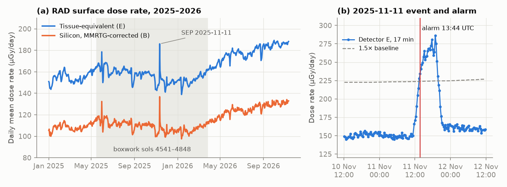
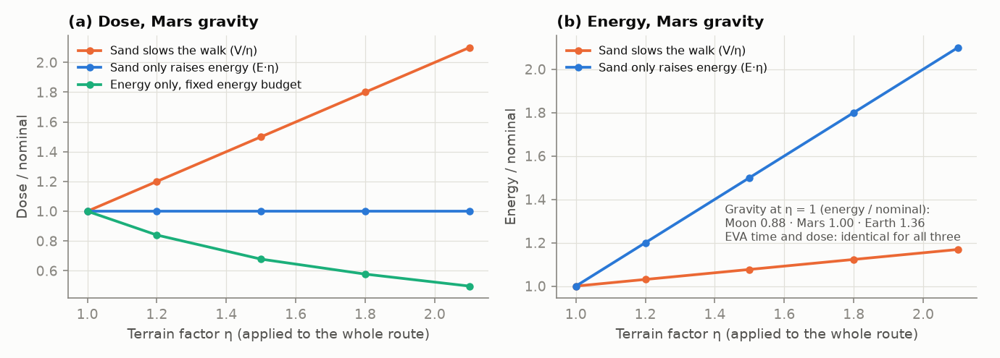
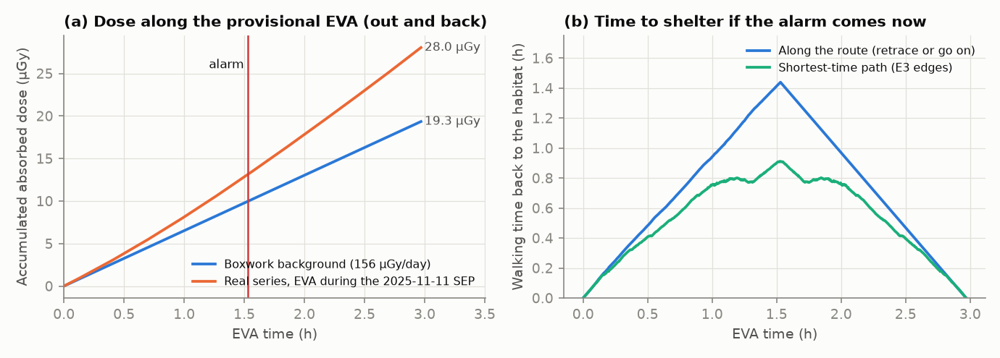
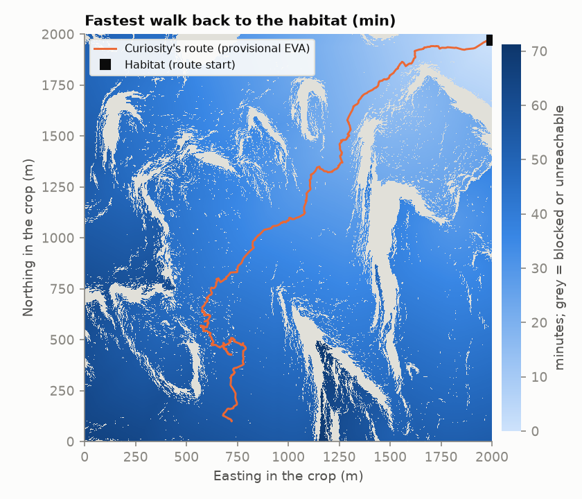

# E12 · Radiation dose along the EVA timeline and the solar-storm alert

Owner: Juan (`@JuanCorredor2023`) · Issue: #13 · PRs: this PR · Status: done on a provisional route (Curiosity's traverse out and back); to rerun on the E4/E5 route when it lands · Last update: 2026-11-14

## Question
How much radiation does an astronaut receive during an EVA in the boxwork, and when does radiation (not energy) change the plan? Following the original plan, the answer is a dose budget along the EVA timeline plus an alert for solar particle events (SEP) that triggers a return to the habitat. It is not a per-pixel radiation map: the background barely depends on position.

## Data
- **RAD dose rates** [RAD-L2]: the CDAWeb `MSL_RAD_OBS-L2` dosimetry listing, 11 CSV files, 57,843 observations from 2025-01-01 to 2026-11-11, one every ~17 min (`src/radiation/rad_data.py` → `data/e12/rad_summary.json`). We use the good-quality columns. The 1,717 flagged observations carry the CDF fill value −1e31 and are dropped.
- **Columns:** absorbed dose rate in tissue-equivalent plastic (detector E, *not* corrected for the rover's MMRTG power source) and in silicon (detector B, raw and MMRTG-corrected). Nominal: detector E. It is the closest to human tissue, and it is conservative because it still contains the MMRTG background. In detector B the MMRTG makes up 33.9 % of the raw rate (`mmrtg_share_of_b`).
- **Units:** µGy per Earth day, as the CSV header says. The PDS label of the same field says µGy/hour. Only per day is consistent with the published surface rate of 0.21 mGy/day [Hassler2014]: our median is 0.76 of it, while per hour would give 18.3 times it (`unit_check`).
- **Sols:** the CSVs have no sol column, so each observation gets a sol from the `START_SOL`/`START_TIME` anchors in the file headers (good to ±0.5 sol). The boxwork sols 4541–4848 map to 2025-05-15 → 2026-03-27, which matches `data/README.md`.
- **Terrain and route:** JB's base grid (`dem_1m.tif`, `slope_deg.tif`) [Parker2016] and Curiosity's traverse from E2 (`data/e2/trajectory.geojson`, 3,900 m) [PLACES]. The E4/E5 route does not exist yet, so the traverse walked **out and back** stands in as the provisional EVA (7,800 m). The habitat is its start.
- **Walking model:** E3 (`src/fisica`, Sebas) is used unchanged: Apollo speed V(α) = 0.75 − 0.01·α and Santee 2001 power.

## Method
1. **Background rate** (`rad_data.py`): median of the good-quality detector-E observations over the boxwork sols. For figures and checks: daily means, monthly medians, the within-day coefficient of variation, and isolated spikes. An isolated spike is a single observation above 1.5× the trailing 3-day median while both neighbours stay below 1.2×.
2. **Dose along the route** (`route_dose.py`):
   - Resample the route every 1 m and read the DEM bilinearly.
   - For each step, take the slope α = atan(dz/d_h) and apply the E3 edge formulas, vectorised: dt = d_h / (V cos α) and E = P(α, V, g)·dt.
   - Each station adds its `service_time_min` at the nearest route point. Stations more than 25 m from the route are ignored and listed.
   - Dose = ∫ rate dt. The rate is either the constant background or the real RAD series from a start time; the series is piecewise linear and is integrated exactly. Equivalent dose is reported as an *estimate* with the GCR quality factor Q = 3.05 [Hassler2014].
   - Every point also gets the walking time back to the habitat. Without stations, this is the shorter of retracing the route and going on to its end (the route is a loop).
3. **Sensitivity to G and η** (`sensitivity.py`), with G ∈ {1.62, 3.71, 9.81} m/s² and η ∈ {1.0, 1.2, 1.5, 1.8, 2.1}. The η values are Pandolf/Soule terrain factors, where 2.1 is loose sand [Soule1972, Pandolf1977]. Santee 2001 has no terrain factor, so η is tested two ways that bracket the effect:
   - "energy" mode: E × η, time unchanged;
   - "speed" mode: V / η, so the time grows by η and the power is taken at the slower speed.
   - A third reading keeps the energy budget fixed at the nominal route energy: the EVA stops when the budget is spent.

   Until `sand.tif` (E8) arrives, η applies to the whole route, which is the worst case for the sand share.
4. **SEP alert** (`sep_alert.py`):
   - **Rule:** the baseline is the trailing 3-day median of past observations only. The alarm fires when the detector-E rate stays above k_on = 1.5× the baseline for n_on = 2 consecutive observations. The event ends after 2 observations below 1.2×. Isolated spikes are kept in the input, because the rule itself must reject them. A sweep over k_on ∈ {1.2, 1.3, 1.5, 2.0} and n_on ∈ {1, 2, 3} counts the alarms.
   - **Return-time map:** a reverse Dijkstra (scipy) from the habitat over the E3 directed edges, weighted by **time**, because dose is rate × time. It uses the default E3 limits (20° per edge, cells steeper than 30° blocked).
   - **Replay:** the provisional EVA is placed so that the real alarm of the strongest event arrives at the farthest point, at 25 % of the EVA time and at 75 %. "Ignore" finishes the plan; "return now" walks back by the faster of the route and the shortest-time path. Only the dose received outside is counted. Storms ×10 and ×50 scale the excess over the baseline and are hypothetical.

## Results
Every number below comes from `src/radiation/paper_figures.py` → `data/e12/e12_summary.json` (which collects `rad_summary.json`, `route_dose_summary.json`, `sensitivity.json` and `sep_alert.json`).

**Background.**
- The boxwork background is **156.4 µGy/day = 6.52 µGy/h** (detector E). The daily means over the 317 boxwork days run from p05 145.8 to p95 166.1 µGy/day. The MMRTG-corrected silicon rate is 109.0 µGy/day.
- Within one day the rate varies by 1.8 % (median coefficient of variation).
- The monthly median rises from 149–163 µGy/day in 2025 to 186 µGy/day in October–November 2026 (Figure E12-1a), consistent with the declining phase of the solar cycle letting in more cosmic rays.
- The equivalent-dose estimate is ≈ 0.48 mSv/day, below the 0.64 mSv/day measured in 2012–2013 [Hassler2014].
- Three isolated spikes exist in 22 months, single observations up to 315 µGy/day.


*Figure E12-1. (a) Daily mean RAD dose rate in tissue-equivalent plastic (E) and in silicon corrected for the MMRTG (B), 2025–2026; the grey band marks the boxwork sols. (b) The 2025-11-11 event at full cadence, the alarm level (1.5× the trailing baseline) and the alarm.*

**Dose of the provisional EVA.**
- 7,800 m out and back takes 2.97 h at 0.73 m/s mean, costs 1,012 Wh and gives **19.4 µGy** absorbed (≈ 59 µSv estimated), i.e. 2.5 µGy per km.
- If the same EVA had run during the 2025-11-11 storm, it would have received 28.0 µGy (Figure E12-2a).

**G and η (Figure E12-3).**
- *Gravity:* on a fixed route, G changes the energy (Moon 0.88×, Earth 1.36× the Mars value) but **not the time, so not the dose**. The E3 speed does not depend on G. This is a property of the model, not a bug.
- *Terrain, "energy" mode:* the energy doubles at η = 2.1, the dose does not move.
- *Terrain, "speed" mode:* time and dose grow by η (2.1× at η = 2.1), while the energy grows only 1.17×.
- *Fixed energy budget:* a costlier walk ends the EVA earlier. Earth gravity gives 0.74× the dose, energy-mode η = 2.1 gives 0.50×.

On Mars the dose ranges from 0.50× to 2.1× of the nominal across all readings.


*Figure E12-3. Sensitivity of dose (a) and energy (b) to the terrain factor η on Mars, under the two readings of η and under a fixed energy budget; the gravity numbers are in the inset text.*

**SEP alert.**
- **The rule finds exactly one event in 22 months:** onset 2025-11-11 13:27 UTC and alarm 13:44 (17 min later). It lasted 7.1 h, peaked at 286 µGy/day (1.92× its baseline of 149) and gave an excess of 31.9 µGy.
- In the sweep, with n_on = 1 every threshold up to 1.5 also fires on the isolated spikes. At k_on = 1.5 and 2 consecutive observations there is no false alarm. k_on = 1.3 also catches a smaller real enhancement on 2025-05-31 (peak 1.45×, 8.3 µGy excess). k_on = 2.0 misses everything.
- **Return-time map** (Figure E12-4): 84.4 % of the grid can reach the habitat (the rest is blocked by the slope limits). The median walk back is 0.68 h and the longest 1.19 h. Along the provisional route the shortest-time path is 0.81× the route's own way back (median).
- **Replay:**

| Alarm when the astronaut is at | Time back: route / shortest | Dose saved by returning: real storm | ×10 | ×50 |
|---|---|---|---|---|
| 25 % of the EVA (1.9 km out) | 0.70 h / 0.56 h | 17.7 µGy | 84 µGy | 379 µGy |
| farthest point (3.9 km) | 1.44 h / 0.91 h | 5.7 µGy | 27 µGy | 123 µGy |
| 75 % of the EVA (on the way back) | 0.74 h / 0.60 h | 1.5 µGy | 7 µGy | 30 µGy |


*Figure E12-2. (a) Accumulated absorbed dose along the provisional EVA, with the boxwork background and with the real RAD series during the 2025-11-11 storm (alarm at the farthest point). (b) Walking time back to the habitat at each moment, along the route and by the shortest-time path.*


*Figure E12-4. Fastest walk back to the habitat from every cell (minutes), from a reverse Dijkstra on the E3 time edges; grey cells are blocked by the slope limits or unreachable.*

## Checks
- **Same model as E3:** each step's time and energy match `fisica.metabolic.segment_cost` (unit test). On Curiosity's traverse, the time per metre from our 1 m resampling, 1.4118 s/m, matches the sum of E3 edge times over E2's 8-connected cell sequence, 1.4120 s/m (−0.01 %; `check_against_e3_edges`). The total times differ (1.53 h against 1.89 h) only because the cell staircase is 4,812 m long against 3,900 m for the line.
- **Units:** per-day reading confirmed against [Hassler2014] (see Data).
- **Sol anchors:** the boxwork sols fall on the dates of `data/README.md`.
- **17 unit tests** in `tests/radiation/` (`python -m pytest tests/radiation -q`):
  - fill values and header check;
  - sol from the anchors;
  - spike and storm detection, consecutive-observation rule and excess dose;
  - time on flat ground = L / 0.75;
  - station dwell, and stations far from the route ignored;
  - G changes energy but not time;
  - both η modes;
  - retrace and loop return times;
  - exact integration of a linear rate;
  - budget cut-off.

## Limitations
- **Provisional route.** Curiosity's traverse is a rover path, not an astronaut plan: 3.6 % of its 1 m steps are steeper than the 20° E3/E4 edge limit. All route numbers must be recomputed on the E4/E5 route, which is one command.
- **Detector E is not MMRTG-corrected**, so the background is an upper estimate. The silicon corrected rate is 30 % lower, but silicon is not tissue.
- **Equivalent dose is an estimate.** Q = 3.05 is the GCR mean of 2012–2013 [Hassler2014]. For SEP protons Q is lower, so the µSv numbers during storms are upper bounds. RAD sits on the rover deck: a suit adds little shielding, and a habitat adds some. The habitat dose is not modelled. "Dose saved" counts only the dose outside.
- **The real storm in our window is weak at the surface** (1.9×, 32 µGy in total). The ×10 and ×50 storms are hypothetical scalings, not measured events. Stronger events may exist outside the downloaded window (2025-01 → 2026-11). The full mission series is on CDAWeb (`radiacion_rad/FUENTES.md`), and it is small to download.
- **η is not part of E3.** Both readings are assumptions that bracket the effect. Until `sand.tif` exists, η covers the whole route.
- **The alarm uses RAD itself,** with a 17 min delay at the 2-observation rule. A real crew would also have forecasts from orbit. The threshold k_on = 1.5 was chosen on 22 months of data with one event and is not validated beyond that.
- **The return map assumes walking at the E3 speed** during a storm, with the same slope limits as the planner.

## What other pieces can use
- **Sebas (product, HUD):**
  - `data/e12/route_dose.geojson` has one Point every 5 m with `t_s`, `energy_wh`, `rate_ugy_h`, `dose_ugy`, `dose_usv_est`, `return_s` and `dwell_s`; the summary is in the FeatureCollection properties.
  - `data/e12/sep_return_time_s.tif` (float32, s, NaN = unreachable) gives the return time from any cell; the dose of the way back is that time × the storm rate.
  - Alert rule: rate > 1.5× the trailing 3-day median for 2 consecutive RAD observations.
- **Aaron (E4) and Diana (E5):** when your route exists, run `python src/radiation/route_dose.py --route <your.geojson>`. It accepts the `/plan` FeatureCollection (LineString + station Points with `service_time_min`) or `--stations stations_manual.gpkg`. Radiation is not the binding constraint of a normal EVA (≈ 20 µGy for 3 h); energy is. It only matters through the SEP return. If E4 exposes a time-weighted R(v), the alert can use it instead of our map.
- **JB (E8):** `--sand-raster sand.tif` applies η only on sand (probability ≥ 0.5).
- **Sebas (E3):** dose is insensitive to G because the Apollo speed has no G. If E3 adds a gravity-dependent speed (e.g. Froude scaling), rerun `sensitivity.py`.

## Reproduce
From the repo root. Needs `data/base/` (release `base-grid-v2`), `data/e2/trajectory.geojson` and `cell_sequence.csv` (release `e2-trajectory-v1`) and the RAD folder `03_curiosity/radiacion_rad/` (`data/README.md`; found through `MARTIAN_DATA`, `data/` or `../data`).
```bash
python src/radiation/rad_data.py
python src/radiation/route_dose.py --out-and-back
python src/radiation/sensitivity.py
python src/radiation/sep_alert.py
python src/radiation/paper_figures.py
python -m pytest tests/radiation -q
```

## Outputs
- `data/e12/rad_dose_rate.csv`: one row per RAD observation with sol, rates and the quality and spike flags.
- `rad_summary.json`
- `route_dose.geojson` and `route_dose_summary.json`
- `sensitivity.csv` and `sensitivity.json`
- `sep_alert.json` and `sep_thresholds.csv`
- `sep_return_time_s.tif`
- `e12_summary.json`
- Figures `paper/figures/e12_fig1…4`.
