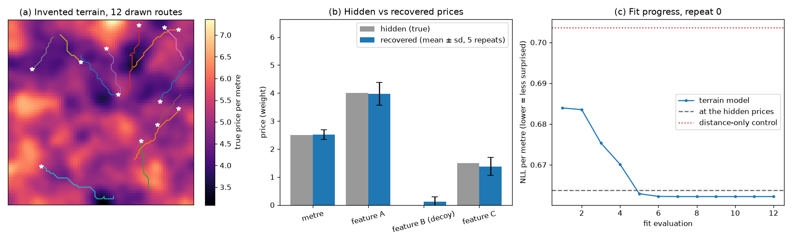
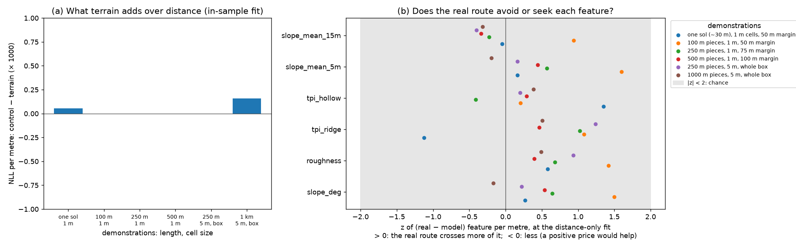
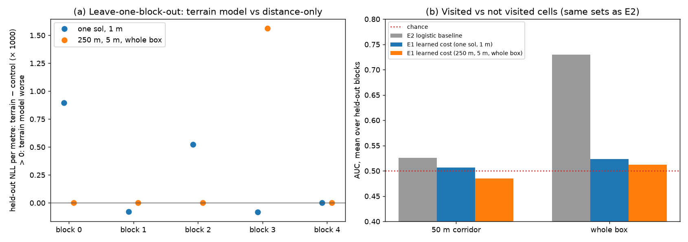
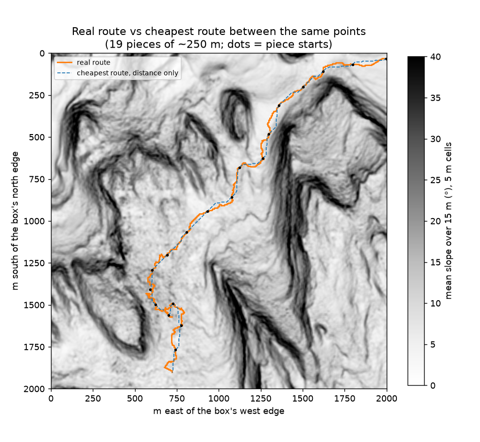

# E1 · Terrain cost learned from Curiosity's route (MaxEnt IRL)

Owner: Juan (`@JuanCorredor2023`) · Issue: #5 (open: refit with sand and boulders, hours 24–34) · PRs: this one · Status: done for the MVP, negative result · Last update: 2026-11-14

## Question
Given where Curiosity started and where it stopped, which terrain prices make the route its drivers actually chose the most likely one? If the learned prices explain the route better than distance alone, they become the terrain part of the astronaut's cost (combined with E3); if not, the planner uses E3 alone.

## Data
- **Demonstrations:** E2's cell sequence (`data/e2/cell_sequence.csv`, release `e2-trajectory-v1`): Curiosity's route inside the bbox from PLACES [PLACES], cell by cell on the 1 m base grid, 8-connected, sols 4369–4868.
- **Terrain:** JB's base grid (release `base-grid-v2`): `slope_deg.tif`, `roughness.tif`, `tpi.tif` from `dem_1m.tif` [Parker2016], plus the mean slope in 5 × 5 and 15 × 15 m windows, the same five features as E2's baseline. No cell of the box is nodata.

## Method

### Model [Ziebart2008]
- **Route probability.** Between a start and a goal, a route ζ has probability P(ζ) = exp(−C(ζ)) / Z, where C is the sum of its move costs. Cheap routes are exponentially more likely than expensive ones, but every route is possible, so detours for reasons the model does not see (science stops, operations) do not break it.
- **Move cost.** Moves go to the 8 neighbours in the order of E3's `NEIGHBOURS` (`src/fisica/edge_cost.py`). The cost of the move u → v is d · (c(u) + c(v)) / 2, with d = 1 or √2 cell lengths and c(cell) = w · φ(cell).
- **Features φ, all ≥ 0:** `metre` (a constant 1, so its weight is the price of one cell length), `slope_deg`, `roughness`, `slope_mean_5m`, `slope_mean_15m`, and TPI split by sign into `tpi_ridge` = max(TPI, 0) and `tpi_hollow` = max(−TPI, 0). Each terrain feature is divided by its 99th percentile over the box (values in `data/e1/e1_summary.json` → `feature_scale_p99`). Weights are kept ≥ 0 so that no cell pays the rover to cross it; splitting TPI lets ridges and hollows each have their own non-negative price.
- **Backward pass (soft value iteration).** V(goal) = 0 and V(u) = −log Σ_k exp(−(cost(u → v_k) + V(v_k))). V is a soft minimum of the cost to reach the goal: Aaron's R(v) is the hard version (min instead of log-sum-exp). The model's policy is π_k(u) = exp(−(cost(u → v_k) + V(v_k)) + V(u)).
- **Forward pass.** Mass 1 starts on the start cell and is pushed with π until the goal absorbs it; this gives the expected metres the model drives over each cell, and from them the expected feature counts E[f].
- **Fit.** The negative log-likelihood of a demonstration is NLL = C(ζ) − V(start) and its gradient is f(ζ) − E[f]: if the model's routes cross more of a feature than the real one, that feature's price goes up. The NLL is convex in w; we minimise the mean NLL per metre with L-BFGS-B [SciPy] under the bounds below. The two passes run on the GPU with PyTorch [PyTorch] in float64.
- **Price floor.** With 8 neighbours the number of walks grows exponentially with their length; if moves are too cheap, Z diverges. For a uniform price c per cell length, Σ_k exp(−c·d_k) = 4e^−c + 4e^−√2c ≥ 1 when c ≤ 1.78, so we keep w_metre ≥ 2.0. No fit ended on this floor (`w0_at_floor` is false in every `irl_fit_*.json`).
- **Control model.** Distance only: every terrain price held at 0, only `metre` fitted. It knows each demonstration's start and goal too, so it already predicts a lot ("go roughly straight"). Terrain explains the route only if the terrain model beats this control. This mirrors Pflueger et al. [Pflueger2019], who learn rover path costs with soft value iteration, but here the costs are linear in interpretable terrain features.

### Demonstrations and scales
- **One per sol** (`irl_data.drives`): each sol's drive starts where the rover was parked (last cell of the previous sol) and ends where it parked; drives shorter than 10 m are skipped. Window: the drive's bbox plus 50 m.
- **Route pieces** of about 100, 250 and 500 m (`irl_data.pieces`), with 50, 75 and 100 m margins on the 1 m grid.
- **Whole box at 5 m:** features averaged over 5 × 5 m cells (400 × 400 grid), pieces of about 250 and 1000 m, and the whole box as the window, so the model can route through any valley or over any wall.
- A demonstration that touches its goal cell earlier is cut there (the goal absorbs); NLL per metre uses the length after the cut.

### Validation
- **Leave-one-block-out** with E2's 5 consecutive blocks of the route (`src/ml/cell_features.py`); a demonstration belongs to the block of its middle step. Both models are fitted on four blocks and scored on the fifth.
- **Metrics:** held-out NLL per metre; the cheapest route between the same start and goal under the learned prices (`skimage.graph.route_through_array`, geometric move costs, which are the same d · (c(u) + c(v)) / 2 [skimage]) against the real route: Hausdorff distance and share of the real route within 5 and 10 m; and the AUC of the learned cell cost −w·φ on E2's comparison sets (50 m corridor and whole box), next to E2's logistic baseline.

### Synthetic check before the real data (`src/ml/irl_toy_check.py`)
- Invented 80 × 80 terrain with three smooth features in 0–1 (one a decoy with price 0), hidden prices w = (2.5, 4.0, 0, 1.5), 60 routes drawn from that model in windows with a 10-cell margin, 5 repeats with new terrain and routes.
- The gradient is checked three ways on 5 routes: the two-pass formula, PyTorch autograd through the unrolled backward pass, and central finite differences.

## Results

### Synthetic check: the method recovers hidden prices
Source: `src/ml/irl_toy_check.py` → `data/e1/toy_check.json`.

| Price | Hidden | Recovered, mean ± sd of 5 repeats |
|---|---|---|
| metre | 2.5 | 2.514 ± 0.169 |
| feature A | 4.0 | 3.972 ± 0.407 |
| feature B (decoy) | 0 | 0.122 ± 0.171 (exactly 0 in 3 of 5) |
| feature C | 1.5 | 1.374 ± 0.320 |

- **Gradient:** largest relative difference from the two-pass formula 5.3 × 10⁻¹⁴ against PyTorch autograd and 8.9 × 10⁻¹⁰ against finite differences.
- **Fit quality:** in every repeat the fit explains the drawn routes slightly better than the hidden prices themselves (repeat 0: NLL per metre 0.6622 vs 0.6638), as a maximum-likelihood fit on a finite sample should. It is clearly better than the distance-only control (0.5924–0.6622 against 0.6347–0.7036 across repeats).
- **Speed:** each fit takes 2.0–2.3 s on the GPU.



*Figure E1-1. (a) Invented terrain coloured by its hidden price per metre, with 12 of the 60 routes drawn from the model (stars = goals). (b) Hidden and recovered prices (mean ± sd over 5 repeats with new terrain and routes). (c) NLL per metre during the fit of repeat 0, against the value at the hidden prices and the distance-only control.*

### Curiosity's route at every scale: no terrain price
Sources: `src/ml/fit_irl.py` → `data/e1/irl_fit_<tag>.json`, gathered by `src/ml/irl_paper_figures.py` in `data/e1/e1_summary.json`.

- **Demonstrations:** 129 drives (sols with at least 10 m), 4,688.6 m of grid route after the goal cut. The 8-connected grid route is longer than E2's 3,900.3 m line through the poses because grid steps zigzag.
- **Feature scales (99th percentile over the box):** slope 49.0°, roughness 0.815, TPI ridge 1.197 and hollow 1.066, mean slope 44.8° (5 m) and 39.5° (15 m).

| Demonstrations | n | NLL per metre: terrain | NLL per metre: control | Largest terrain price (relative to the metre price) | Metre price | Largest \|z\| |
|---|---|---|---|---|---|---|
| One per sol, 1 m, 50 m margin | 129 | 1.17997 | 1.18002 | `tpi_ridge` 0.049 (0.019) | 2.589 | 1.35 |
| 100 m pieces, 1 m, 50 m margin | 48 | 1.34766 | 1.34766 | 0 | 2.316 | 1.60 |
| 250 m pieces, 1 m, 75 m margin | 19 | 1.42311 | 1.42311 | 0 | 2.213 | 1.03 |
| 500 m pieces, 1 m, 100 m margin | 10 | 1.48642 | 1.48642 | 0 | 2.121 | 0.54 |
| 250 m pieces, 5 m cells, whole box | 19 | 0.28263 | 0.28263 | 0 | 2.178 | 1.24 |
| 1000 m pieces, 5 m cells, whole box | 5 | 0.29981 | 0.29997 | `slope_mean_15m` 0.083 (0.040) | 2.070 | 0.51 |

NLL per metre is lower on 5 m cells because one move covers 5 m; compare the two models within a row, not rows of different cell size.

- **No feature is avoided or sought.** "Largest |z|" is the preference check at the control's fit: for each feature, the real route's amount per metre minus the model routes', over its standard error across demonstrations. No feature at any scale reaches |z| = 2 (fig. E1-2b): the real route crosses as much slope, roughness, ridge and hollow per metre as the routes of a model that only minimises distance.
- **The only non-zero prices are small.**
  - Per sol, `tpi_ridge` costs 0.049: 1.9 % of the metre price at the box's 99th percentile ridge.
  - On 1000 m pieces over the whole box, `slope_mean_15m` costs 0.083: 4.0 % of the metre price at its 99th percentile.
  - The second points the same way as E2's whole-box result (steep areas avoided at large scale), but it rests on 5 demonstrations and has no held-out test.
- **The metre price falls with demonstration length,** from 2.59 (one sol) to 2.07 (1000 m pieces). Longer stretches of the route wander more relative to their cheapest path, so the fitted route distribution gets softer. It stays above the 2.0 floor.



*Figure E1-2. (a) In-sample gain in NLL per metre of the terrain model over the distance-only control at each demonstration scale (× 1000; all below 0.0002). (b) Preference check at the control's fit: z of the real-minus-model amount of each feature per metre. The grey band |z| < 2 is chance.*

### Held-out validation: the terrain model does not beat distance
Source: `src/ml/validate_irl.py` → `data/e1/validation_per_sol_cell1m_margin50m.json` and `validation_piece250m_cell5m_box.json`.

| Held-out metric | One sol, 1 m: terrain | One sol, 1 m: control | 250 m, 5 m, whole box: terrain | 250 m, 5 m, whole box: control |
|---|---|---|---|---|
| NLL per metre | 1.18373 | 1.18349 | 0.28492 | 0.28462 |
| Hausdorff, median | 3.6 m | 4.0 m | 29.2 m | 30.0 m |
| Real route within 5 m of the predicted one | 92.0 % | 90.4 % | 30.0 % | 31.2 % |
| Real route within 10 m | 99.0 % | 98.8 % | 45.2 % | 47.1 % |
| AUC of the learned cost, 50 m corridor (E2 logistic: 0.526) | 0.506 | 0.5 by construction | 0.485 | 0.5 by construction |
| AUC of the learned cost, whole box (E2 logistic: 0.730) | 0.524 | 0.5 by construction | 0.513 | 0.5 by construction |

- **Held-out NLL is slightly worse with terrain at both scales.**
  - Per sol, the difference per block is +0.90, −0.08, +0.52, −0.08 and 0.00 × 10⁻³ (test sets of 24, 24, 22, 33 and 26 drives).
  - Over the whole box it is 0 in every block except block 3 (+1.56 × 10⁻³), the only block where the fit put a price on `slope_mean_15m` (0.135).
  - Per sol, the training fits gave `tpi_ridge` 0.040–0.091 in 4 of 5 blocks; that price does not carry over to the held-out block.
- **Route metrics:** the differences (a few per cent) are within the tie noise of single cheapest routes (see Limitations).
- **AUC:** the learned cost does not beat E2's logistic baseline in the corridor (0.506 vs 0.526) and is far below it over the whole box (0.524 vs 0.730). Its terrain weights are almost all 0, so it scores cells nearly uniformly. The logistic model learns where in the box the route lies, which a goal-conditioned model does not try to learn.
- **Hand-off:** `src/ml/export_e1_weights.py` therefore writes every weight as 0 in `data/e1/e1_weights.json`.



*Figure E1-3. (a) Held-out NLL per metre of the terrain model minus the distance-only control, per E2 block, for one-sol demonstrations at 1 m and 250 m pieces over the whole box at 5 m (above 0 = terrain worse). (b) AUC of the learned cell cost on E2's comparison sets, next to E2's logistic baseline.*

### Why: the waypoints already lie in the valley
On the whole-box grid, the cheapest route between the start and end of each 250 m piece, with distance only, follows the same valley floor as the real route and stays off the steep walls (fig. E1-4). The real route departs from that cheapest route by a median Hausdorff distance of 30 m, but terrain from the DEM does not explain those departures.



*Figure E1-4. Real route (orange) and the cheapest distance-only route between the same points (dashed blue) for the 19 pieces of about 250 m, over the mean slope at 15 m on 5 m cells.*

## Checks
- **Gradient:** three independent computations agree (synthetic check above), and 6 unit tests in `tests/ml/test_maxent_irl.py` cover it, including padded batches (`python -m pytest tests/ml -q`).
- **Policy:** sums to 1 at every cell but the goal (test).
- **Route cost:** w · f(ζ) equals the step-by-step sum of move costs (test).
- **Move order:** identical to E3's `NEIGHBOURS` (test), so E1 prices can multiply E3 edges directly.
- **Feature matching:** at every optimum, for every feature whose weight is not at its bound, the model's expected counts equal the real ones to the stored precision of 0.01 (`feature_counts_real` vs `feature_counts_model` in `irl_fit_*.json`). Every fit reports L-BFGS-B success.
- **Coarse grid:** 4 tests in `tests/ml/test_irl_data.py` (block means, 8-connected coarse routes, lengths in metres).

## Limitations
- **The goal is given.** E1 explains how the rover went between two points, not where it went. The drivers' terrain choice is mostly in the waypoints themselves (on the valley floor, away from the walls; fig. E1-4), which this model takes as data. E2's whole-box AUC of 0.73 measures that choice of place; a goal-conditioned model cannot learn it.
- **Features are from a 1 m DEM whose effective resolution is coarser** (base grid note): sand, boulders and the boxwork ridges, which a rover actually avoids, are not in them. A null weight means "not explained by these features", not "terrain does not matter".
- **Single cheapest routes are not unique.** With nearly uniform prices, many 8-connected routes have the same cost, and which one the solver returns changes with tiny changes in the numbers. In held-out blocks where both models had only the metre price, the route metrics still differed by a few per cent, so differences of that size are noise; the NLL is the fair comparison.
- **Few long demonstrations.** 19 pieces of 250 m and 5 of 1000 m; the 1000 m whole-box fit has no held-out test.
- **Linear prices, ≥ 0.** A feature the rover sought out would show up as a positive preference z, not as a weight; the preference check shows none.
- **5 m cells average away 1 m detail;** they are only used for the whole-box scale.

## What other pieces can use
- **E3 and product (Sebas):** E1 learned no terrain price from the DEM features at any scale, so for the MVP the human cost is E3 alone (guide's plan B for hour 20: terrain factors fixed by sensitivity). The hand-off file `data/e1/e1_weights.json` (`src/ml/export_e1_weights.py`, format agreed in #2 and read by `fisica.human_cost`, PR #41) carries every weight at 0, the fitted values in `fitted_weight` for the record and the held-out NLL that decided it; with it the terrain factor is 1.0 on every cell. A price is only handed over if the terrain model beats the control on held-out blocks.
- **E8 (JB) and E9 (Aaron):** the missing terrain terms are most likely sand and boulders. E1 takes a new layer as one more feature (`irl_data.feature_stack`); when `sand.tif` and `rocks.tif` arrive (hours 30–34), refit with `fit_irl.py` and `validate_irl.py`.
- **E4 and E5 (Aaron, Diana):** at 250 m the cheapest route between the rover's consecutive positions already follows the valley floor like the real route (fig. E1-4). Steep walls are avoided by where the waypoints are, which E4/E5 decide through E3's cell block and slope cost.

## Reproduce
From the repo root, with the `martian` environment, `data/base/` from release `base-grid-v2` and `data/e2/` from E2:
```bash
python -m pytest tests/ml -q
python src/ml/irl_toy_check.py
python src/ml/fit_irl.py --chunk 32
python src/ml/validate_irl.py --chunk 32
python src/ml/fit_irl.py --piece-m 100 --chunk 16
python src/ml/fit_irl.py --piece-m 250 --margin 75 --chunk 8
python src/ml/fit_irl.py --piece-m 500 --margin 100 --chunk 4
python src/ml/fit_irl.py --piece-m 250 --cell 5 --whole-box --chunk 8
python src/ml/fit_irl.py --piece-m 1000 --cell 5 --whole-box --chunk 5
python src/ml/validate_irl.py --piece-m 250 --cell 5 --whole-box --chunk 8
python src/ml/irl_paper_figures.py
python src/ml/export_e1_weights.py
```
About 90 minutes on an NVIDIA T1000 (4 GB); most of it is the whole-box runs.

## Outputs
In `data/e1/` (not in git): `toy_check.json`, `irl_fit_<tag>.json` for the six scales, `validation_per_sol_cell1m_margin50m.json`, `validation_piece250m_cell5m_box.json`, `e1_summary.json`, and the hand-off to E3 `e1_weights.json` (also posted in #2). In `paper/figures/`: `e1_fig1_toy_check.png` to `e1_fig4_whole_box_routes.png`. Column and file reference: `src/ml/README.md`.
