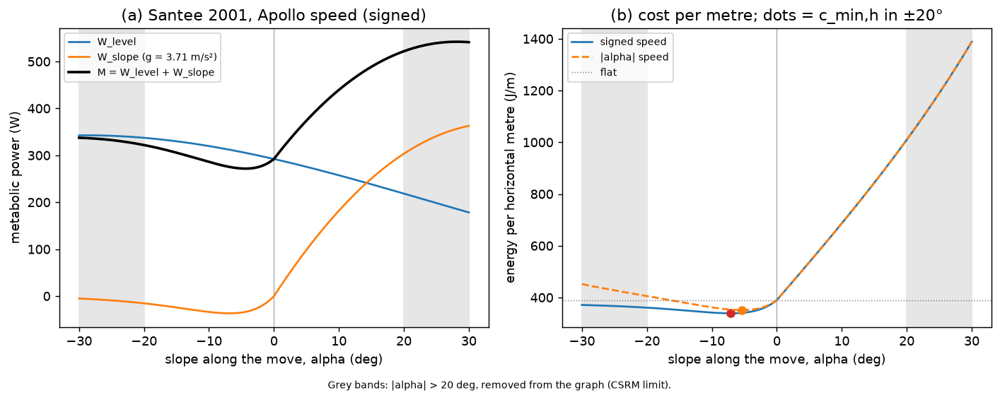

# E3 · Metabolic and O2 cost of walking under Mars gravity

Owner: Sebas (`@Seredial0326`) · Issue: #6 · PRs: #21, #26 · Status: done for the MVP (E1 weights still to be combined, hours 20–24) · Last update: 2026-11-14 (boxwork resolution limitation added)

## Question
How much energy, time and metabolic O2 does a suited astronaut spend on each move across the 1 m base grid, under Mars gravity? The answer is the cost the planner uses: E4 (return energy R(v) and walkback) and E5 (orienteering) plan on it.

## Data
- **Model and reference values:** the team's zero-to-hero guide, technical revision 3 [Guide-REV3], which reproduces Santee et al. (2001) as given in the MIT SEXTANT paper [Johnson2010], Pandolf with the Santee (2003) correction as given in the NASA CSRM [Kim2025], and the Apollo speed regression of the CSRM.
- **Terrain:** JB's base grid (release `base-grid-v2`): `dem_1m.tif` [Parker2016] (2000 × 2000 cells of 1 m) and `slope_deg.tif` (steepest slope per cell, degrees).

## Method

### Power: Santee (2001) as the nominal model (`src/fisica/metabolic.py`)
M = W_level + W_slope, with m the total equipped mass (kg), v the speed parallel to the surface (m/s), alpha the slope along the move and g the local gravity:
- W_level = (3.28 m + 71.1)(0.661 v cos alpha + 0.115). **Does not depend on g.**
- W_slope = 3.5 m g v sin alpha uphill; 2.4 m g v sin alpha · 0.3^(|alpha|/7.65) downhill; 0 on flat ground.

Why not Pandolf scaled by g_Mars/g_Earth (the CSRM's whole-power scaling)? It fails a lunar consistency check: on flat ground it drops to about 52 W on the Moon, against about 292 W from Santee's level term and the ~290 W inferred for Apollo 14 walking [Carr2003]. So gravity enters only the slope term. Pandolf + CF is kept only as a sensitivity branch and is never mixed with Santee 2001 (that would count the downhill correction twice).

### Speed, time and energy
- Speed: Apollo regression V = 0.75 − 0.01·alpha (m/s, alpha in degrees, **signed**: downhill is faster). The CSRM does not say whether alpha is signed; we declare signed and report both in the checks.
- A move of horizontal length d_h runs d_h / cos(alpha) over the surface, so dt = d_h / (V cos alpha) and E = M · dt (J). Metabolic O2 = E[kJ] / 20.1 kJ/L.
- Parameters: m = 124.2 kg (75 kg astronaut + 47.8 kg suit and load), g = 3.71 m/s².

### Directed edge costs on the grid (`src/fisica/edge_cost.py`)
- 8-neighbour graph; diagonal moves are √2 m. For each cell and neighbour k: alpha = atan(Δz / d_h) from the DEM, then dt and E as above. Arrays `time_s`, `energy_j`, `alpha_deg` of shape (8, 2000, 2000), float32, NaN = no edge. The graph is **directed**: going up an edge costs more than coming back down.
- **Why the DEM difference and not `slope_deg.tif`:** `slope_deg.tif` is the steepest slope of the cell, without sign or direction. It cannot tell uphill from downhill, and it overstates the slope of a move that crosses a hillside diagonally.
- **Edge limit:** an edge is removed if |alpha| > 20° (CSRM limit; beyond it the model is extrapolated).
- **Cell block (team decision):** a cell is blocked (no edge in or out) if `slope_deg.tif` > 30°. It stands in for the cross-slope risk that Santee does not model. It can be disabled or moved in the HUD and in `POST /plan` (`max_cell_slope_deg`, null = off).
- **Guard:** `edge_costs` refuses `max_slope_deg ≥ 75°` and warns above 25° (see Limitations).
- Display layer for the HUD: `costo_e3.tif`, the mean Wh to cross each cell over its valid outgoing edges. Planning uses the directed edges, never this layer.

### Tried and dropped
- **Smoothing the DEM before taking slopes** (3 × 3 and 5 × 5 m mean filters), as the guide suggests against orbital DEM noise. It barely changes the share of steep edges (table below): the steep edges are real scarps and butte walls, not noise. We kept the 1 m DEM unsmoothed.

## Results
Source for every number: `src/fisica/paper_figures.py` → `data/e3/e3_summary.json`.

### Model checks against the guide
| Quantity | Value | Guide [Guide-REV3] |
|---|---|---|
| Flat power, v = 0.75 m/s (Earth, Moon and Mars) | 292.23 W in all three | 292.23 W |
| Pandolf flat on Earth → whole-power scaling on the Moon | 315.87 W → 52.16 W | 315.87 → 52.16 W |
| Toy route 5 km (4.1 km flat + 0.9 km horizontal at +10°) | 2215.5 kJ = 615.4 Wh; 110.2 L O2 eq.; 1.91 h | 2215.5 kJ, 615.4 Wh, 110.2 L, 1.91 h |
| Minimum cost per horizontal metre in ±20°, signed speed | 338.75 J/m at −7.10° | 338.75 J/m at −7.10° |
| Same with speed from \|alpha\| | 351.00 J/m at −5.41° | 351.00 J/m at −5.41° |
| Flat cost per horizontal metre | 389.64 J/m | 389.64 J/m |



*Figure E3-1. (a) Santee 2001 power and its two terms against the slope along the move, Mars gravity, signed Apollo speed. (b) Energy per horizontal metre; the minimum lies on a gentle descent, not on flat ground. Grey bands are removed from the graph.*

### Slopes on the grid
| Quantity | Steepest slope per cell (`slope_deg.tif`) | Slope along each move (edges) |
|---|---|---|
| Mean | 16.2° | 10.9° |
| Share above 20° | 29.6 % of cells | 15.8 % of edges |
| Share above 30° | 12.4 % of cells | 5.8 % of edges |

| DEM smoothing before taking slopes | none (1 m) | 3 × 3 m | 5 × 5 m |
|---|---|---|---|
| Edges above 20° | 15.8 % | 14.2 % | 13.1 % |

### Cost on the grid
| Configuration | Walkable cells | Largest 4-connected walkable area | Edge energy (min–max) |
|---|---|---|---|
| Edge limit 20° only | 99.9 % | 99.9 % of the box | 338.8–1427.8 J |
| Edge limit 20° + cell block 30° (default) | 87.5 % | 85.0 % of the box | 338.8–1427.8 J |

The minimum edge energy on the real DEM (338.75 J for a 1 m move) equals the analytic c_min,h, which is an independent check of the vectorised code.

## Checks
- 20 unit tests in `tests/fisica/` (`python -m pytest tests/fisica -q`): every reference value above, gravity changing only W_slope, downhill W_slope < 0 with M > 0, up/down asymmetry, grid borders, nodata, both slope limits, cell block on/off, and positive costs right up to the 75° guard.
- Aaron reviewed the edges against the real DEM for E4: `NEIGHBOURS` orientation correct (N = row − 1), no edge leaving the grid, energies 339–1428 J, largest strongly connected component 84.4 % of the grid with the default configuration.
- Visual: in the HUD the cost layer is low on valley floors and high on scarps, and the 20° and 30° block masks fall on the scarps of the orthophoto.

## Limitations
- **Not validated on Mars.** Santee 2001 comes from Earth and lunar lineage; applying g = 3.71 m/s² in the slope term is our extrapolation. The ~290 W Apollo 14 value is an inference from the reports, a plausibility check, not a validation [Carr2003].
- **Speed convention.** Signed or |alpha| Apollo speed changes the downhill costs (c_min,h 338.75 against 351.00 J/m). We use signed; a sensitivity run with |alpha| is still to do.
- **Negative result: the Apollo regression breaks on steep climbs.** V = 0.75 − 0.01·alpha reaches 0 at +75°. Without a slope limit, the real DEM has 107 climbing edges at or above 75°; their time is negative and 91 of them gave negative energy, which breaks Dijkstra (non-negative weights). The regression was fitted on gentle slopes and must not be extrapolated; hence the guard.
- **Cross-slope is not modelled.** Santee only sees the slope along the move. The 30° cell block is a design choice, not a physiological threshold.
- **The DEM does not see the boxwork.** The base grid note shows that the 1 m DEM does not resolve the 1–3 m ridges that the 0.25 m orthophoto shows clearly, so inside the boxwork the metabolic cost misses the up-and-down of crossing ridges and is probably an underestimate. This matches E2: terrain features from the DEM do not explain the route inside the boxwork (AUC about 0.53). The fix has to come from the image (E8 `sand.tif`, ridge/hollow masks) and the E1 weights.
- **No terrain factor.** Santee 2001 has no surface factor (eta); sand and boulders will come from E8 and E9 and from the E1 weights.
- **O2 is a metabolic equivalence** (20.1 kJ/L, 1–7 % uncertainty), not a PLSS tank reading. Time spent at stations is not included yet.

## What other pieces can use
- **E4 and baselines (Aaron):** `data/base/edges_e3.npz` or `edge_costs()` directly; J and s inside the engine. Dijkstra on the reversed graph must keep the cost of the original arc. Use `time_s` for the 30 min contingency line (R_T = 1800 s) and `energy_j` for R_E.
- **E5 (Diana):** the station cost matrix must come from these directed costs (one Dijkstra per station), plus R_E and R_T for the final return check.
- **E1 (Juan):** for the human cost, the slope term of the learned cost is replaced by this metabolic cost (hours 20–24); E2 showed that slope explains the valley choice but not the path inside the valley, so sand and rocks are the missing terms.
- **A\* (Aaron):** admissible heuristic h = horizontal Euclidean distance × 338.75 J/m (signed speed, slopes within ±20°); with |alpha| speed use 351.00 J/m.

## Reproduce
From the repo root, with `data/base/` from release `base-grid-v2`:
```
python -m pytest tests/fisica -q
python src/fisica/build_cost_layers.py data/base/dem_1m.tif data/base --slope-raster data/base/slope_deg.tif
python src/fisica/paper_figures.py
```

## Outputs
- `data/base/edges_e3.npz` (185 MB): directed `time_s`, `energy_j`, `alpha_deg`; not in git, regenerated in about 3 s.
- `data/base/costo_e3.tif`: Wh per cell, display only.
- `data/e3/e3_summary.json`: every number in this note.
- `paper/figures/e3_fig1_power_and_cost_vs_slope.png`.
