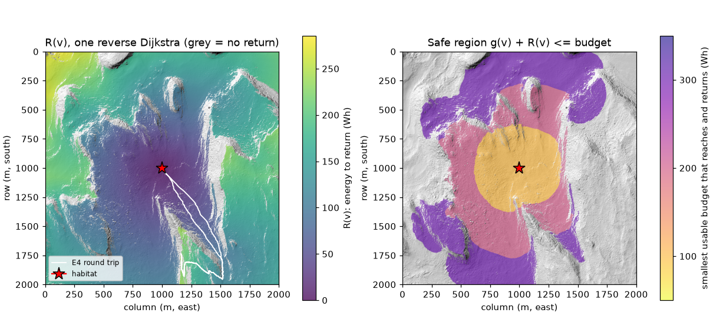
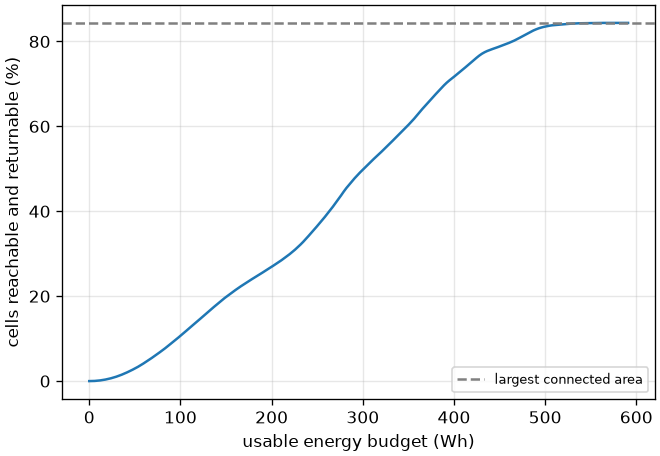

# E4 · Graph, return-energy layer R(v) and walkback routes

Owner: Aaron (`@aahg1105`) · Issue: #7 · PRs: (this PR) · Status: in progress (MVP block done; baselines #8 next) · Last update: 2026-11-14

## Question
From any cell of the study box, what is the minimum metabolic energy needed to walk back to the habitat, R(v)? And what is the best round trip habitat → goal → habitat such that, at every point, what has been used plus what is still needed to get home fits the budget, now with energy, EVA duration and oxygen as limits at the same time?

## Data
- Base grid v2 (JB, release `base-grid-v2`): `dem_1m.tif`, `slope_deg.tif`, `grid.json`, `crs.wkt`. 2000 × 2000 cells of 1 m, 0 NaN cells. See [base grid note](base_grid.md) and [Parker2016].
- E3 directed edge costs (Sebas, `src/fisica/edge_cost.py`, PR #21): energy (J) and time (s) for the 8 moves of every cell, Apollo speed and Santee (2001) metabolic power. Defaults kept: an edge is removed if |slope along the move| > 20°, a cell is blocked if `slope_deg` > 30°. Stored as `data/base/edges_e3.npz`, or computed in memory if missing.
- Suit figures used to choose budgets (declared assumptions, not measured): see Method, step 5.

## Method
1. **Graph.** Node = `row * 2000 + col`. One directed arc per finite E3 edge; one sparse CSR matrix per weight (energy, time, length). Built from the (8, rows, cols) arrays in 0.67 s (`summary.json: graph_build_s`). Python with `scipy.sparse.csgraph` (compiled Dijkstra) was chosen over C++: one Dijkstra over the whole grid takes about 0.6 s, so C++ would gain little and add build friction on Windows for the team.
2. **R(v).** The graph is directed (going up costs more than going down), so R(v) is ONE Dijkstra from the habitat on the reversed graph, where each arc v → u keeps the cost of the original arc u → v. g(v), the cost to reach v from the habitat, is the forward Dijkstra. Both together take 1.89 s (`rv_and_g_s`).
3. **Habitat as user input.** Decided by the team on 2026-11-14. The position is given in metres of the DEM CRS. If it falls on a blocked cell or outside the largest strongly connected component, it is moved to the nearest valid cell (Euclidean distance transform) and the move is reported. For the numbers in this note the habitat is the box centre, an illustrative choice.
4. **Safe region.** Cells with g(v) + R(v) ≤ usable budget, for energy and time; the oxygen limit is checked on the combination. It is the set of goals the astronaut can reach and come back from. With several limits it is a necessary condition, and the round trip in step 6 is the exact test for one goal.
5. **Oxygen and duration.** E3 gives oxygen as `E / 20.1 kJ/L` (`fisica.metabolic.liters_o2`), so with that model alone an O2 limit is only a rescaled energy limit and adds nothing. Oxygen becomes a different constraint once a time term is added: `O2 = E / 20.1 kJ/L + q · t`, where `q` (L/min) stands for use that depends on time and not on effort (leakage, purge). The time term also covers the service time at a station, at a working metabolic power of 205 W by default, the upper end of the "low" band (≤ 700 BTU/h) in [NASA-xEMU-met]. Planning figures for budgets: an ISS EMU average of 1000 BTU/h ≈ 293 W [NASA-Mars-mass], about 7 h at 1000 BTU/h for the Shuttle/ISS EMU [AEMU-PLSS], and a 30-minute secondary O2 pack as an emergency reserve outside the budget [NASA-EMU]. For example, 7 h × 293 W = 7.4 MJ ≈ 367 L of metabolic O2. `q` has no source yet and is 0 by default.
6. **Round trip with walkback** (`src/grafos/labels.py`). Resources (E, t); objective energy, time or O2. Three steps:
   - **dijkstra:** the best route for the objective alone (two Dijkstras). If it fits every limit, it is the exact optimum.
   - **lagrangian:** otherwise, sweep the routes that minimise a weighted sum `cos θ · E/E0 + sin θ · t/t0`, refine the feasible/infeasible boundary by bisection and keep the best route that fits. These are the supported Pareto routes.
   - **label_setting:** exact resource-constrained search with Pareto labels (E, t) per (node, phase), where phase 0 is going out and phase 1 is coming back. Labels are expanded best-first by objective plus an exact lower bound, and pruned by the walkback limits and by the lagrangian value. If it expands more than 50,000 labels, the lagrangian route is returned with `exact = false` and a bound on the gap.
   - **Tried and dropped:** plain label-setting without the lagrangian bound ran for more than 10 minutes on the real grid when the time limit was binding and did not finish. Energy and time are almost tied along most routes, so the Pareto sets grow without limit.
7. **Walkback rule.** `used(v) + need(v) ≤ budget` at every point. For a fully planned round trip this follows from the totals, because R(v) ≤ the planned rest of the trip. The per-point check matters for open or partial routes (an E5 tour that is changed on the way, baselines), which `walkback.check_walkback` reports with the index of the first violating point.

## Results
All numbers come from `src/grafos/paper_figures.py` → `data/e4/summary.json` (habitat = box centre).

- **Graph:** 4,000,000 nodes and 25,296,494 arcs, which is 79.1 % of 8 per node. 12.5 % of the cells have no outgoing arc (blocked at > 30°).
- **Connectivity:** the largest strongly connected component holds 84.4 % of the grid, or 96.4 % of the walkable cells. The second one has 12,546 cells. Cells outside the main component cannot be a habitat or a goal.
- **R(v):** median 135.0 Wh, 99th percentile 259.7 Wh, maximum 285.5 Wh. 15.6 % of the cells cannot return (blocked or outside the main component).
- **Asymmetry:** R(v) / g(v) has percentiles 5/50/95 of 0.531 / 0.877 / 1.674. Coming back can cost half, or 1.7 times, what going out cost, so a symmetric "radius" is wrong in both directions.
- **Safe area vs usable energy:**

  | Usable energy (Wh) | 100 | 200 | 300 | 400 | 500 | ≥ 600 |
  |---|---|---|---|---|---|---|
  | Grid reachable and returnable (%) | 10.7 | 26.9 | 49.8 | 71.7 | 83.5 | 84.4 |

  (`safe_fraction_by_usable_wh`; Figure 2)
- **Farthest round trip:** 562.8 Wh, 91.1 min, 100.8 L of metabolic O2, 3,930 m, solved by `dijkstra` in 5.7 s. This is the most expensive cell to visit from the centre. A 7 h suit budget (7 h × 293 W ≈ 2,050 Wh of metabolic energy) is therefore far from binding inside a 2 × 2 km box: the box, not the suit, limits the EVA.
- **Binding time limit** (same goal):
  - The minimum-time route takes 90.93 min and 564.89 Wh; the minimum-energy route takes 91.1 min and 562.8 Wh.
  - With the limit halfway (91.03 min), the planner returns 563.31 Wh in 91.01 min (`lagrangian`, 29.4 s).
  - The exact search hit its 50,000-label cap, so the result has `exact = false` and a gap of at most 0.5 Wh (0.09 %).


*Figure 1. Left: R(v) over the hillshade, with the round trip to the farthest returnable cell. Right: smallest usable budget that reaches each cell and returns (100, 200, 300 Wh). Grey cells are blocked or cannot return.*


*Figure 2. Fraction of the grid that is reachable and returnable as a function of the usable energy budget.*

## Checks
- **E3 contract** (checked on the real DEM before use): `NEIGHBOURS` points to `dem[r + dr, c + dc]` with N = row − 1. There are 0 finite arcs leaving the grid, and all energies with the default limits are positive (339–1,428 J per arc).
- **Unit tests** in `tests/grafos/`, 15 of them on synthetic DEMs:
  - arc count on a flat grid and Chebyshev distances;
  - the reversed graph keeps the original arc cost, and a ramp is cheaper down than up;
  - a round trip at 1.02 × its own energy is feasible with 0.02 slack, and at 0.98 × it is rejected;
  - a time limit returns a route within the limit, never cheaper than the free optimum;
  - O2 = E / 20.1 kJ/L + q·t, with the service added at the turn;
  - the planner matches **brute-force enumeration** of all simple out-and-back paths on a 4 × 4 grid, for 4 time limits.
- **Visual check:** in Figure 1, R(v) grows away from the habitat and jumps across the ridges, and the safe areas follow the valleys and stop at the steep walls.

## Limitations
- **Costs come from the 1 m DEM only.** Its effective resolution does not resolve the boxwork ridges ([base grid note](base_grid.md)), and E2 found that DEM features do not explain the route inside the boxwork (AUC ≈ 0.53, [E2 note](E2_curiosity_traverse.md)). Sand (E8) and rocks (E9) are not in the cost yet.
- **Blocking and edge limits are E3 defaults** (30° cell, 20° move). The 3.6 % of walkable cells outside the main component are islands created mostly by the cell block.
- **Suit figures** are planning numbers taken from NASA conference papers seen through search summaries. They must be checked in the full texts before the paper cites them as facts. `q` (leakage/purge) has no source and is 0.
- **Exactness under binding limits:** with the limits binding, the exact search is capped at 50,000 labels (~30 s), and the result can be a lagrangian route with a reported gap. Pure-Python label-setting on 4 M nodes is the bottleneck. Numba or C++ for that loop only is the option if exact answers are needed in the HUD.
- **One goal per trip.** Several stations are E5's job (Diana); `check_walkback` validates her tours.
- **Box size:** inside a 2 × 2 km box a 7 h suit budget almost never binds. The energy limit matters for short EVAs, fatigue or reserve-driven budgets (≤ 500 Wh).

## What other pieces can use
- **E5 (Diana):** `Graph.cost_matrix(nodes, "energy_j")` gives the directed station-to-station matrix (one Dijkstra per station). `check_walkback(graph, path, rv_j, usable_j)` validates a tour and returns the first point of no return.
- **E12 (Juan):** read `data/e4/rv_time_s.tif` (minimum return time in seconds, same habitat and snap) instead of a separate Dijkstra. Agreed on the board on 2026-11-14. The route profile carries `t_s` per vertex.
- **API/HUD (Sebas):** `rv.tif` (Wh), `safe.tif` and `e4_route.geojson`, with per-vertex `used_wh`, `rv_wh`, `t_s`, `o2_used_l` and `slack_wh`. The planner takes energy, duration and O2 limits, which need new fields in `/plan` (contract change in #2).
- **Baselines (#8):** the same graph with other weights (fixed radius, slope threshold, linear O2).

## Reproduce
```powershell
gh release download base-grid-v2 --dir data; Expand-Archive data\base_grid_v2.zip data\base -Force; Remove-Item data\base_grid_v2.zip
python src/fisica/build_cost_layers.py data/base/dem_1m.tif data/base --slope-raster data/base/slope_deg.tif   # optional, ~3 s
python src/grafos/build_rv.py --habitat 8143537.99 -284463.58 --budget-wh 1000 --margin 0.1
python src/grafos/build_rv.py --habitat 8143537.99 -284463.58 --max-duration-min 420 --o2-budget-l 330 --service-min 30
python src/grafos/paper_figures.py
python -m pytest tests/grafos
```

## Outputs
`data/e4/`: `rv.tif` (Wh), `rv_time_s.tif` (s), `g.tif` (Wh), `safe.tif`, `e4_route.geojson` and `summary.json`. Not in git; regenerate with the commands above.
