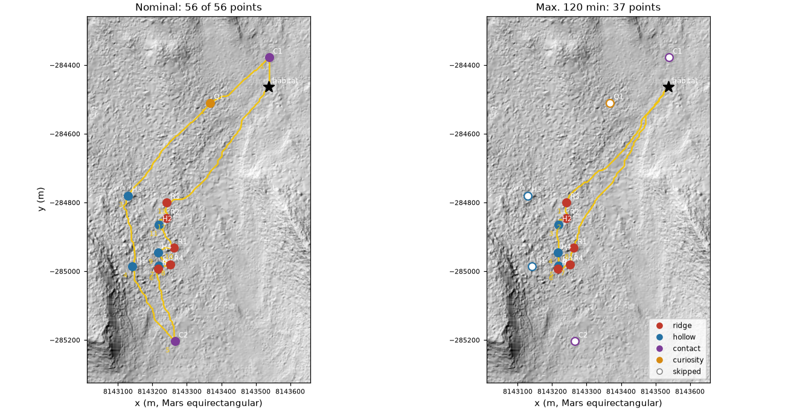
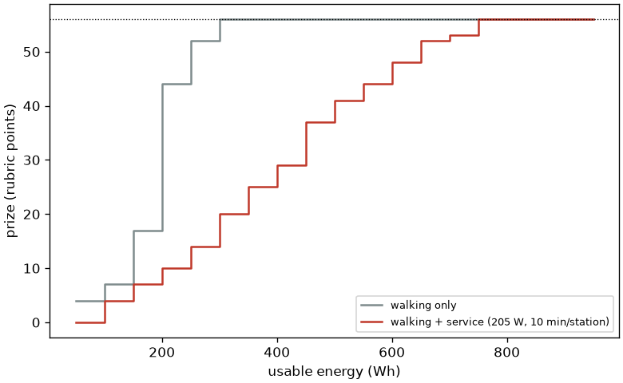
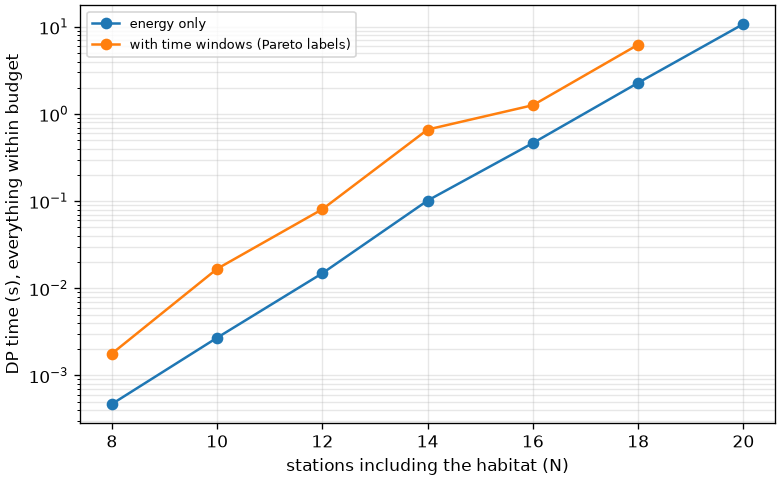
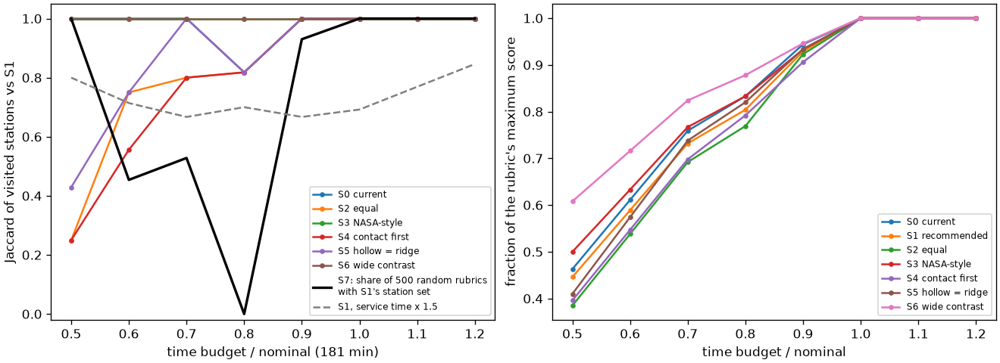
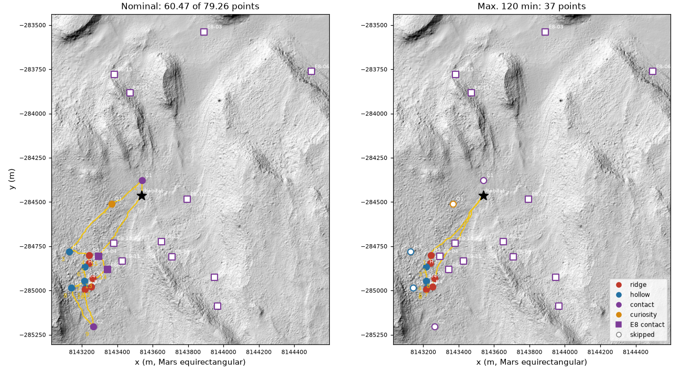

# E5 · Station selection and order (orienteering)

Owner: Diana (`@dianagrz`) · Issue: #9 · PRs: #37, #78, #83 · Status: done (in `main` since #37: `/plan` plans the multi-station tour through `plan_tour`; DP up to 20 nodes, CP-SAT above; E8 stations v0 integrated; a v1 is not committed (JB, #9) and would only need a rerun; real time windows have no source) · Last update: 2026-11-15

## Question
Given N science stations with a value, which subset should the astronaut visit, and in what order, to collect the most value without breaking the energy budget, the EVA duration, the stations' time windows or the walkback rule (always able to walk home)?

## Data
- **Terrain cost:** E3 directed edge costs (Sebas, `data/base/edges_e3.npz`): energy (J) and time (s) for the 8 moves of every 1 m cell, Santee (2001) metabolic power at Apollo speed ([E3 note](E3_metabolic_cost.md)). Loaded through E4's graph (Aaron, `src/grafos/graph.py`, [E4 note](E4_walkback.md)), with E3's defaults: no move steeper than 20°, no cell steeper than 30°.
- **Human cost (comparison):** E3 energy × E1's terrain factor of the arrival cell (`fisica.human_cost`), with the sand price of release `e1-sand-v1` (Juan, [E1 note](E1_maxent_irl.md)) on E8's `sand.tif` (release `e8-v0`, [E8 note](E8_boxwork_sand.md)). It is the cost `/plan` uses by default (`human_cost = true` in its request).
- **Stations:** the 13 manual stations of release `stations-v1` (Sebas, `data/stations/stations_manual.gpkg`, layer `stations`): 5 ridges, 5 hollows, 2 contacts and 1 Curiosity drill site, scored with the 5/4/4/3 rubric ([product note](product_api_hud.md)), 56 points in total. Every station has 10 min of service (`service_time_min`, a placeholder).
- **Habitat:** a user input (team decision, 2026-11-14). For this note it is the box centre, (8143537.99, −284463.58), the same illustrative choice as the E4 note.
- **E8 stations (separate run):** the 15 sand-rock contacts of release `stations-e8-v0` (JB, `data/stations/stations_e8.gpkg`, script `src/dl_boxwork/stations_e8.py`, [E8 note](E8_boxwork_sand.md)), all `type = contact`, scores 1–5 from hollow size and local hollow density, 20 min of service each. With the manual stations they make 28, beyond the DP; they are solved with OR-Tools and reported in their own section and files, so the DP results above them stay as they are.
- **Not used yet:** time windows (no source; see Limitations).

## Method
1. **Stations on the graph.** Each station falls in one 1 m cell; two stations in the same cell are merged. The habitat is placed with `Graph.place` like E4 and `/plan`: a blocked cell, or one outside the largest strongly connected component, is moved to the nearest valid cell. Stations outside that component are dropped, since the astronaut could not get back from them.
2. **Station matrices.** One Dijkstra per station (`scipy.sparse.csgraph`) gives the directed minimum-energy cost between every pair. The walking time of each pair is measured along that same minimum-energy leg, not the fastest one, so the solver's times match the route that is actually walked (`network.station_matrices`). The pair values are cached per graph, so a repeated plan with the same stations runs no Dijkstra.
3. **Service and waiting.** Working at a station costs `service_time × power`, with 205 W by default: E4's value, the top of the "low" band in [NASA-xEMU-met]. It was proposed as a shared value on #2 and never confirmed; `/plan` uses the same 205 W. It is paid on arrival at each station; the habitat is not served again on return. Waiting for a time window costs `wait time × wait power`, 0 W by default until the team agrees a value.
4. **Exact bitmask DP** [HeldKarp1962]. `dp[mask][i]` is the least energy to visit (and serve) the set `mask` ending at station `i`, built over masks in increasing order. Every set that can be closed within the budget is kept with its cheapest closing; the solution is the closable set with the most points, and among equal points the one using less energy. The order is rebuilt from parent pointers. Exact up to 20 nodes including the habitat. Prizes are summed per set, so the DP maximises total points [Vansteenwegen2011] [Gunawan2016].
5. **Time windows and maximum duration.** With two resources, one value per state is no longer enough: a route that spends more energy but arrives earlier can be the only one that still meets a later window. Each state then keeps its Pareto labels, the (energy, departure time) pairs no other label beats, as in resource-constrained shortest paths [Irnich2005]. Arriving before a window opens means waiting until it opens. With a waiting power `w`, label A dominates B when it leaves no later and `e_A + w·(t_B − t_A) ≤ e_B` (A could wait until B's time and still spend no more); with `w = 0` this is plain Pareto dominance. Without windows or a duration limit the single-value DP runs.
6. **Several rubrics at once.** Which station sets fit the limits does not depend on their scores, so `solve_many` builds the DP tables once and only repeats the choice of the best set for each rubric. The sensitivity analysis (step 9) uses it.
7. **Walkback.** After solving, the tour's full cell path is checked with E4's `check_walkback`, adding the service and waiting energy spent so far: at every cell, energy used + R(v) ≤ usable energy, where R(v) is the minimum energy to walk back to the habitat. If a tour fails, two repairs are tried breadth first, at most 5 extra solves: lower the budget by the deficit, or forbid the station of the first violation. The best feasible tour wins, so the result is never worse than lowering the budget alone (`safety.solve_with_walkback`).
8. **One shared rule set.** `problem.evaluate_route` applies these rules to any route. The DP, the brute-force solver, the tests and the outputs all use it.
9. **Rubric sensitivity**, as specified in `docs/research/station_value_rubric.md` (Sebas):
   - Scenarios S0 current (5/4/3/3), S1 recommended (5/4/4/3, the reference), S2 equal (1/1/1/1), S3 NASA-style (3/2/2/1), S4 contact first (4/4/5/3), S5 hollow = ridge (5/5/4/3), S6 wide contrast (9/4/4/1), for ridge/hollow/contact/Curiosity site.
   - S7: 500 random rubrics in [1, 5] that keep S1's order (ridge ≥ hollow and contact ≥ Curiosity site).
   - Each is solved at time budgets of 0.5–1.2 × the nominal duration, the time S1 needs to visit every station. Time is the budget swept because in this box time, not energy, binds (`docs/demo.md`); energy stays at 900 Wh usable. S1 is also solved with service times × 1.5, since SEXTANT's field validation found real traverses slower than planned (as cited in the rubric review).
   - Metrics against S1 at the same budget: Jaccard index of the visited stations, Kendall τ of the order of the stations both visit, and the fraction of the rubric's maximum score. The stability threshold is the smallest budget from which every fixed scenario and at least 95 % of S7 visit S1's set.
10. **Beyond 20 nodes: OR-Tools CP-SAT** [ORTools] (`solvers/cpsat.py`). An exact model: a Boolean per arc and per station, `AddCircuit` with a self-loop for every station that may be skipped, the energy budget as one linear constraint, and for time a start-of-service variable per station that each chosen arc pushes forward (service at the departure station plus the walk). Visited stations start within their window. Two details matter:
    - When the tour may stay at the habitat (the empty tour), staying forces every other station off. Otherwise the solver can close a loop through other stations that never touches the habitat.
    - With a maximum duration, the walking and service of the chosen arcs must also fit in it. This is redundant, since waits only add time, but it is linear. Without it CP-SAT could not prove the 28-station 120 min case within its time limit; with it the optimum is proven in 0.5 s.

    Costs are rounded up (energy to 10⁻⁶ of the budget, time to 1 ms) and limits down, so every tour the model accepts also holds exactly. A first phase maximises the points; a second, with the points fixed, minimises the energy (the DP's tie-break). The solver reports whether the optimum is proven and an upper bound on the points. `run.py --solver auto` and `/plan` (`plan_tour(solver="auto")`) use the DP up to 20 nodes and CP-SAT above. Waiting energy is not modelled in it.
11. **Tried and kept only for comparison: OR-Tools routing** (`solvers/routing.py`): the vehicle-routing library with one vehicle, each station a skippable node whose skipping costs its points, and guided local search. It finds the right tour on the real instances, but on random energy-only instances it misses the optimum in up to 6 of 10 cases, by up to 31 % of the points (`vs_dp_random`, 2 s per case). Its moves change one or two stations at a time, and a tight budget can need several swapped at once. Enabling the path and inactive-node LNS moves made it match the DP on the unit tests' small cases (2–7 nodes) but not on the larger ones.
12. **Windows DLL clash.** The pip build of OR-Tools and conda-forge's pyarrow (loaded by pandas 3) ship DLLs with the same names (abseil, protobuf); in one Python process whichever loads second fails. When pyarrow is installed on Windows, both OR-Tools solvers run in a fresh Python process that never imports pandas (about 0.2 s per solve).
13. **Tried and dropped:**
    - The first DP pruned a state whenever going straight to the end was already over budget. That is only valid when the cost matrix satisfies the triangle inequality. Dijkstra matrices do, but the random test matrices did not, and the DP disagreed with brute force on some of them. It now prunes only on the energy already spent.
    - Splitting each station's service cost into half on its incoming and half on its outgoing edges, a common way to turn station costs into edge costs, was considered and dropped. It gives the same totals here but wrong partial totals, which the walkback and windows need.
    - Caching each station's whole Dijkstra result (about 48 MB per station) was dropped for caching only the station-to-station values.

## Results
All numbers come from `src/orienteering/paper_figures.py` → `data/e5/summary.json` (habitat at the box centre, 1000 Wh budget, 10 % margin, so 900 Wh usable, 205 W service, plain E3 cost unless stated).

- **Matrices:** 14 nodes (13 stations and the habitat), all inside the main component. The 14 Dijkstras take 8.53 s and R(v) 1.30 s. Leg energies range from 1.2 to 133.8 Wh (median 30.4 Wh). The cost from i to j divided by the cost from j to i has percentiles 5/50/95 of 0.625 / 1.0 / 1.599, so the order of a tour matters.
- **Nominal tour:** all 13 stations, 56 of 56 points, order habitat > C1 > Q1 > H3 > H1 > C2 > R0 > H0 > R4 > H4 > R1 > H2 > R2 > R3 > habitat.

  | | Energy | Time |
  |---|---|---|
  | Walking | 279.4 Wh | 50.9 min |
  | Service | 444.2 Wh | 130.0 min |
  | Total | 723.6 Wh | 180.9 min |

  2,252 m over 1,842 cells. The DP takes 0.08 s. Walkback holds with a minimum slack of 176.4 Wh and no re-plans. Service, not walking, is most of the cost (61 % of the energy, 72 % of the time).
- **With a 120 min limit:** 8 stations and 37 points (66 % of the maximum): habitat > R3 > R2 > H2 > H4 > H0 > R0 > R4 > R1 > habitat, in 111.4 min and 445.1 Wh. Time, not energy, is the binding limit. The DP with Pareto labels takes 0.23 s.
- **Human cost:** leg energies rise by up to 3.5 % (ratio 1.0–1.0348 to plain E3). The nominal tour visits the same 13 stations (726.3 Wh, 2.7 Wh more) and the 120 min tour the same 8 (447.5 Wh), in a different order for the nominal one. The sand price does not change which stations are chosen.
- **Prize against budget** (Figure 2): counting service, the planner needs 750 Wh of usable energy to visit all 13 stations; walking alone would need 300 Wh. At 450 Wh it collects 37 points with service against 56 without. Ignoring service would overstate what an EVA can do by a wide margin.
- **Rubric sensitivity** (Figure 4, nominal duration 180.9 min):

  | Time budget / nominal | 0.5 | 0.6 | 0.7 | 0.8 | 0.9 | ≥ 1.0 |
  |---|---|---|---|---|---|---|
  | Stations S1 visits | 5 | 7 | 9 | 10 | 12 | 13 |
  | Station sets tied at S1's best score | 1 | 15 | 3 | 9 | 1 | 1 |
  | S7 rubrics choosing S1's set | 100 % | 45 % | 53 % | 0 % | 93 % | 100 % |
  | Jaccard vs S1: S0 / S2 / S4 / S5 | 1 / 0.25 / 0.25 / 0.43 | 1 / 0.75 / 0.56 / 0.75 | 1 / 0.8 / 0.8 / 1 | 0.82 for all four | 1 for all | 1 for all |

  S3 and S6 match S1's set at every budget. The visited set stops depending on the rubric from **1.0 × the nominal duration** (`stable_from_fraction`); at 0.9 every fixed scenario agrees and 93 % of S7. Where S7 agrees least (0.6, 0.7, 0.8), S1's integer scores tie: several station sets reach S1's best score (15, 3 and 9) and energy decides between them, while random scores never tie. So the disagreement there is between equally good sets for S1, not a different judgement. With service times × 1.5, S1 keeps only 36–88 % of its maximum score across the sweep and never matches the nominal set (Jaccard 0.67–0.85). From 0.7 × the nominal duration upwards, that change of the service estimate moves the visited set more than any fixed rubric does; only at 0.5 (S2, S4 and S5) and 0.6 (S4) does a fixed rubric move it more.
- **DP runtime** (Figure 3, worst case where every station fits, so every state is reachable):

  | N (with habitat) | 8 | 10 | 12 | 14 | 16 | 18 | 20 |
  |---|---|---|---|---|---|---|---|
  | Energy only (s) | 0.0005 | 0.0027 | 0.015 | 0.10 | 0.46 | 2.28 | 10.8 |
  | Time windows (s) | 0.0018 | 0.017 | 0.081 | 0.66 | 1.26 | 6.26 | – |

  The fast DP grows about 5× per two stations, as 2ⁿ·n² predicts. With windows it stays under 6.3 s up to 18 nodes. The 14 real nodes solve in under 0.25 s, so a run is dominated by the 8.5 s of Dijkstras, which the cache removes on repeated plans.


*Figure 1. E5 tours over the hillshade. Left: nominal (900 Wh usable), all 13 stations. Right: 120 min limit, 8 stations. Filled circles are visited, open circles skipped; small numbers give the visiting order.*


*Figure 2. Points collected against usable energy, with and without the service energy (205 W, 10 min per station).*


*Figure 3. DP time against the number of nodes, with everything within budget. Random Euclidean instances; one run per N.*


*Figure 4. Left: overlap (Jaccard) of each scenario's visited stations with S1's, the share of 500 random order-preserving rubrics that pick S1's set, and S1 with service times × 1.5. Right: fraction of each rubric's maximum score. Time budget as a fraction of the 180.9 min S1 needs for all stations.*

## Results with the E8 stations (OR-Tools, 28 stations)
Kept apart from the DP results above. All numbers come from `src/orienteering/paper_ortools.py` → `data/e5/summary_ortools.json`, with the same habitat, budget, margin and service power, plain E3 cost.

- **Instance:** 13 manual and 15 E8 stations. E8-02 and E8-08 are outside the main connected component, so 26 stations and the habitat remain (27 nodes). The 27 Dijkstras take 16.5 s. Maximum points: 56 manual + 23.26 E8 = 79.26. E8 stations carry 20 min of service each, so all 26 would need 390 min of service alone (130 manual + 260 E8).
- **Nominal (900 Wh usable, no time limit):** 60.47 points, proven optimal by CP-SAT in 0.3 s. It visits all 13 manual stations (56 points) and two E8 contacts, E8-05 and E8-04 (4.47 points), at the end of the tour near the ridges: habitat > C1 > Q1 > H3 > R3 > R2 > H2 > H4 > H1 > C2 > R0 > H0 > R4 > R1 > E8-05 > E8-04 > habitat.

  | | DP, 13 manual stations | CP-SAT, 26 stations |
  |---|---|---|
  | Points | 56 | 60.47 |
  | Energy (walking + service) | 723.6 Wh | 872.0 Wh (291.2 + 580.8) |
  | Duration | 180.9 min | 222.9 min |
  | Walkback minimum slack | 176.4 Wh | 28.0 Wh |

  2,341 m over 1,911 cells; walkback holds with no re-plans. Energy is now the binding limit: 872.0 of 900 Wh, 148.4 Wh more than the DP's manual-only tour for 4.47 more points.
- **With a 120 min limit:** 37 points, proven optimal in 0.5 s: the same 8 manual stations and order as the DP (445.1 Wh, 111.4 min). No E8 station enters: each costs 20 min of service, twice a manual station's.
- **OR-Tools against the DP** (the DP is exact up to 20 nodes):
  - On the 14-node manual instance, CP-SAT (0.06 s and 0.2 s) and the routing heuristic (10 s) both return the DP's stations and energy, nominal and 120 min.
  - On random instances (generator of `paper_figures.py`, 10 per size and kind): CP-SAT matches the DP's points on 60/60 and proves the optimum on all of them, in at most 0.25 s.

    | Nodes | 12 | 16 | 20 |
    |---|---|---|---|
    | Routing heuristic (2 s), energy only: same points as the DP | 7/10 | 6/10 | 4/10 |
    | Its largest loss | 20 % | 19 % | 31 % |
    | Routing heuristic, time windows: same points | 10/10 | 10/10 | 10/10 |

  - On the 26 stations the routing heuristic finds the optimal points in 1 s in both cases, and the optimal energy after 5 s (nominal) and 15 s (120 min).


*Figure 5. CP-SAT tours over the 13 manual (circles) and 13 reachable E8 stations (squares). Left: nominal, 900 Wh usable. Right: 120 min limit. Filled markers are visited, open ones skipped; small numbers give the visiting order.*

## Checks
- **Brute force.** The DP matches exhaustive enumeration of every ordered subset on 500 random instances of 2–7 nodes with asymmetric costs and random start and end: 100/100 with energy only, with service, with time windows, with a maximum duration, and with windows plus a waiting cost (`dp_vs_brute`). The random windows and limits are tight enough to change the best answer in many of those cases.
- **OR-Tools against the DP:** see the results section above (`vs_dp_manual_14`, `vs_dp_random`); every CP-SAT tour is re-checked with `evaluate_route` before it is returned.
- **Unit tests:** `pytest tests/orienteering` passes 654 tests (10 of them for E6's metaheuristics). Besides the brute-force cases, they cover:
  - `solve_many` against separate solves and brute force, for several rubrics at once
  - a named toy problem with a known optimum: 10 stations on a circle around the habitat, where the best tour is a run of neighbours of predictable length and energy
  - service changing which stations are picked, waiting energy changing them too, and the habitat served once
  - a window that forces the order, an unreachable window, and a slower but cheaper label that must survive
  - time measured along the minimum-energy leg, directed costs, and the matrix cache (no new search for repeated stations; callers can't alter it)
  - a blocked station detoured or moved; walkback failing at the right stop; both re-plan repairs
  - the route GeoPackage read back, and `plan_tour` with the real `/plan` request model
  - both OR-Tools solvers against the DP on 30 small random instances each (CP-SAT also proves each optimum), windows, a maximum duration, unreachable legs, and CP-SAT on 30 stations on a circle (beyond the DP) with a known optimum
  - reading the manual and E8 files together without repeated ids or cells, and `plan_tour` switching to CP-SAT for 21 stations
- **Same cost as `/plan`:** with `human=True`, E5's station matrix equals the one built by `api.planner.graph(base, 30.0, human=True)` (maximum relative difference 0.0 on the 13 stations).
- **`/plan` integration:** in `main`, `/plan` delegates to `plan_tour` (#64) and refuses a tour that still fails the walkback after the re-plans (#68). The tour and plan tests of `tests/api` pass (17 tests).
- **Route against solver:** the energy of the written route, recomputed cell by cell with E4's `Graph.path_cost`, equals the solver's energy.
- **Visual check** (Figure 1): the routes pass through every visited station in the reported order, and stay off the steep scarp in the south-west of the map.

## Limitations
- **Station values are a rubric, not measurements**, and points add up: two Curiosity sites (3 + 3) outweigh one ridge (5). The sensitivity analysis shows the choice of stations does not depend on the rubric once the time budget covers all stations, and that below it S1's own ties are as large an effect as changing the rubric.
- **Service is a placeholder:** 10 min per station and 205 W are not agreed values (proposed on #2, never confirmed). Service is most of the cost, and from 0.7 × the nominal duration upwards 1.5 × the service time changes the plan more than any fixed rubric does.
- **No real time windows yet.** The DP and the reader support them (`window_open_min`, `window_close_min`), but nobody provides them; REMS weather data could. Waiting costs no energy unless a waiting power is set.
- **Pareto labels can grow** with many binding windows. Measured up to 18 nodes with random windows (6.3 s); denser binding windows could be slower; CP-SAT is the fallback.
- **Walkback never binds for round trips.** For a tour that starts and ends at the habitat and fits the budget, R(v) is never more than the rest of the planned tour, so the check always passes. It only matters for routes that end elsewhere. It covers energy only, not return time; the HUD shows the 30 min return separately.
- **Costs come from the DEM-based E3 model**, with the same limits as E4: no rocks (E9), and the DEM does not resolve the boxwork ridges ([base grid note](base_grid.md)). The human cost adds only sand, and it does not change the chosen stations here.
- **The sensitivity uses one habitat** (the box centre) and the 13 manual stations; the tie pattern depends on both.
- **E8 scores are not on the rubric's scale.** They grow with hollow size and hollow density (1–5, continuous), while the manual stations use the 5/4/4/3 rubric, so adding them mixes two scales. With 20 min of service each, E8 adds 4.47 points to the nominal tour and none under 120 min. The HUD makes the other choice: its *Load E8 contact stations* button (#79) scores them by the rubric as contacts (4 points), so a `/plan` tour over the 28 stations is not this section's tour ([product note](product_api_hud.md)).
- **No radio constraint.** E11 ([E11 note](E11_comms.md)) finds stretches of a tour without a direct radio link to the habitat. E5 does not limit them; the team left that for after the hackathon (#76).
- **CP-SAT has no waiting energy** and is only exact up to the rounding (costs up, limits down; 10⁻⁶ of the budget, 1 ms). It was proven optimal on every instance here, but a larger or harder instance could hit its time limit; it then returns its best tour, the bound and `optimal = false`.

## What other pieces can use
- **API/HUD (Sebas):** `/plan` delegates the multi-station tour to `tour.plan_tour(req, graph)` (#64). It applies the energy, duration and `o2_budget_l` limits, re-plans on a walkback failure, and switches to CP-SAT above 19 stations (output `method = "cpsat"`, `exact` true only if the optimum is proven, `gap` from the bound). Its signature and output keys are kept stable. `api/tour.py` keeps a fallback on E5's primitives (`Stations`, `station_matrices`, `Problem`, `SOLVERS["dp"]`, `route_path`), so those names stay stable too. `station_matrices` caches pairs, so repeated `/plan` requests with the same stations skip the Dijkstras. The HUD can add the E8 stations to a plan (#79).
- **Rubric (Sebas):** the sensitivity results answer the proposal in `docs/research/station_value_rubric.md`: stable from the full-tour budget, and the contact/hollow tie of S1 is what makes it ambiguous below.
- **E4 and baselines (Aaron):** the station matrices and `evaluate_route` can score any visiting order, including the baselines.
- **E12 (Juan):** the route GeoPackage (`data/e5/e5_route.gpkg`, layers `route` and `stops`) and the `/plan` output have arrival and departure times per stop for the dose timeline.
- **E8 (JB):** `stations_e8.gpkg` is read together with the manual stations (`read_station_files`, `run.py --stations A B`). Two of the 15 are unreachable from the habitat's component, and only two are worth their 20 min of service in the nominal tour.
- **E11 (JB):** a limit on the minutes without radio would enter E5 as one more additive resource per leg, like the duration, or need no E5 change at all if the graph prices the cells without radio (#76).
- **E6 (Diana):** the benchmark of the exact solvers against ILS and simulated annealing is in the [E6 note](E6_benchmark.md): at E5's sizes the exact solvers are as fast and always right.

## Reproduce
```powershell
gh release download base-grid-v2 --dir data; Expand-Archive data\base_grid_v2.zip data\base -Force; Remove-Item data\base_grid_v2.zip
gh release download stations-v1 --dir data/stations
gh release download stations-e8-v0 --dir data/stations
gh release download e8-v0 --dir data\e8; Expand-Archive data\e8\e8_v0.zip data\e8 -Force
gh release download e1-sand-v1 --dir data\e1; Expand-Archive data\e1\e1_sand_v1.zip data\e1 -Force
python src/fisica/build_cost_layers.py data/base/dem_1m.tif data/base --slope-raster data/base/slope_deg.tif   # optional, ~3 s
python src/orienteering/run.py --habitat 8143537.99 -284463.58
python src/orienteering/run.py --habitat 8143537.99 -284463.58 --max-duration-min 120 --human-cost
python src/orienteering/paper_figures.py
python src/orienteering/run.py --habitat 8143537.99 -284463.58 --stations data/stations/stations_manual.gpkg data/stations/stations_e8.gpkg
python src/orienteering/paper_ortools.py
python -m pytest tests/orienteering
```

## Outputs
- `data/e5/e5_route.gpkg` (from `run.py`): layers `route` and `stops`, CRS of the DEM, with the cost model used.
- `data/e5/summary.json` (from `paper_figures.py`, about 70 s).
- `paper/figures/e5_fig1_tour_map.png`, `e5_fig2_prize_vs_budget.png`, `e5_fig3_dp_runtime.png`, `e5_fig4_rubric_sensitivity.png`.
- With the E8 stations, separately: `data/e5/summary_ortools.json`, `data/e5/e5_route_ortools_28.gpkg` and `e5_route_ortools_28_120min.gpkg` (from `paper_ortools.py`, about 4 min, most of it the routing heuristic's comparison runs), `paper/figures/e5_fig5_ortools_28.png`.

`data/` is not in git; regenerate with the commands above.
