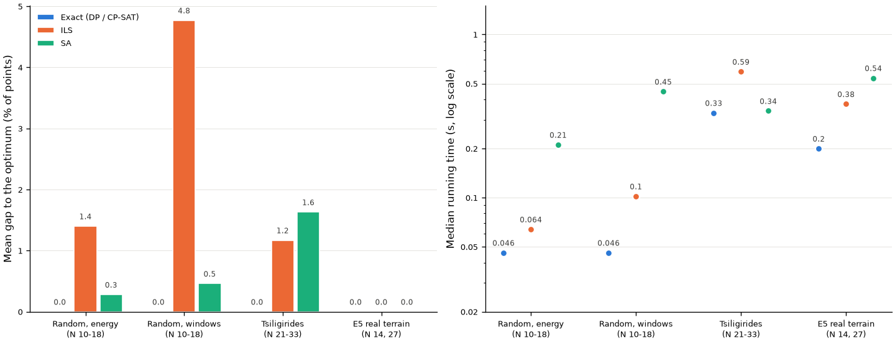

# E6 · Exact solvers against metaheuristics for station selection

Owner: Diana (`@dianagrz`) · Issue: #14 · PRs: #81 · Status: done (benchmark in `main`; numbers delivered for the team's results table on #16) · Last update: 2026-11-15

## Question
For the station-selection problem of E5 (which stations to visit, and in what order, within an energy budget, time windows and a maximum duration), how far from the optimum, and how fast, are two standard metaheuristics compared with the exact solvers? Is there a size of the problem in this project where a metaheuristic should replace the exact answer?

## Data
- **Random instances** (`src/orienteering/instances.py`, `random_instance`): 10 per N in {10, 14, 18} and per kind, 60 in total. N counts the habitat, which is the start and the end.
  - Points in a 100 × 100 square. Energy is the distance times an asymmetric factor in [0.9, 1.2]. Prizes are 1–5, and each station has 0–20 units of service energy.
  - The budget is 30–70 % of a nearest-neighbour tour through every station, so only part of them fit.
  - The "windows" kind adds walking time (equal to energy) and service time, and gives about half of the stations a time window.
- **Tsiligirides instances** [Tsiligirides1984]: the 49 classic OP instances of sets 1–3 (32, 21 and 33 points, budget 5–110), from the KU Leuven test-instance page (`data/08_instancias_orienteering/OP_clasico/`, see `data/README.md`). The start and end are distinct points, distances are Euclidean, and there is no service.
- **E5 on the real terrain** ([E5 note](E5_orienteering.md)): the 13 manual stations, and the 13 manual plus 13 reachable E8 stations. The habitat is at the box centre, with 900 Wh usable and 205 W of service, nominal and with a 120 min limit. That gives 14 or 27 nodes.

## Method
1. **Exact references.** The bitmask DP up to 20 nodes [HeldKarp1962] (random and manual E5 instances). Above 20, OR-Tools CP-SAT [ORTools] (Tsiligirides and E5 with E8), counted only if it proves the optimum. It proved it on all 51 instances where it was used (49 Tsiligirides, 2 E5 with E8). Both solvers are described in the E5 note.
2. **Iterated local search (ILS)** after Vansteenwegen et al. [Vansteenwegen2009] (`solvers/ils.py`):
   - Local search:
     - insertion of the station with the largest prize² / added energy at its cheapest position, while any fits
     - 2-opt on the order (the matrices are asymmetric, so every reversed segment is re-costed)
     - replacing a visited station by a better unvisited one
   - Shake: remove S consecutive stops starting at position R. S grows by one at each shake, up to half the route, and R moves along the route.
   - Stop after 150 shakes without improvement, or 10 s. No random numbers, so one run per instance.
3. **Simulated annealing (SA)** [Kirkpatrick1983] (`solvers/sa.py`):
   - Moves: add an unvisited station at its cheapest position, drop a visited one, swap one for an unvisited one, or reverse a segment.
   - Infeasible moves are rejected. A move that loses points is accepted with probability exp(−loss / T), with a tie-break on energy worth far less than any prize difference.
   - T cools geometrically from 0.5 to 0.005 × the mean station prize over 20,000 steps. The best tour seen is polished with the ILS local search.
   - Three seeds (0, 1, 2) per instance; every run is counted.
4. **Same rules for every method.** All four solvers take the same `Problem` (energy budget, service, windows, maximum duration). Every tour the metaheuristics return is re-checked with `evaluate_route` before it is counted; the benchmark asserts it.
5. **Metrics:**
   - share of runs that reach the optimum
   - mean and maximum gap, (optimum − points) / optimum
   - median and maximum running time

   Times are measured inside each solver on one Windows laptop (Python 3.12, OR-Tools 9.15, 8 CP-SAT workers). CP-SAT's time excludes the start of its separate process (about 0.2 s, see the E5 note).
6. **Tried and dropped:** OR-Tools' routing library with guided local search as a third heuristic. It missed the optimum in up to 6 of 10 random energy-only instances by up to 31 % (E5 note, `summary_ortools.json`), so CP-SAT replaced it as the reference above 20 nodes.

## Results
All numbers from `src/orienteering/e6_benchmark.py` → `data/e6/e6_results.json` (one row per instance and run) and `data/e6/e6_table.csv` (summary).

| Instances | Method | Runs | Optimum reached | Mean gap | Max gap | Median time | Max time |
|---|---|---|---|---|---|---|---|
| Random, energy (N 10–18, 30) | Exact (DP) | 30 | 100 % | 0 | 0 | 0.046 s | 1.53 s |
| | ILS | 30 | 76.7 % | 1.40 % | 11.1 % | 0.064 s | 0.18 s |
| | SA | 90 | 93.3 % | 0.28 % | 6.4 % | 0.21 s | 0.26 s |
| Random, windows (N 10–18, 30) | Exact (DP) | 30 | 100 % | 0 | 0 | 0.046 s | 4.57 s |
| | ILS | 30 | 76.7 % | 4.77 % | 37.5 % | 0.10 s | 0.25 s |
| | SA | 90 | 93.3 % | 0.46 % | 10.8 % | 0.45 s | 0.65 s |
| Tsiligirides (N 21–33, 49) | Exact (CP-SAT) | 49 | 100 % (49 proven) | 0 | 0 | 0.33 s | 0.79 s |
| | ILS | 49 | 73.5 % | 1.17 % | 12.9 % | 0.59 s | 2.85 s |
| | SA | 147 | 62.6 % | 1.63 % | 19.4 % | 0.34 s | 0.50 s |
| E5 real terrain (N 14, 27; 4) | Exact (DP / CP-SAT) | 4 | 100 % | 0 | 0 | 0.20 s | 0.54 s |
| | ILS | 4 | 100 % | 0 | 0 | 0.38 s | 1.26 s |
| | SA | 12 | 100 % | 0 | 0 | 0.54 s | 0.63 s |

- **The exact solvers are as fast as the metaheuristics here and always right.** The median exact time is at or below both metaheuristics' on every set. The DP's worst case grows with N, up to 1.5 s (energy) and 4.6 s (windows) at N = 18, while the heuristics stay under 1 s. That is the only place where a metaheuristic is faster, and it pays for it with misses.
- **ILS misses the optimum in about a quarter of the instances on every set.** Its worst gaps come with time windows, 37.5 % on one instance, where a greedy insertion order can block a later window.
- **SA is better on the random instances** (93 % optimal) **but worse on Tsiligirides** (63 %, worst 19 %). Tsiligirides prizes are multiples of 5 (set 1: 5–15; sets 2–3: 10–50), so settling on a different cluster of points loses a whole high-value point at once.
- **On the real E5 instances all three methods agree:** 56 and 37 points with the manual stations, 60.47 and 37 with E8 (the E5 note's optima).
- **By size** (`e6_results.json`): the DP's time grows from at most 0.002–0.008 s at N = 10 to 1.5–4.6 s at N = 18. ILS reaches the optimum in 70–80 % of instances at every N; SA in 100 % at N = 10 and 80–87 % at N = 18.


*Figure 1. Left: mean gap to the proven optimum, as a % of its points. Right: median running time per instance (log scale). Exact = bitmask DP up to 20 nodes, OR-Tools CP-SAT above; SA over three seeds per instance.*

## Checks
- Every optimum used as the reference is proven: DP (exact) or CP-SAT with `optimal = true` (`optimum_proven` in the rows; 113/113).
- Every metaheuristic tour is re-checked for the budget, windows and duration (`evaluate_route`) inside the benchmark. A failure would stop the run.
- **Unit tests** (`tests/orienteering/test_metaheuristics.py`):
  - on 60 small random instances (2–7 nodes, every rule), ILS and SA are always feasible, never above the DP and on it in at least 55
  - both find the toy problem's optimum (10 stations on a circle)
  - both respect a window that forces the order, and return no tour when nothing fits
  - SA is reproducible with a seed
  - the instance reader and generator
- **Tsiligirides optima:** the optima for the full budgets match the total points of each set (set 1, budget 85: 285; set 2, budget 45: 450; set 3, budget 110: 800), as they must when every point fits. Published best-known values for the other budgets were not compared (not in the downloaded files).

## Limitations
- **Two metaheuristics, one parameter setting each**, not tuned per set. Other settings (longer SA schedules, more ILS shakes, the time-window insertion of [Vansteenwegen2009]) could close part of the gap; the comparison shows these implementations, not the best possible ones.
- **Sizes stop at 33 points.** E5's real problems have at most 27 nodes, and CP-SAT proves those in under a second. Where a metaheuristic would be needed (hundreds of stations, or CP-SAT hitting its time limit) was not measured.
- **Running times are from one laptop and Python implementations**; the metaheuristics would be faster in a compiled language. The conclusion (exact is fast enough at these sizes) does not depend on a constant factor.
- **Random instances are Euclidean-like**, with a mild asymmetry. The real terrain is more asymmetric (E5 note: cost ratio i→j / j→i of 0.63–1.60 between its 5th and 95th percentiles). The four real instances agree with the random ones, but they are few.

## What other pieces can use
- **Results table (Juan):** `data/e6/e6_table.csv` has one row per instance set and method (optimum share, mean and max gap, median and max time), ready to merge into the team's results table.
- **E5 and `/plan` (Diana, Sebas):** the answer to the plan's E6 question is that at E5's sizes (≤ 27 nodes) the exact solvers are the right choice. A metaheuristic should not be presented as the solution (`docs/enfoques.md`). `/plan` keeps the DP up to 20 nodes and CP-SAT above.
- **Solvers:** `SOLVERS["ils"]` and `SOLVERS["sa"]` take the same `Problem` as the DP, for anyone who needs a fast answer on a much larger instance.

## Reproduce
```powershell
# KU Leuven instances: team shared data folder, data/08_instancias_orienteering (data/README.md)
# E5 inputs (optional, --no-real skips them): see the E5 note's Reproduce section
python src/orienteering/e6_benchmark.py            # about 4 min
python src/orienteering/e6_benchmark.py --figure-only
python -m pytest tests/orienteering/test_metaheuristics.py
```

## Outputs
- `data/e6/e6_results.json`, `data/e6/e6_table.csv` (from `e6_benchmark.py`)
- `paper/figures/e6_fig1_gap_runtime.png`

`data/` is not in git; regenerate with the commands above.
