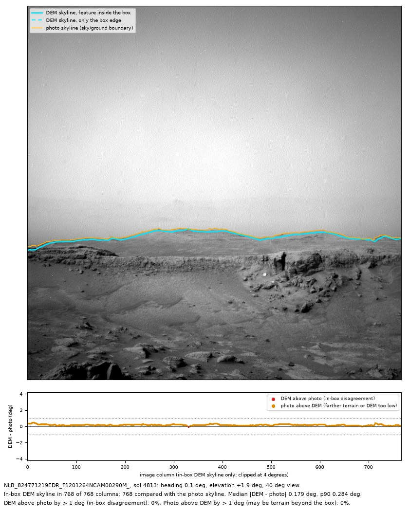

# P3 · Curiosity ground photographs in the 3D map

Owner: Juan (`@JuanCorredor2023`) · Issue: #46 · PRs: #80 (block 1), block 2 pending · Status: blocks 1–2 done (catalogue, camera geometry, photos in the 3D page, visual check of three photos); station previews pending (block 3) · Last update: 2026-11-15

## Question

Can a real Curiosity photograph be placed at its measured camera position and direction in the P1 terrain, and help an astronaut understand the surroundings of a planned station? Block 1 prepared the catalogue, the camera geometry and the local images. Block 2 puts the photographs in the 3D page and checks, for photographs of different sols, whether the terrain model agrees with them.

## Data

- Curiosity raw-image index downloaded by the team on 2026-11-13 [MSL-raw]: `03_curiosity/imagenes_crudas/indice_soles_4450_4848/page_*.json`, 140,755 items of all cameras, sols 4450–4848. Each selected photograph keeps its source URL and `image_credit`.
- Full-resolution Navcam photographs (1024 × 1024, monochrome): 10 of the selected ones were already in `imagenes_crudas/muestra_navcam/`; the other 373 were downloaded on 2026-11-15 into `imagenes_crudas/navcam_p3/` (181,424,448 bytes, 0 failures; `src/viz3d/fetch_rover_photos.py` → `navcam_p3/_download_log.json`). The count and an estimated size were approved by Juan before the download.
- PLACES `places_pds/data_localizations/localized_interp.csv` [PLACES]. Its easting/northing are in the DEM CRS, as in E2. The `_demv2` table belongs to another DEM and is refused by the code.
- The team's `data/base/dem_1m.tif` [Parker2016] and the box in `docs/contracts/grid.json`. P1's terrain assets are not changed.
- Filtered out: thumbnails, subframes and downsampled frames, other cameras, and one "full" Navcam frame whose metadata say it is cropped (`NRB_803470978EDR_F1162562ACS_00000M_`). All 6,504 remaining full Navcam frames lie inside the box.
- Source files and generated media stay outside git. Only small metadata fixtures used by the tests are committed.

## Method

### Positions and camera geometry

`src/viz3d/rover_photo_geometry.py` holds the camera mathematics; `src/viz3d/build_rover_photos.py` the join, selection and generated assets. Both take explicit input paths.

- **Frames.** The CAHVOR model of the raw-image metadata is in the rover navigation frame (x forward, y right, z down): the API's `camera_vector` agrees with the mast azimuth and elevation in that frame. The image `attitude` (scalar first) rotates rover vectors into the site frame (north, east, down), the direction given in the PLACES SIS [PLACES]. The CAHVOR projection and its inverse follow the VICAR camera model library [VICAR-CAHVOR]. The full rotation is used: adding the rover yaw to a mast angle would lose pitch and roll.
- **Join to PLACES.** Images join to PLACES rover rows by site and drive. When a site/drive has several poses, the pose whose quaternion is closest to the image attitude is used. Poses whose attitude ties within the API's 6-decimal rounding (1e-5 rad) must agree in position within 1 cm; then the highest pose is kept, the SIS's rule of thumb. Otherwise the image is rejected as ambiguous and listed. The PLACES clock is the earliest clock of the site/drive whatever the pose, so it is not used to choose a pose.
- **Camera pose.** Camera centre = PLACES rover origin + the attitude-rotated CAHVOR C vector, as easting, northing and elevation in metres. Heading is clockwise from north and pitch positive below the horizon, both in radians (P1's `flyTo`); field of view in degrees. The view direction is the ray through the physical image centre (pixel 511.5, 511.5), with the lens distortion inverted. Elevations are kept as computed and compared with the DEM, never adjusted to fit it.
- **Comparison image.** A 768 × 768, 40° square seen from the camera with the same heading and pitch and no roll, sampled through the source CAHVOR model (bilinear), transparent where the photograph has no pixels. It removes lens distortion and camera roll. An unchanged copy of the photograph is kept for the card (`unwarped`), and a 320 px thumbnail.

### Selection

Stops are grouped by the rover position: each group's representative is the first real PLACES position in a stable order, and a photo joins the nearest representative within 10 m (horizontal); otherwise it starts a new group. There is no chaining and no averaging. Each group keeps at most one photo per 90° heading sector (0–90°, 90–180°, …, from north): the one closest to the horizon, then closest to the representative, then by image id. Every selected photo keeps its own exact position. Items are processed in image-id order, so the result does not depend on how the index is paged.

### Photos in the 3D page (block 2)

`web/3d/photos_model.js` (pure, tested in Node) reads the catalogue; `web/3d/photos.js` draws one orange camera pin per stop on its own marker layer, the stop's card (photo, one button per view, UTC date, sol, LMST, direction, credit, link to the NASA original) and the photo view. Pins that overlap on screen offer a list of stops. "View from here" flies P1's camera to the photograph's pose: the camera's horizontal position, its height above the DEM at relief ×1 (catalogue elevation minus DEM, never forced onto the ground), heading and pitch, and a vertical field such that the centred square of the canvas spans 40° on both axes. The Sun is set to the photograph's own sol and local true solar time at its longitude (`sunOf`, from the UTC time). The comparison image is laid over that square without stretching, with an opacity slider. A pose under the ground, less than 0.5 m or more than 4 m above it, or outside the box is stated in the bar, not corrected. Exit gives back camera pose and field, relief, near plane and Sun. Pins are hidden while rehearsing; `?photo=<id>` opens a photo view and `?check=photos` measures it.

### Photograph against terrain (block 2)

`src/viz3d/photo_skyline.py` ray-casts the 1 m DEM from each camera for every column of the 768 px comparison frame (same pinhole, heading and pitch, zero roll, curvature drop included) and finds the DEM skyline, marking whether it is a terrain feature inside the box or only the box edge. It detects the photograph's sky/ground boundary per column (bright smooth sky at the top; transparent pixels ignored) and compares the two only where the DEM skyline is an in-box feature. The test is one-sided: a DEM skyline above the photograph's means the model puts ground where the photograph shows sky, an in-box disagreement; a photograph skyline above the DEM can be farther terrain beyond the box (or rover hardware) and is not counted as an error. Where farther terrain rises behind an in-box crest, it checks that the crest still shows as a brightness step within ±3 px.

The build never downloads. It lists the selected photos without a local file in `download_manifest.json`, with an estimated size from the local sample. Products go to `data/tiles/3d/photos/` under an immutable generation folder; the root `catalog.json` points to it.

## Results

All numbers: `src/viz3d/build_rover_photos.py` → `data/tiles/3d/photos/catalog.json` and `report.json` (generation `9d2e6fb0bc52df508447d619`), unless stated.

| Quantity | Value |
|---|---|
| Full Navcam frames in the index / eligible | 6,505 / 6,504 (241 site/drive keys) |
| PLACES rover rows / repeated site/drive keys | 49,194 / 113 |
| Eligible photos joined to a repeated key / ambiguous rejections | 321 / 0 (largest tied-position spread 0 m) |
| Stops (groups) | 100: 92 with four sectors, 2 with three, 3 with two, 3 with one |
| Selected photos | 383 (379 right, 4 left Navcam), from 122 sols, 2025-02-11 to 2026-03-27 UTC |
| Largest distance from a photo to its representative | 9.88 m |
| Selected pitch | median 16.9° below the horizon (−15.2° to 36.1°); 379 within 25° |
| Credit | "NASA/JPL-Caltech" for all 383; none missing |
| Generated products | 383 thumbnails, card images and comparison images, 362 MB |

Geometry diagnostics over the 6,504 eligible photos (`report.json`, `geometry_diagnostics` and summaries):

| Check | Mean | p95 | Max |
|---|---|---|---|
| Image attitude vs joined PLACES quaternion | 0.018° | 0.146° | 1.09° |
| Image yaw vs PLACES yaw | 0.0002° | 0.0006° | 1.09° |
| API `camera_vector` vs ray through the image centre | 0.033° | 0.033° | 0.033° |
| Source field of view (horizontal) | 45.46° | 45.52° | 45.52° |
| Camera above the DEM | 1.92 m | 2.29 m | 3.48 m (min −0.32 m) |
| PLACES rover origin above the DEM | −0.02 m | 0.32 m | 1.39 m (min −2.27 m) |
| Comparison image covered by the photograph (383 selected) | 99.93 % | 100 % | min 97.8 % |

The 0.033° between `camera_vector` and the centre ray is the half-pixel between the API's pixel 512 and the physical centre 511.5. The selected cameras are 0.97–2.46 m above the DEM (median 1.93 m), close to the Navcam's height on the mast.

**Photograph against terrain** (`src/viz3d/photo_skyline.py` → `data/tiles/3d/photos/skyline_check.json`, figures `../figures/p3_fig1_skyline_<sol>.jpg`). Three photographs of different sols that look near the horizon and into the box:

| Photo (sol, direction) | In-box columns compared | DEM above photo (error case) | Photo above DEM (not an error) | Reading |
|---|---|---|---|---|
| NLB_824771219EDR_F1201264NCAM00290M_ (4813, north, 1.9° up) | 768 | median 0.02°, max 0.04°, 0 % > 1° | median 0.18°, p90 0.29°, 0 % > 1° | the ridge line of the box follows the photograph across the frame |
| NRB_794593028EDR_F1140288NCAM00296M_ (4473, 160°, 7° down) | 251 | median 0.14°, p90 0.28°, max 0.55°, 0 % > 1° | 29 columns, ≤ 0.04° | the near hillside fills the top of 517 columns; where its crest is in the frame it agrees |
| NRB_806844774EDR_F1172730NCAM00722M_ (4611, 105°, 9.8° up) | 768 | median 0.04°, p90 0.10°, 0 % > 1° | median 1.88°, p90 3.41°, 55 % > 1° | right half within 0.1°; on the left a sunlit hill beyond the box's east edge (about 1.47 km) rises above the in-box crest, which still shows as a brightness step in 61 % of those columns (19 % by chance) |

Over all 23 selected photographs with |pitch| ≤ 12° (17 sols, 12,524 compared in-box columns): DEM above photo median 0.07°, p90 0.25°, max 0.69°, beyond 1° in no photograph. Photo above DEM: median 0.46°, p90 5.2°, 33.5 % beyond 1°, from distant landscape in hazy north-looking views and the rover arm in one sol-4822 frame. Where a constant shift fits (9 photographs), the photograph sits a median 0.22° to the left of and 1 px below the model; the north-looking views of sols 4808–4832 agree on about −0.25° horizontally. That hints at a heading or position error of about 0.2°, with zero inside its uncertainty; nothing points to an error of 0.5° or more.



## Checks

- `tests/viz3d/test_rover_photo_geometry.py`: known rotations, camera-centre translation, pitch sign, distortion forward and inverse, roll removal by ray mapping, transparent corners, rejection of unsupported metadata, and real metadata from six sols (frame agreement with mast angles and PLACES).
- Physical checks on real data, independent of the module's formulas (`tests/viz3d/fixtures/rover_photo_real_checks.json`, made by `src/viz3d/make_photo_check_fixture.py`): a Navcam stereo pair from sol 4711 is 0.423 m apart, 0.421 m of it to the right of the view and 0.017 m along it, both cameras 1.99–2.02 m above the PLACES origin; 20 real drives inside the box go within 1.4° of the attitude's forward axis, and 102° or more off it with the inverse rotation. A swapped axis, a mirrored image or an inverted attitude fails these tests.
- `tests/viz3d/test_build_rover_photos.py` (synthetic inputs): `_demv2` refused, repeated PLACES rows, ambiguous positions, bounds and camera filters, grouping without chaining, one photo per sector with each tie-break, independence from input order, exact positions, missing sectors, download manifest without network access, generated images and corrupt files, outputs only in the output folder, JSON without NaN.
- `tests/viz3d/test_fetch_rover_photos.py`: only NASA raw-image URLs and full 1024 × 1024 JPEGs, failures logged, resumable.
- An independent review by a separate agent repeated the frame checks over all local stereo pairs, drives and mast mosaics and found no convention error; it led to the highest-pose rule above and to the physical tests.
- Results on 2026-11-15: `python -m pytest tests/viz3d -q` 61 passed (with `MARTIAN_DATA` pointing at the data folder; 60 passed and 1 skipped without it); `node --test tests/viz3d/` 71 passed. No file of the page changed, so `?check=shading`, `route` and `rehearse` are unchanged.
- Block 2, `?check=photos` (photos of sols 4450, 4596 and 4848; 2026-11-15, high preset): camera position error 0 m, eye height equal to the catalogue's height above the DEM (1.778, 2.007, 1.924 m), heading, pitch and field errors 0°, relief ×1, the Sun at each photo's sol and solar time, the laid photo on the centred square to 0 px; after Exit, position, heading, pitch, field, relief and Sun as before. P1's `?check=shading`, `route` and `rehearse` give the same numbers as on main; the only change is one more marker layer in the scene list.
- Block 2 visual check: the three figures above, inspected by eye, and the aggregate over 23 photographs. Node tests: 86 passed (`node --test tests/viz3d/`), including 15 for `photos_model.js` (catalogue parsing, pose limits, the square view, and the photographs' own LMST reproduced from their UTC time within 4 s).

## Limitations

- Navcam images are black and white; they are not Mastcam colour photographs.
- The index covers sols 4450–4848 (2025–2026), not the date of a simulated EVA nor the whole mission.
- PLACES positions and attitudes have errors. Camera heights above the DEM range from −0.32 m to 3.48 m over the eligible photos, so some poses or DEM cells disagree by metres; they are reported, not corrected.
- Heading is checked only against PLACES and the rover's own motion: PLACES does not localize orientation independently, so an absolute heading error shared by both would not show until block 2.
- The DEM does not resolve the narrow boxwork ridges. Only features the terrain supports can be used to judge alignment. P1 renders only the 2 × 2 km box: distant mountains cannot match a photograph, and that is not a wrong camera direction.
- The four heading sectors are fixed to north. Four stops have two selected photos less than 15° apart across a sector boundary (stop_0091: 0.14°). Four views are not a panorama and do not guarantee a photograph toward every station; nearness does not establish visibility.
- Choosing the view nearest the horizon does not avoid the rover: in many forward-looking frames the arm and turret fill the lower part of the image.
- The comparison image resamples a JPEG; it cannot recover field of view or detail. Seven of the 383 have between 97.8 % and 99 % coverage.
- PIA26559 is not used. Its caption associates May 15–18, 2025 with sols 4451–4454, whereas the downloaded image dates put those dates around sols 4541–4544 [PIA26559]. The discrepancy must not be used to assign a panorama pose without further verification.
- The skyline comparison fails only one way: "photo above DEM" cannot tell terrain beyond the box from a DEM that is too low or from rover hardware. The sky detector treats faint, hazy hills as sky and its threshold was tuned on the three figures. The 1 m DEM rounds off crests, and heading cannot be separated from position. In six of fifteen photographs with hidden crests, the brightness-step check is at chance level (dark or low-contrast frames, or the arm), so those crests are not confirmed.
- Most selected photographs look 10–35° down at the near ground, which the 1 m DEM and the 0.25 m orthophoto cannot resolve at 2–20 m: their laid photo shows rocks the 3D ground does not have. The comparison is meaningful for crests and knolls, not for near rocks.
- At the overview, the 100 photo pins form a dense row along the traverse; station pins stay on top, and "Show photo stops" hides them.
- Not done yet: station previews (block 3). No video or tablet test is planned.

## What other pieces can use

- Block 2 is in the page: `?photo=<id>` opens any photo view, and `window.viz3d.photos` exposes the layer (`openGroup`, `enter`, `exit`, `state`).
- P3 block 2 (Juan): `catalog.json` gives for each photo its exact camera position, heading and pitch (radians), field of view, sol, UTC date, local mean solar time, credit and image paths; groups give the stops and their missing sectors. It will reuse P1's markers, card, terrain conversions, solar time and `controls.flyTo`.
- Station previews (block 3): selected positions and directions with an explicit missing-image state. A nearest-photo result must show the distance and whether the station is inside the photographed field.
- E2 (Juan): the join rule for repeated PLACES poses (attitude, then the highest co-located pose) applies to any use of image metadata with PLACES.
- No API contract, planner output or P1 asset changes. Sebas's PR #73 (rehearsal) is not touched.

## Reproduce

From the repository root, with `<raw>` the full data folder outside the repository (`data/README.md`) and the team's conda environment:

```
python -m src.viz3d.build_rover_photos --index-dir <raw>/03_curiosity/imagenes_crudas/indice_soles_4450_4848 --places-csv <raw>/03_curiosity/places_pds/data_localizations/localized_interp.csv --images-dir <raw>/03_curiosity/imagenes_crudas --dem data/base/dem_1m.tif --output-dir data/tiles/3d/photos
python -m src.viz3d.fetch_rover_photos --manifest data/tiles/3d/photos/download_manifest.json --dest <raw>/03_curiosity/imagenes_crudas/navcam_p3
```

Then the first command again (about 3 minutes with all images local). The photograph-against-terrain check (about 75 s):

```
python -m src.viz3d.photo_skyline --catalog data/tiles/3d/photos/catalog.json --dem data/base/dem_1m.tif --ids NLB_824771219EDR_F1201264NCAM00290M_ NRB_794593028EDR_F1140288NCAM00296M_ NRB_806844774EDR_F1172730NCAM00722M_ --figure-dir paper/figures --output-json data/tiles/3d/photos/skyline_check.json
```

In the page: `/3d/?check=photos` and `/3d/?photo=<id>`. The download is needed only for missing images. The same inputs give the same generation id.

## Outputs

- `data/tiles/3d/photos/catalog.json`: versioned catalogue (groups, photos, poses, units, provenance), pointing to its generation folder.
- `data/tiles/3d/photos/report.json`: counts, rejections, joins, coverage and geometry checks.
- `data/tiles/3d/photos/download_manifest.json`: selected photos without a local file, with an estimated size (empty after the download).
- `data/tiles/3d/photos/generations/<id>/assets/`: thumbnail, card image and comparison image per photo; `sources.json` with the raw metadata and PLACES row of each.
- `<raw>/03_curiosity/imagenes_crudas/navcam_p3/`: the 373 downloaded photographs and their log.
- `data/tiles/3d/photos/skyline_check.json`: per-photo and aggregate photograph-against-terrain numbers.
- `paper/figures/p3_fig1_skyline_4813.jpg`, `_4473.jpg`, `_4611.jpg`: DEM skyline over the comparison image, with the per-column difference.
- `web/3d/photos_model.js`, `photos.js`, `photos.css`: the photos in the 3D page.
