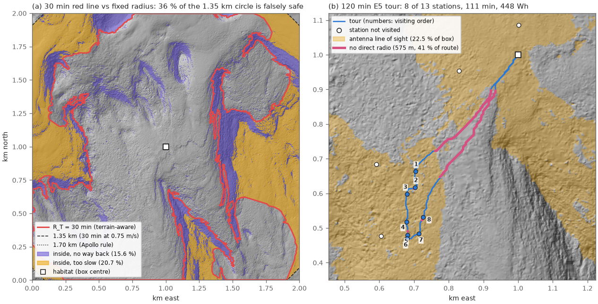

# Product · API, HUD and manual science stations

Owner: Sebas (`@Seredial0326`) · Issues: #10 (product), #43 (guide mode, closed), #44 (data types, closed) · PRs (all Sebas): #21, #24, #26, #30, #33, #34, #36, #38, #40, #41, #48, #51–#53, #55, #58, #60, #64, #68, #70, #72–#74, #79, #82, #84 · Status: done except the E9 boulder layer (waiting for `rocas.tif`) · Last update: 2026-11-15

## Question
How does the planner reach the jury: which service exposes the terrain, the cost and the plans, how the HUD shows them in Mars coordinates, and how the science stations that E5 optimises get a value that can be defended?

## Data
- JB's base grid (`base-grid-v2`) and map tiles (`tiles-v2`): ortho z 0–5, slope and hillshade z 0–3, gdal2tiles raster profile, tile z = 0 spans 2048 m [Parker2016] [HiRISE-Gale].
- Curiosity's trajectory from E2 (`data/e2/trajectory.geojson`) as a fixed test route [PLACES].
- E3 directed costs (`src/fisica/edge_cost.py`) and `slope_deg.tif`.
- Station rubric: literature review in `docs/research/station_value_rubric.md` (notes per source in `docs/research/station_value_notes/`).
- From teammates, through releases: E1's sand price (`e1-sand-v1`, Juan), E8's sand fraction and contact stations (`e8-v0`, `stations-e8-v0`, JB), E12's dose outputs (`e12-dose-v1`, Juan); E4's graph and E5's tour solver as code (Aaron, Diana); E11's radio API (JB).
- Context data added for P4: the MSL REMS public weather feed [REMS-feed], two NASA Mars Trek mineral point layers (CRISM/OMEGA) and one THEMIS night IR tile [MarsTrek] [THEMIS-night], released as `rems-v1`, `minerals-v1` and `themis-v1`.

## Method

### API (`api/`, FastAPI)
- `GET /health`, `GET /layers` (CRS WKT, `grid.json`, `tiles.json`). Everything is served from one origin, so no CORS setup [Guide-REV3, sections 33–38].
- `POST /plan` plans **live**. With stations and no explicit goal it is the multi-station tour (E5 on E4, below). With an explicit goal it is E4's single-goal round trip (`api/planner.py`: `labels.round_trip` under the energy, duration `max_duration_min` and O2 `o2_budget_l` limits agreed in #2, formatted by `build_rv.route_geojson`). The graph is built from `fisica.edge_costs` with the user's cell block, and with E3 or human cost (E3 × E1 sand, #58), cached per setting. Habitat and stations are snapped with `Graph.place`, and the response reports the metres moved. An infeasible request returns 422; the API never invents a route. Every live plan is saved for the guide and the 3D view (`GET /plan/last`).
- Pydantic contract: budget in Wh (> 0), gravity in m/s² (> 0, never a 0.38 factor), margin in [0, 1), unique station ids, scores ≥ 0, points inside the box, `max_cell_slope_deg` (null disables the cell block), `human_cost`. Without stations, `/plan` returns Curiosity's trajectory as a **fixed test route** (`feasible = null`, with warnings); this tested the whole pipeline before E4 and E5 existed (guide section 38). Responses are GeoJSON FeatureCollections in metres of the DEM CRS, never WGS84.
- `GET /layers/cost.png` (+ legend): E3 mean Wh per cell, computed once without the cell block. `GET /layers/blocked.png?max_cell_slope_deg=N` (+ blocked fraction): cheap, so the HUD slider requests it live.
- Stations: `GET /stations/rubric`, `GET/POST /stations`, `GET /stations/stations_manual.gpkg`.

### HUD (`web/index.html`, deck.gl 9.1.14, vendored)
- `OrthographicView` (a plane in metres, the equivalent of Leaflet's `L.CRS.Simple`). One world unit = `tile_z0_m / 256` = 8 m, so deck.gl tile indices equal gdal2tiles indices with no offset.
- Layers: ortho, hillshade, slope (opacity slider made linear: deck.gl applies `opacity^(1/2.2)`, compensated by raising the slider value to 2.2), E8 sand, radio coverage (E11), THEMIS night thermal, E3 cost with legend, steep-cell block with on/off and a 15–60° slider, route, start and stations. Cursor readout in Mars metres and grid cell.
- All map layers lie on one plane, so they are drawn in list order with the depth test off (`depthCompare: "always"`). With the depth test on, coplanar layers fought on a real GPU (patches after turning the slope tiles off and on under the thermal layer); headless rendering did not show it.

### Multi-station tour (E5 on E4, `api/tour.py`)
With stations and no explicit goal, `/plan` delegates to E5's `orienteering.tour.plan_tour(req, graph)` (Diana, in `main` since #37; #64 here). It passes the same shared E4 graph (E3 or human cost) and only renames the output for the HUD and the guide (the habitat is dropped from the visiting order).
- E5 solves the tour exactly: a bitmask DP up to 20 nodes, CP-SAT (OR-Tools) above. Its limits are energy, service time, maximum EVA duration and O2. E4 gives the legs and the walkback is checked at every vertex; E5 re-plans if it fails.
- `api/tour.py` keeps a local fallback built on E5's primitives (`Stations`, `station_matrices`, `Problem`, `SOLVERS["dp"]`, `route_path`) for E5 versions without `plan_tour`.
- The per-vertex profile (used, R(v), time, O2, slack) has the same format as E4's route, with service energy and time added at each stop, so the HUD and the guide need no changes. The guide announces each stop and shows cards only for visited stations; the HUD numbers the visit order.
- With the 13 stations of `stations-v1`, 1,000 Wh, habitat at the box centre and human cost (`main` at 2d62f8c, through `/plan`):

  | Max duration | Visited | Prize | Energy | Time |
  |---|---|---|---|---|
  | 240 min | all 13 | 56 | 726.3 Wh | 180.7 min |
  | 120 min | 8 | 37 | 447.5 Wh | 111.4 min |
  | 60 min | 3 ridges (R3, R2, R1) | 15 | 252.7 Wh | 57.3 min |

  Energy never binds (at most 726 of 900 Wh usable), but duration does. With 60 min the solver keeps the three highest-scoring ridges, so **the rubric decides the plan once time is short**, as the literature on reward sensitivity predicts [Smith2004]. Diana's rubric sensitivity (E5 note) finds the same: the choice stops depending on the rubric from the nominal duration up.
- **Walkback failure.** The DP checks energy only at the stations, but the walkback is checked at every vertex of the walked line, so a tour can pass the DP and still leave the astronaut without enough energy to return partway through a leg. E5's `plan_tour` re-plans (lower budget, or drop the failing station). If every retry still fails, it returns the last tour marked `feasible = False`. `/plan` **refuses that tour with a 422** that names the first failing vertex, so an unsafe tour never reaches the HUD or the guide. The local fallback (`api/tour.py`, for E5 versions without `plan_tour`) re-plans up to 5 times, lowering the DP budget by the deficit each time, and refuses the same way (`tests/api/test_api.py::test_plan_refuses_a_tour_that_fails_the_walkback`). This matches E4's single-goal round trip, which is feasible by construction.

### Route profile in the HUD
The HUD walks the planned route vertex by vertex, with a slider and play at ×30/×60/×180, using E4's per-vertex profile (guide section 32).
- A stacked budget bar shows energy used, energy needed to return (R(v)) and free energy against the usable budget. It can only shrink: a test checks that `used_wh` never decreases.
- It shows the elapsed time, metabolic O2, time back and the background dose.
- A heading arrow points to the vertex about 12 m ahead.
- On pause, the walkback lines are recomputed from that point with the energy left.
- Example, single-goal round trip from the box centre to Nevado Sajama with the full xEMU budget (2,813 Wh, 2,532 Wh usable): 1,334 m, 197 Wh, 40 min, 35 L O2 with 10 min of service. Energy does not bind in this box, as E3 and E4 found.

### Guide mode (#43, `web/guide.html`, `web/guide_core.js`, `api/guide.py`)
The app has two stages: **plan** in the habitat (the HUD) and **guide** during the walk, on the arm tablet.
- Each live plan is saved (`data/plans/last_plan.json`, `GET /plan/last`), and the guide screen loads it.
- Layout: portrait, large buttons for gloves, high contrast.
- Next maneuver: a card with a spoken announcement at 80 m and 20 m (browser `speechSynthesis`). Maneuvers come from the route geometry: heading change over ±8–15 m, at least 40°, events 25 m apart. They read "bear", "turn" or "sharp" left/right. The turnaround at the goal is announced as the arrival.
- "Can I make it back": energy left after returning (usable − used − R(v)) and time back against the 30 min limit.
- **Return home:** the fastest path from the current position to the habitat, from E4's reversed Dijkstra on time with predecessors (`POST /guide/return_home`), with no new planning. Example: 14.2 min, 664 m, 69 Wh from Nevado Sajama, computed in 0.6 s.
- A station card on arrival shows the rubric type, why it matters and tasks per type.
- The walk is simulated (play, ×30/×60/×180). The screen says so: there is no GPS on Mars; a real suit would use beacons and motion sensors.
- **Off route:** off route means more than 15 m from the planned route. The guide then announces it and asks `POST /guide/rejoin` for the least-energy path to a point about 30 m ahead on the route. It splices that path into the rest of the plan, shifting times and energy and carrying R(v) per vertex, like a car navigator. A demo button pushes the astronaut 25 m aside; example: back on track in 53 s.
- **Solar storm:** a demo button raises the E12 alert (RAD above 1.5× its 3-day median, 2 readings). The guide starts the fastest way home automatically and reports the dose on the way back (return time × storm rate). Example: 10.9 min home, 2.2 µGy with the real 2025-11-11 event and 53 µGy if 50× stronger.
- **One guide, two views (`web/guide_core.js`).** The guide's logic is one ES module, shared by the arm tablet (2D map) and Juan's 3D rehearsal (`web/3d/rehearse.js`). It covers maneuvers, voice on/off, the meters, station cards with tasks, Return home, the detour with rejoin and the solar storm. Both views therefore show the same numbers for the same walk. The 3D view draws the way home (red) or the rejoining path (orange) on the terrain. That route replaces the walked one until the rehearsal is left, and the EVA clock keeps running, so the Sun does not jump back.
- **EVA time left:** a third meter in both views shows the plan's maximum duration minus the EVA clock. It is shown only when the plan has a maximum duration.
- **Fix found while sharing it:** on the way home the energy meter ignored what returning still needs (R(v) was null). It now uses what is left of the way home. On a 60 min tour at mid-walk, the 3D view reads 703 Wh left on the plan and 700 Wh on the fastest way home, which costs 3 Wh more than the least-energy return.
- **Juan's review (#73):** a detour now rejoins the first near-closest vertex ahead of the walker (within 10 m of the minimum), so on a round trip with parallel legs it never snaps onto the way back and skips the goal. Searching only "from the walker on" was not enough, because the way back is also ahead. Stale answers are dropped (double click, or leaving and re-entering). A way home started while standing at a stop keeps the walker's real clock instead of jumping to the departure time.
- **Checks:** 14 `node --test` tests of the module run on the real `/plan` answers (`tests/web/guide_core.test.mjs`, with the fixtures in `tests/viz3d/fixtures/`). The 3D page also has `?check=guide`. In headless Edge it read the banner and meters at the start, the middle and the end, and ran Return home (11.0 min, 507 m, 58 Wh), the detour (back on track in 60 s) and the storm (2.2 µGy; 54 µGy if 50× stronger). After leaving, it found the planned route back. Juan's `?check=rehearse` and his 71 tests still pass.
- **Offline:** deck.gl 9.1.14 is vendored in `web/vendor/`, so the HUD and the guide need no internet at demo time. A test fails if a page loads a script from a CDN.

### Plan against the walk and the wrist card (P6, #45)
- **Plan against the walk** (`guide_core.createWalkLog/logStep/walkSummary`, both views). The guide logs what is walked: position, EVA clock, energy and radio at least every metre, plus arrivals and events (detour, way home, storm, radio warnings). When the walker moves along the route, the vertices skipped by a fast simulation are logged too: at ×180 one tick jumps about 30 m, and a first version cut corners and logged 82 m less than the plan. At the habitat a card compares plan and walk: time, energy, distance, stations (with the skipped ones), metres with no direct radio and the farthest distance from the planned line. `POST /walks` keeps it in `data/walks/` for the debrief (`GET /walks/last`).
  - A 120 min tour walked as planned on the tablet matches the plan exactly (111.4 min, 448 Wh, 1,392 m, 8 stations, 567 m without direct radio).
  - The 3D rehearsal logs only while playing, so dragging the scrubber does not count as walking. It reads 1,382 m, because it logs interpolated positions.
  - Fixed on the way: two stations reached in the same step (the drilled ridge and hollow are 10 m apart) showed only one card, so R0 was never logged. The tablet now queues the cards.
- **Wrist card** (`web/card.html`, linked under the plan and from the tablet). It is a printable step list in the spirit of the Apollo cuff checklists. For each stop it gives the arrival time, energy and O₂ used, the time and energy to get back from there, and the energy left after returning (warnings in colour). Each leg lists its length and its stretch with no direct radio (10 m or more). A "turn back if…" box gives the 25 min / 25 % / maximum-duration rules, the farthest point, the storm dose from there (E12) and the radio total. A QR opens guide mode on the same server (qrcode-generator 1.4.4, MIT, vendored for offline use). The card warns when it is opened as `localhost`, where the QR would not work on the tablet. *Print / Save as PDF* uses the browser, so there is no PDF dependency.

### Walkback: the red line and the energy-safe area (`api/walkback.py`, `POST /walkback`)
The fields are computed on the **same shared E4 graph** as `/plan` and the guide (`planner.graph`), with E3 or human costs (E3 × E1 sand).
- R_T(v) and R_E(v): minimum time and energy from v back to the base, from Dijkstra runs from the base on the **reversed** graph that keep each original arc's cost (guide section 20). Cached per base and cell-block limit. Run time is under 1 s per field on the 4 M-node, 25 M-edge graph (`scipy.sparse.csgraph.dijkstra`).
- Red line: contour R_T = 1800 s, the 30 min emergency-oxygen contingency (guide section 20.4). It depends only on the base.
- Energy-safe boundary: contour of F_E(p, v) + R_E(v) = E_remaining, with F_E from a forward Dijkstra limited to E_remaining (guide section 20.3). It is recomputed for each position and energy, about 0.3 s.
- Boundaries are drawn from the **region**, not from raw contours. The cells inside the limit that are connected to the base (red line) or to the astronaut (cyan line) form the region. Blocked and unreachable cells count as outside, and small holes are filled. A morphological closing and opening of about 2 m smooth it, and it is traced with `contourpy` on a one-cell padded grid so it closes along scarps and the box edge. The result is simplified to 2 m. A first version contoured the raw fields with NaN at blocked cells. It produced over 3,000 broken fragments (the line stopped at every blocked cell) and never closed the region; this is now covered by a test.
- The HUD places the astronaut and the base by clicking. It shows the return time against the 30 min limit, the return energy and the energy left after returning.

### Sand layer (E8)
`GET /layers/sand.png` draws E8's sand fraction (JB, release `e8-v0`). It uses one hue, opacity grows with the fraction, and cells without sand are transparent. The HUD labels it "sand detected": the U-Net is conservative (about 91 % precision, low recall), so empty areas are not proof of no sand. Inside the boxwork network, where the stations are, it marks little sand; most detected sand lies on the darker deposits to the east and north.

### Radiation in the HUD (`api/radiation.py`, `GET /radiation`)
- Reads E12's outputs (Juan, `data/e12/`): background rate, the real 2025-11-11 SEP event, the alarm rule and the dose along the provisional EVA. Radiation is shown as a **dose budget along the EVA timeline**, never as a per-pixel map, because the cosmic background barely changes across a few km [Guide-REV3, section 43] [Hassler2014].
- HUD panel:
  - background rate and EVA dose;
  - a one-series chart of accumulated dose against EVA time, with a crosshair tooltip;
  - an **SEP alert simulation** at the astronaut's position: dose on the way back = R_T(p) × storm rate.
- Storm options are the real event peak and E12's hypothetical ×10 and ×50 scalings of its excess over the baseline.
- With the real storm the return dose is tiny. For an astronaut about 520 m from the base, R_T is 12.1 min, so the dose on the way back is 58.8 µGy at ×50 against 1.3 µGy without a storm. So radiation only changes the plan through the SEP return, as E12 concludes.

### Radio (E11, JB's `POST /comms/check`, #82)
After each plan, the HUD reports the stretches with no direct line of sight to the habitat antenna (3 m) from a suit radio (1.7 m), alone and as a pair 20 m apart. It can draw the coverage (`/layers/comms.png`) and those stretches in magenta. For the 120 min tour from the box centre: 575 m (13 min, 41 %) with no direct radio, longest 315 m; as a pair, 526 m unlinked; the antenna sees 22.5 % of the box. In both views of the walk (`guide_core.attachComms`), a radio meter shows *direct*, *relay through your partner* or *no link*. The voice warns about 80 m ahead: "you lose direct radio for about N minutes" (plus whether the partner can relay), then "Direct radio back". Radio stretches shorter than 10 m inside a shadow are treated as silent (`steadyRadio`), so the voice does not flicker. A way home or a rejoin is checked again with its own route. It is pure line of sight on the 1 m DEM: conservative, with no diffraction or link budget. Without GDAL the API answers 503 and the meter stays hidden.

### The red line against fixed-radius rules (guide section 15.2)
`POST /walkback` also returns the circles of the classic fixed-radius rules around the base: 30 min at 0.75 m/s = 1.35 km, as in the guide, and the Apollo rule of 1.7 km at 3.4 km/h. For each one it reports the share of box cells **inside the circle that cannot get back within 30 min**, split into *no way back* (blocked or cut off) and *too slow* (detours). The HUD draws the circles next to the red line.

| Base at the box centre | Falsely safe inside 1.35 km | of which no way back | of which too slow | Inside 1.7 km |
|---|---|---|---|---|
| Edge 20° + cell block 30° (default) | 36.3 % | 15.6 % | 20.7 % | 36.6 % |
| Edge limit 20° only | 7.2 % | 0.9 % | 6.2 % | 7.6 % |

Both circles cover the whole 2 × 2 km box, so no truly safe cell lies outside them. A fixed radius **over-promises**: about a third of what it calls safe is not. This agrees with Aaron's baseline study (PR #56: the fixed radius is the worst baseline, 45.7 % falsely safe at a 50 % budget). The red line follows the terrain instead of a circle.

### Manual science stations and their rubric
- Stations are placed by clicking on the 0.25 m orthophoto, where ridges and hollows are visible; the 1 m DEM does not resolve them (base grid note).
- A station's score is **the rubric score of its type**, never typed per station, so each value traces back to a written rule [Guide-REV3, section 24]. The rubric is editable live in the HUD and saved with the stations.
- Output for E5: `data/stations/stations_manual.gpkg`, layer `stations`, DEM CRS, columns `id, type, score, service_time_min, note`, plus `stations_rubric.json` (scores, default version, sources).

**Default rubric (version 2026-11-14):**

| Type | Score | Why (short) | Sources |
|---|---|---|---|
| Boxwork ridge | 5 | Groundwater cement; drilled ridge has clays + Fe oxides; chosen for the last SAM TMAH organics run | [Siebach2014] [Hausrath2026] [JPL2026] |
| Hollow between ridges | 4 | Siderite-rich, clay-free, less altered bedrock (reduced end-member); sand hazard is costed in E3/E4, not here | [Hausrath2026] [Siebach2026] |
| Contact between units | 4 | Brackets environmental change and timing; final-phase target of the boxwork campaign | [NASA-blog-4804] [Herd2025] [Siebach2026] |
| Curiosity measurement site | 3 | Ground truth and calibration for E8; little new science | [MSR-STM2025] [Brady2019] |

**Why integers, and why these.**
- No EVA analog published a numeric score per station. Apollo used priority orders, prime and alternate stations and a deletion order; BASALT/Minerva ranked candidates on an ordinal "leaderboard" by expert consensus against a Science Traceability Matrix [Brady2019] [Marquez2019] [Stevens2019]. MIT SEXTANT leaves site value to the user [Johnson2010].
- The closest numeric precedent is NASA's lunar "Science Yield" prototype, which scores relevance and objective priority 3/2/1 and lets the science team adjust the weights [Broddrick2024]. Orienteering surveys treat scores as given inputs [Vansteenwegen2011] [Gunawan2016]; Smith models rover science planning as orienteering with given rewards [Smith2004].
- So 5/4/4/3 is presented as our cardinal encoding of an expert order, with a sensitivity analysis, not as a measured quantity.
- Contact was raised from 3 to 4 after the review: stratigraphic transitions drove the choice of Gale and Mars 2020 sampling [Herd2025], and Curiosity spent the final phase of the boxwork campaign on contacts.
- Astrobiology frameworks group clays and carbonates as preservation-capable minerals, with sulfates less stable; they give no explicit ranking (MEPAG Goals, Mars 2020 SDT, iMOST). The ridge stays above the hollow because of context (early cement, the TMAH choice), not the mineral label.

### Suggested stations (`api/candidates.py` → `data/stations/candidates.json`)
The HUD can load suggestions **unsaved**; a person reviews them on the orthophoto and only saved stations reach E5.
- **Curiosity's own targets (NASA science team choices).** No public NASA layer of drill sites exists, so drill sites are found by crossing the PLACES drill-mechanism log (`mech_drill.csv`, site/drive with drill activity) with the rover poses [PLACES]: Altadena (site 116, drive 1944, arrival sol 4560), Valle de la Luna hollow (119/1722, sol 4687) and Nevado Sajama ridge (120/82, sol 4711; re-drilled at 120/574, sol 4789). Check: the drilled ridge lies 10.2 m from the drilled hollow and 2.5 m higher in the DEM (PLACES elevations agree within 0.5 m), matching NASA's "about 10 m and 2 m". Nevado Sajama is counted once, as a ridge. Two contacts are the rover positions on the sols it crossed them (4534 and 4848), so they are approximate.
- **Extra ridge/hollow candidates.** Calibrated on the drilled pair: in a 21 m window the ridge stands +0.5 m above its surroundings and is lighter; the hollow is lower and darker (JB's `tpi.tif` gives the same +0.52 / −0.08 m). Candidates need both signals to agree (ridge relief > +0.3 m and lighter; hollow < −0.1 m and darker), slope ≤ 25°, at least 40 m apart, inside the visible polygon network. Relief above 1.5 m is flagged low confidence (likely a scarp, not a boxwork ridge). The signal is weak because the 1 m DEM barely resolves the boxwork, so these are suggestions, not detections; E8 will replace them.

### E8 contact stations in the HUD (`GET /stations/e8`)
The HUD button *Load E8 contact stations* adds JB's 15 automatic stations (release `stations-e8-v0`: the highest rock point next to a boxwork-sized sand patch), unsaved, next to the 13 manual ones. They are type `contact`, so they score by the rubric like any other station; E8's own 1–5 score (patch size and hollow density) is shown in the note as a hint. E5 plans more than 20 stations with CP-SAT (Diana, #37). With all 28 stations and 1,000 Wh from the box centre:
- 240 min: 15 stations visited, 4 of them from E8 (E8-13, E8-04, E8-05, E8-11), 234.8 min. The first request took 26.8 s because the station-to-station costs were not cached yet.
- 120 min: 8 stations, none from E8 (ridges score higher), 111.4 min, 3.0 s.

### Implied trade-offs (orienteering adds scores)
- One ridge (5) is worth less than two Curiosity sites (6).
- Hollow + contact (8) ties ridge + Curiosity site (8); the E3/E4 cost breaks the tie.

### Data types combined and surface weather (P4, #44; `api/data_sources.py`, `api/weather.py`)
The challenge asks for at least three data types. `GET /data_sources` lists the ones the product actually uses, and only counts a source whose file is on disk. The HUD shows the count under the title. Today it is **7 data types from 4 missions**:
- orbital image (HiRISE orthophoto, MRO);
- elevation (HiRISE DEM, MRO);
- rover traverse (Curiosity localization, MSL);
- radiation (RAD, MSL);
- surface weather (REMS, MSL);
- spectral minerals (CRISM detections, MRO; OMEGA, Mars Express);
- thermal (THEMIS night IR, Mars Odyssey).

Chemistry (ChemCam/APXS) is listed as planned and not counted.

`GET /weather?sol=&eva_min=` reads the public REMS feed (release `rems-v1`; 4,745 sols, 1–4995) [REMS-feed]. It returns:
- the chosen sol: air and ground temperature range, pressure, UV index, sunrise, sunset and hours of daylight;
- whether the EVA's maximum duration fits in daylight;
- the daily air range over the boxwork campaign (sols 4541–4848, 299 sols with data).

If a sol has no data, the nearest one is used and reported. The default sol is 4711 (the Nevado Sajama drill), the same as the 3D view's Sun.
- On sol 4711 (2025-11-06), the air ranged from −74 to −4 °C, the ground from −86 to +12 °C, the pressure was 692 Pa, UV was moderate, and there were 11.9 h of daylight (05:24–17:20).
- Over the campaign, the air ranged from −100 to +8 °C (`tests/api/test_api.py::test_weather_from_rems`).

Weather is context, not a cost term: REMS gives one value per sol for the whole site, not a map. The feed calls itself an outreach product; REMS science data is in PDS.

`GET /minerals?radius_km=` reads `data/minerals/gale_minerals.geojson` (release `minerals-v1`, built by `python -m api.minerals build`). It combines two NASA Mars Trek point layers [MarsTrek]:
- *Aqueous Mineral Distribution*: phyllosilicate, sulfate, silica, chloride or carbonate; it names neither author nor instrument.
- *Hydrous Mineral Detections OMEGA/CRISM*: hydrous minerals, with the instrument.

Within 300 km there are 27 distinct detections, after removing the repeated points. **None falls inside the 2 × 2 km box.** Within 100 km there are 7 hydrous detections, 5 phyllosilicate, 1 silica and 1 sulfate. The nearest hydrous one is 16 km to the south-west (OMEGA and CRISM at the same point), and the nearest clay is 30 km to the west. The HUD draws them on a 100 km north-up inset with the box and an approximate Gale rim (centre 5.4° S, 137.8° E, radius 77 km). The layers are global compilations rounded to 0.01–0.1° (0.6–6 km), so they are regional context only, never a per-cell layer or a station score. The box's own minerals come from Curiosity's drills (rubric, `docs/research/station_value_rubric.md`) (`tests/api/test_api.py::test_minerals_are_regional_context_only`).

**Thermal (THEMIS night IR, `api/thermal.py`, `GET /layers/thermal.png`, `GET /thermal`).** One Mars Trek tile covers the whole box [MarsTrek] [THEMIS-night]: `THEMIS_NightIR_ControlledMosaics_100m_v2_oct2018`, zoom 9 (the deepest), row 269, column 902, about 81 m per pixel, released as `themis-v1`. The HUD shows it over the box interpolated smoothly (cubic, after a 0.6 px Gaussian) between the 81 m pixel centres, on a warm sequential ramp; this shows the broad warm/cool pattern and adds no detail the data lacks. At night, ground that holds heat (rock) is brighter than loose sand. The issue proposed it to confirm E8's sand. **At this scale it does not.**
- Over the 576 THEMIS pixels fully inside the box, the Spearman rank correlation between night brightness and E8's sand fraction averaged per pixel is −0.001 (permutation p = 0.97, optimistic because neighbouring pixels are alike).
- The sandiest and least sandy quarters have mean brightness 186.3 and 184.1.
- Brightness follows slope weakly (+0.14): steeper, rockier ground is slightly warmer at night.
- The reason is scale: E8's sand patches cover 67–548 m², less than one THEMIS pixel (~6,600 m²).
- The tile is an 8-bit display product, not a temperature or a thermal inertia.

It stays a context layer and is not a cost term (`tests/api/test_api.py::test_thermal_themis_layer_and_sand_check`).

## Results
**Key results for the paper** (each detailed above or below):
- **A fixed radius over-promises.** About a third (36 %) of what the classic 1.35 km or Apollo 1.7 km circle calls safe cannot get back in 30 min. The red line follows the terrain.
- **Time, not energy, binds in this box.** The costliest return is about 10 % of the xEMU budget, the 240 min tour uses at most 726 of 900 Wh usable, and the 30 min contingency shapes the safe area.
- **The rubric decides only when time is short.** 60 min keeps the three highest-scoring ridges. Diana's sensitivity analysis finds that from the nominal duration (180.9 min) up the station choice no longer depends on the rubric (E5 note).
- **Radio is a constraint the planner does not see yet.** With pure line of sight, about 41 % of the 120 min tour has no direct radio to the habitat antenna, which sees 22.5 % of the box. Walking as a pair 20 m apart barely helps (526 m unlinked of 575 m).
- **Coarse orbital data are context, not cost.** THEMIS night IR at 81 m does not see E8's sand (ρ = −0.001); the nearest CRISM/OMEGA detection is 16 km away.
- **One guide, two views.** The same module drives the arm tablet and the 3D rehearsal, so both show the same maneuvers, meters and alerts for the same walk.



*Figure 1. Habitat at the box centre, 30° cell block, human cost (E3 × E1 sand), 1,000 Wh with 10 % margin. (a) The terrain-aware 30 min line (R_T = 1800 s, red) against the fixed-radius rules. Inside the 1.35 km circle, 15.6 % of the cells have no way back (violet: blocked or cut off by scarps) and 20.7 % are too slow (yellow: detours make the return longer than 30 min), so 36 % of what the circle calls safe is not. The 1.35 km circle only clips the box corners and the 1.7 km Apollo circle lies entirely outside the 2 × 2 km box. (b) Zoom on the 120 min E5 tour of the 13 saved stations: 8 visited (numbers: visiting order), 111 min, 448 Wh. Yellow: cells the 3 m habitat antenna sees from a 1.7 m suit radio (22.5 % of the box). Magenta: 575 m (41 %) of the route with no direct radio. Source: `api/paper_figures.py` → `data/product/product_fig1.json`.*

- Blocked share of the box by the cell limit: 12.4 % at 30°, 29.6 % at 20° (`/layers/blocked`, from `slope_deg.tif`).
- Cost layer colour scale starts at 0.0941 Wh per cell = 338.75 J/m, the analytic c_min,h of E3 (`/layers/cost`; test `test_cost_layer_png_and_legend`).
- Fixed test route: Curiosity's 3,900.3 m trajectory falls on the valley floor of the orthophoto, entering at cell (row 30, col 1999) as in E2.

### Walkback on the real grid (base at the box centre)
Source: `api/walkback.py` fields, computed in the session that produced this note.

| Configuration | Cells that can reach the base | Within 30 min (R_T ≤ 1800 s) | Costliest return |
|---|---|---|---|
| Edge limit 20° + cell block 30° (default) | 84.4 % | 63.4 % of the box | 2600 s, 285.5 Wh |
| Edge limit 20° only | 99.1 % | 92.4 % of the box | 2324 s, 267.3 Wh |

- The 84.4 % equals the largest strongly connected component that Aaron found independently for E4, a cross-check that both pieces use the same graph.
- The cell block shrinks the 30 min zone from 92 % to 63 % of the box: detours around scarps lengthen the way back.
- The costliest return (286 Wh) is about 10 % of the xEMU budget (2813 Wh). So inside this box the binding limit is the 30 min time contingency, not energy, as the guide anticipates (section 15).

## Checks
- API tests with FastAPI's TestClient (`tests/api/test_api.py`): contract validation (422 on invalid budgets, margins, gravity, out-of-box points, duplicate ids, negative scores, unknown station types), PNG layers, walkback (return time and energy of a point 300 m from the base within physical bounds, R_T = R_E = 0 at the base, forward and return energies differ, invalid requests rejected), blocked fractions, GeoPackage round trip in a temporary folder (scores follow the edited rubric, DEM CRS kept).
- Visual checks with headless Edge screenshots: ortho and slope align, north up, layers blend, route and stations drawn in place, rubric edits update labels and point sizes live.
- Browser checks driven over the DevTools protocol (headless Edge): the HUD radio line and coverage layer against the live E11 API, the tablet and 3D radio meters, layer toggles compared pixel by pixel before and after (identical), and the 3D page's `?check=guide` and `?check=rehearse`.
- JavaScript: `node --test tests/web/` (shared guide: maneuvers, meters, arrivals, voice, Return home, rejoin on parallel legs, radio events with flicker removal) on the real `/plan` fixtures.
- Whole repo on `main` before this update: 791 Python tests and 84 Node tests pass.

## Limitations
- The walk is simulated (there is no GPS on Mars); positions in a real EVA would come from habitat or rover beacons and motion sensors.
- Radio is pure line of sight on the 1 m DEM, with no diffraction or link budget: conservative, and the DEM misses the 1–3 m ridges and boulders that can block more.
- THEMIS (81 m) and the CRISM/OMEGA compilations (rounded to 0.6–6 km) are regional context only; the THEMIS tile is a display product, not a temperature.
- Tours of more than 20 stations need OR-Tools, and the radio needs GDAL; without them those features answer with a clear error and the rest works.
- The base defaults to the box centre until the user moves it (the habitat is a user input).
- The rubric's empirical base is thin: one drill sample per setting, LPSC 2026 abstracts and JPL releases, no peer-reviewed paper on the in-situ campaign, no published TMAH result. Revisit when they appear.
- Additive scores can stack near-duplicate stations; BASALT removed redundant locations. Not handled yet (options: minimum distance between stations of the same type, or one station per site with the maximum of its types).
- A contact station only makes sense if the 2 × 2 km box contains a real contact between units; to be checked on the map.
- Station placement is manual and subjective; the HUD makes it explicit and editable, it does not remove it.

## What other pieces can use
- **E5 (Diana):** `data/stations/stations_manual.gpkg` (layer `stations`, columns above). Proposed sensitivity analysis for the E5 results: rubrics S0 5/4/3/3, S1 5/4/4/3 (default), S2 all equal, S3 NASA-like 3/2/2/1, S4 contact first 4/4/5/3, S5 hollow = ridge 5/5/4/3, S6 wide 9/4/4/1, S7 ≥ 500 random rubrics in 1–5 that keep the order of S1; budgets 0.5–1.2 × nominal; metrics: Jaccard of the station set against S1, Kendall's τ of the visiting order, share of the maximum score. The key output is the budget above which the route stops depending on the rubric [Smith2004] [Broddrick2024]. A complementarity bonus for visiting a ridge and its neighbouring hollow (the sampling unit Curiosity used) is a possible extension.
- **E4 (Aaron):** `/plan`, `/walkback` and the guide share his `Graph` (`api.planner.graph(base, limit, human)`); the baselines can use the human-cost graph the same way.
- **E11 (JB):** the HUD and both views of the walk read `/comms/check` per route vertex; the 3D route coloured by radio state (item 4 of #76) is open for Juan.
- **P1/P3 (Juan):** `web/guide_core.js` is the guide's single source; the 3D rehearsal and the photo view can add to it without forking the logic.
- **E8 (JB):** Curiosity measurement sites are the ground truth for the ridge/hollow maps.
- **E12 (Juan):** the HUD reads `data/e12/` from his release `e12-dose-v1` (produced by `src/radiation/`); the walkback R_T at the astronaut is the same return time his alert uses (they agree within 0.0002 s).

## Reproduce
```
python -m api.check_data                        # which releases are missing, with the commands
python -m pytest tests/api -q
node --test tests/web/
python -m uvicorn api.main:app --port 8000      # then open http://localhost:8000/
python -m api.paper_figures                     # Figure 1 and data/product/product_fig1.json
```
Required inputs: `data/base/` (base-grid-v2), `data/tiles/` (tiles-v2), `data/e2/` (e2-trajectory-v1). Optional: `stations-v1`, `stations-e8-v0`, `e12-dose-v1`, `e8-v0`, `e1-sand-v1`, `rems-v1`, `minerals-v1`, `themis-v1`. Walkthrough: `docs/demo.md`.

## Outputs
- `data/stations/stations_manual.gpkg` and `stations_rubric.json` (written from the HUD; not in git).
- `docs/research/station_value_rubric.md` and `docs/research/station_value_notes/`.
- `paper/figures/product_fig1_redline_tour_radio.png` and `data/product/product_fig1.json` (its numbers).
- Releases made for the product: `rems-v1` (REMS feed), `minerals-v1` (27 deduplicated CRISM/OMEGA detections within 300 km), `themis-v1` (the THEMIS night IR tile).
