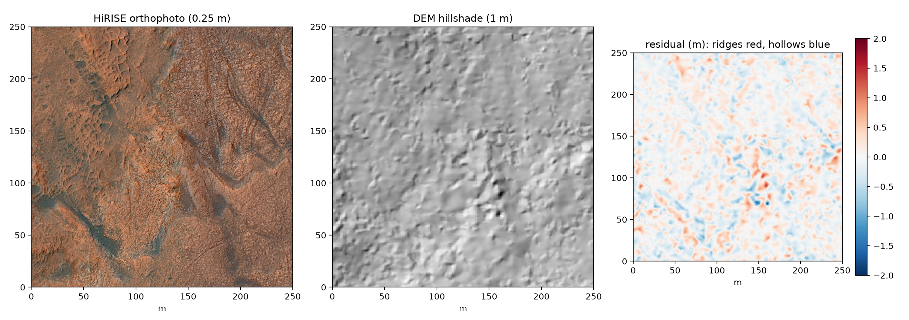
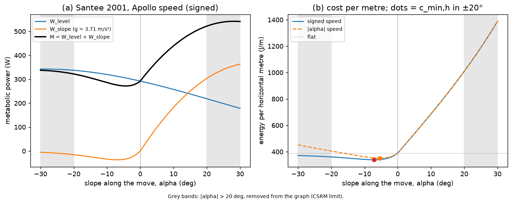
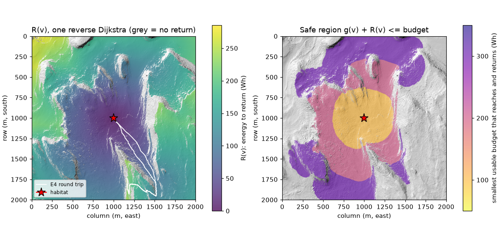
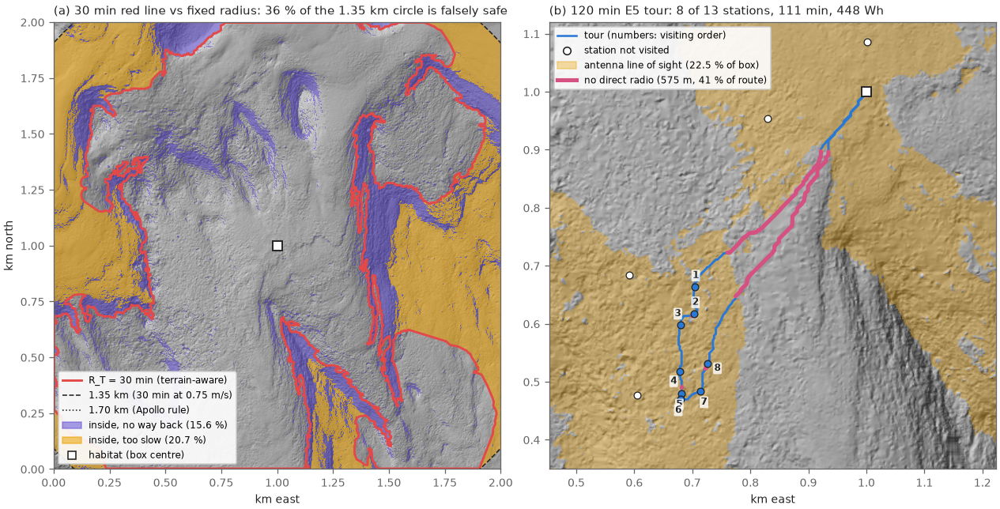
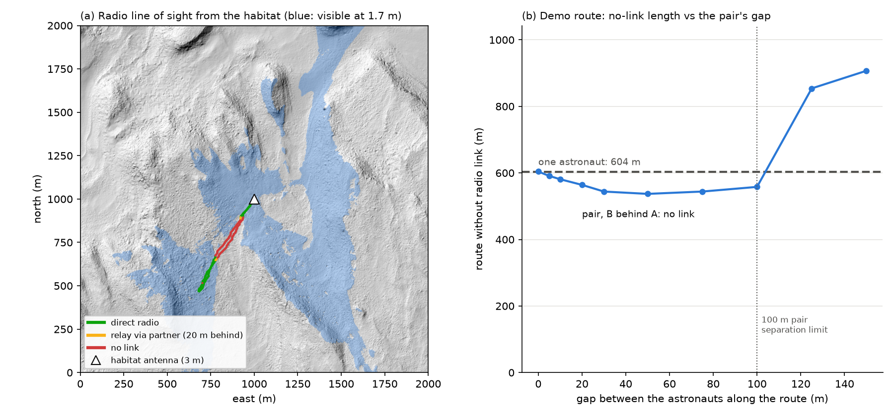
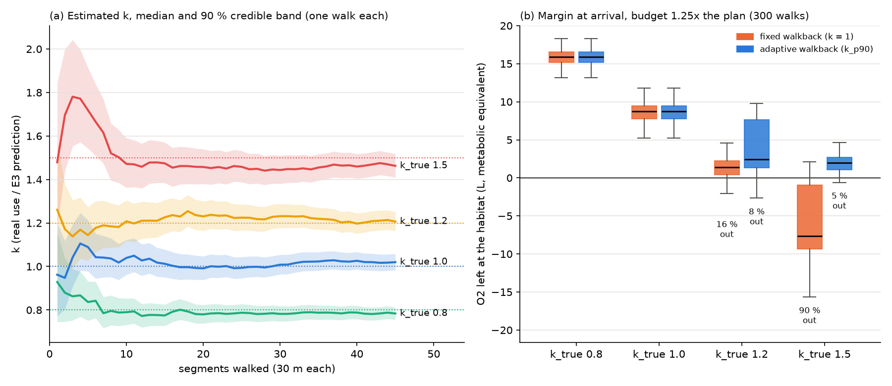

<!-- One-page version of the paper (#127). It is assembled from the notes in paper/notes/
     and the team results registry (results/registry.csv), with the theory written out.
     The per-section files in paper/sections/ are kept unchanged. Every number comes from
     a note, which cites its script and output file. Status: draft, owners to confirm. -->

## Abstract

Astronauts walking on Mars need routes that respect the terrain, the suit's energy and oxygen, the time to get home in an emergency, and the science they came for. We present an EVA planner for a 2 × 2 km box of the boxwork in Gale crater, explored by Curiosity in 2025–2026.

**Cost model.** On a 1 m grid built from the HiRISE-based DEM [@Parker2016], each of the eight moves out of a cell is a directed edge. Its time and metabolic energy come from Santee et al. (2001), with Mars gravity entering only the slope term, at the Apollo walking speed.

**Planner.** An exact planner computes, for every cell, the minimum energy and time to walk back to the habitat. It plans round trips that satisfy the *walkback* invariant (energy used plus energy needed to return never exceeds the budget) at every point. An exact orienteering solver chooses which science stations to visit and in what order.

**Classic rules fail on this terrain.** About a third of what a fixed 1.35 km radius calls safe cannot get back in 30 min. At half the farthest round trip's energy, three simple baselines call 21–46 % of their goals safe when their own route cannot complete them, against 0 % for the planner. Inside the box, time binds before energy.

**What Curiosity's traverse shows.** DEM features explain which valley the rover drove but not the path inside the boxwork. Only sand mapped from the 0.25 m orthophoto earns a small learned price.

**Operational layers.** We add radio line of sight to the habitat, which leaves about 41 % of a 120 min tour without direct radio, and an adaptive walkback. The adaptive walkback learns the astronaut's own consumption with a conjugate Bayesian filter and keeps the reserve at its 90th percentile.

**Software.** It runs offline on a local server, with a planning HUD, an arm-tablet guide and a 3D rehearsal.

Everything is tested in simulation and against a rover's traverse, not with astronauts.

## 1. Introduction

A surface EVA is limited by the suit's consumables and by the walk back to the habitat. On Apollo, return distances were planned with fixed radii and constant consumption rates, and recomputed from the real consumption during the walk. On Mars, a radio signal takes 3–22 min each way [@NASA-MarsFact]. Mission control cannot answer during the EVA, so the plan has to answer on site, at every point: *can the astronaut still get home?*

The boxwork of Gale crater is a network of mineralised ridges a few metres wide enclosing sandy hollows [@Siebach2014]. It was Curiosity's target in 2025–2026 and is a natural target for human exploration. It is also a hard place to walk:
- Scarps and knolls make the cost of moving strongly **direction-dependent**: going up an edge costs more than coming down.
- The features that matter (ridges, sand, boulders) are near or below the resolution of the orbital DEM.

A planner for this terrain must therefore:
- reason on a directed graph;
- carry several resources (energy, time, oxygen) with a hard return guarantee;
- say honestly what the orbital data can and cannot see.

**Contributions.**
1. **Directed metabolic costs** on a 1 m grid under Mars gravity (Section 3.2).
2. **An exact return layer and walkback-safe round trips** with energy, duration and O2 limits (3.3–3.4).
3. **An exact station tour** (orienteering) with time windows (3.5).
4. **A test against Curiosity's traverse**, with a terrain price learned by maximum-entropy inverse reinforcement learning (3.6), and layers mapped from the 0.25 m orthophoto: sand (3.7) and boulders (3.8).
5. **Operational layers:**
   - radiation dose and a solar-storm alert (3.9);
   - radio line of sight (3.10);
   - an adaptive walkback that learns the astronaut's consumption (3.11);
   - the best time to leave (3.12).
6. **Software that runs offline:** an API, a planning HUD, an arm-tablet guide and a 3D rehearsal (3.13).

We report negative results as well as positive ones, and we say what is tested only in simulation.

## 2. Study area and data

The study box is 2 × 2 km of Gale crater, centred on Curiosity's poses in the boxwork campaign and snapped to the DEM pixel grid. Every analysis layer shares one grid, one CRS and one nodata value (Table 1). The data are in Table 2.

**Table 1. The base grid.** Source: `src/gis/paper_figures.py` → `data/base/summary.json`.

| Quantity | Value |
|---|---|
| CRS | Mars equirectangular, sphere R = 3,396,190 m (the DEM's) |
| Box (m) | x 8,142,537.49 – 8,144,537.49 · y −285,463.08 – −283,463.08 |
| Analysis grid | 2000 × 2000 cells of 1 m (orthophotos 8000 × 8000 at 0.25 m) |
| DEM elevation | −3876.1 to −3401.2 m; no gaps |
| Steepest slope per cell | mean 16.2°; 44.0 % > 15°, 12.4 % > 30°, 1.92 % > 45° |
| Curiosity poses inside | 5,247 rover poses, sols 4369–4868 |

**Table 2. Data.**

| Data | Use | Source |
|---|---|---|
| DEM 1 m (HRSC + CTX + HiRISE tied to MOLA) | terrain, costs, viewshed, shadows | [@Parker2016] |
| HiRISE colour and grey orthophotos, 0.25 m (images of 2006–2011) | sand, boulders, display | [@HiRISE-Gale] |
| PLACES localized rover poses | Curiosity's traverse | [@PLACES] |
| BoulderNet weights (Mask R-CNN) | boulder detection | [@Prieur2023] |
| RAD dosimetry, 57,843 observations 2025-01-01 – 2026-11-11 | dose and solar-storm alert | [@RAD-L2] |
| Navcam raw images, sols 4450–4848 | photographs in the 3D map | [@MSL-raw] |
| REMS, THEMIS night IR, CRISM/OMEGA | context only | [@REMS-feed; @THEMIS-night] |

**Effective resolution.** The DEM is posted at 1 m, but it is coarser in practice: it does not resolve the 1–3 m boxwork ridges, which only the orthophoto shows (Figure @fig:detail). This one fact shapes several results below.

{#fig:detail}

## 3. Theory and methods

### 3.1 Grid and terrain features

The DEM is cropped, never resampled, to the box. A 64 m margin lets filters see neighbours at the edges.

Let $z(i,j)$ be the elevation of cell $(i,j)$ and $h = 1$ m the cell size. The following features are computed on the 1 m grid.

**Steepest slope** (Horn's method, `gdaldem`). With $\partial z/\partial x$ and $\partial z/\partial y$ estimated from the 3 × 3 neighbourhood with weights 1–2–1,
$$\theta = \arctan\sqrt{\left(\frac{\partial z}{\partial x}\right)^2 + \left(\frac{\partial z}{\partial y}\right)^2}.$$
It is the slope of the steepest direction. It has no sign and no direction, so it cannot tell uphill from downhill (Section 3.2).

**Residual** (local relief above the trend): $r = z - G_{\sigma} * z$, with a Gaussian of $\sigma = 5$ m.

**Roughness:** the local standard deviation of $r$ in a 7 × 7 m window.

**Topographic position index:** $\mathrm{TPI} = z - \bar z_{15 \times 15}$, the elevation minus the local mean over 15 × 15 m.

**Checks.**
- The grey and colour orthophotos agree (Pearson 0.953).
- Horn's slope matches a NumPy central-difference slope to a median of 0.30°.

### 3.2 Metabolic cost of walking under Mars gravity

**Power.** Metabolic power follows Santee et al. (2001) in the form used by SEXTANT [@Johnson2010]. For total equipped mass $m$ (kg), speed $v$ parallel to the surface (m s⁻¹), slope along the move $\alpha$ and gravity $g$,
$$M = W_\text{level} + W_\text{slope},\qquad W_\text{level} = (3.28\,m + 71.1)\,(0.661\,v\cos\alpha + 0.115),$$
$$W_\text{slope} = \begin{cases} 3.5\,m\,g\,v\sin\alpha & \alpha > 0,\\ 2.4\,m\,g\,v\sin\alpha\cdot 0.3^{|\alpha|/7.65} & \alpha < 0,\\ 0 & \alpha = 0,\end{cases}$$
with $\alpha$ in degrees in the exponent.

Gravity enters only $W_\text{slope}$. The alternative scales the whole Pandolf power by $g/g_\oplus$, the whole-power scaling of the CSRM [@Kim2025]. We reject it because it fails a lunar check: on flat ground it gives 52 W on the Moon, against about 290 W inferred for Apollo 14 [@Carr2003]. Pandolf with the downhill correction is kept for sensitivity only.

**Speed.** Speed follows the Apollo regression $V(\alpha) = 0.75 - 0.01\,\alpha$ m s⁻¹, with $\alpha$ signed so that downhill is faster. We declare this choice because the source is ambiguous. Parameters: $m = 124.2$ kg (astronaut 75 kg plus suit and load 47.8 kg) and $g = 3.71$ m s⁻².

**Directed edges.** Each cell has 8 neighbours. For the move from $u$ to $v$, of horizontal length $d_h \in \{1, \sqrt2\}$ m,
$$\alpha_{uv} = \arctan\frac{z_v - z_u}{d_h},\qquad \Delta t_{uv} = \frac{d_h}{V(\alpha_{uv})\cos\alpha_{uv}},\qquad E_{uv} = M(\alpha_{uv}, V(\alpha_{uv}), g)\,\Delta t_{uv}.$$
Since $\alpha_{vu} = -\alpha_{uv}$ and $M$ is not symmetric in $\alpha$, $E_{uv} \neq E_{vu}$: **the graph is directed.**

The DEM difference along the move is used, and not `slope_deg`. The latter is the steepest slope, with no sign, and it overstates the slope of a move across a hillside.

**Limits.**
- An edge with $|\alpha| > 20°$ is removed. That is the CSRM limit; beyond it the model is extrapolated.
- A cell whose steepest slope exceeds 30° is blocked, with no edge in or out. This team decision stands in for the cross-slope risk that Santee does not model.
- Speed would reach zero at $\alpha = 75°$, so steeper edges are refused outright.

**Oxygen.** Metabolic O₂ is the energy-equivalent volume
$$O_2 = \frac{E}{20.1\ \text{kJ L}^{-1}} + q\,t,$$
where $q$ (L min⁻¹) is an optional time-based use (leak, purge), 0 by default. With $q = 0$ an O₂ limit is a rescaled energy limit.

**Cost per metre.** The cost per horizontal metre is
$$c(\alpha) = \frac{M(\alpha, V(\alpha), g)}{V(\alpha)\cos\alpha}.$$
It is minimal on a gentle descent, not on flat ground (Figure @fig:e3). That minimum, $c_\text{min} = 338.75$ J m⁻¹, is the admissible heuristic for A\* and the floor of the cost colour scale.

**Table 3. E3 against the reference values of the team guide** [@Guide-REV3]. Source: `src/fisica/paper_figures.py` → `data/e3/e3_summary.json`.

| Quantity | E3 | Guide |
|---|---|---|
| Flat power at 0.75 m s⁻¹ (Earth, Moon, Mars) | 292.23 W in all three | 292.23 W |
| Pandolf flat on Earth → whole-power scaling on the Moon | 315.87 → 52.16 W | 315.87 → 52.16 W |
| Toy route 5 km (4.1 km flat + 0.9 km at +10°) | 2215.5 kJ, 615.4 Wh, 110.2 L, 1.91 h | same |
| Minimum cost per horizontal metre, signed speed | 338.75 J m⁻¹ at −7.10° | same |
| Same with speed from \|α\| | 351.00 J m⁻¹ at −5.41° | same |
| Flat cost per horizontal metre | 389.64 J m⁻¹ | same |

**Human cost.** It multiplies E3's energy by a terrain factor learned from Curiosity's route (Section 3.6), taken at the arrival cell:
$$E^{\text{human}}_{uv} = E_{uv}\,\phi(v),\qquad \phi(v) = 1 + \sum_k w_k\, f_k(v) \ge 1.$$
The weights are non-negative, so costs stay positive. Time is unchanged.

{#fig:e3}

**Sensitivity.** Table 4 varies one parameter at a time from the nominal model, on the route from the box centre to Curiosity's drilled ridge Nevado Sajama.
- Mass scales energy almost proportionally and leaves the route unchanged.
- The metabolic model is the largest energy uncertainty.
- The 30 min zone depends only on the speed convention and the cell block, because E3's speed has no mass, gravity or model term.

**Table 4. Sensitivity of E3.** Source: `src/fisica/sensitivity.py` → `data/e3/e3_sensitivity.json`.

| Scenario | Median return energy $R_E$ | Cells that can return | Box within 30 min | Route energy / time | Route within 5 m of nominal |
|---|---|---|---|---|---|
| nominal | 135.0 Wh | 84.4 % | 63.4 % | 93.4 Wh / 15.7 min | 100 % |
| mass 100 kg | 112.3 Wh | 84.4 % | 63.4 % | 77.3 Wh / 15.7 min | 100 % |
| mass 150 kg | 159.3 Wh | 84.4 % | 63.4 % | 110.5 Wh / 15.7 min | 100 % |
| speed from \|α\| | 138.4 Wh | 84.4 % | 53.1 % | 93.5 Wh / 15.9 min | 100 % |
| gravity Moon 1.62 | 125.6 Wh | 84.4 % | 63.4 % | 81.8 Wh / 15.7 min | 82 % |
| gravity Earth 9.81 | 145.1 Wh | 84.4 % | 63.4 % | 127.0 Wh / 15.8 min | 100 % |
| Pandolf + CF | 205.2 Wh | 84.4 % | 63.4 % | 139.9 Wh / 15.8 min | 89 % |
| Pandolf + CF × g/g⊕ | 77.6 Wh | 84.4 % | 63.4 % | 52.9 Wh / 15.8 min | 89 % |
| cell block 20° | 95.3 Wh | 42.9 % | 35.9 % | 94.8 Wh / 16.0 min | 39 % |
| no cell block | 107.5 Wh | 99.1 % | 92.4 % | 93.3 Wh / 15.7 min | 100 % |

### 3.3 Directed graph, return layer and the walkback invariant

**Graph.** Every walkable cell is a node. Every finite edge cost of Section 3.2 is a directed arc. The graph has 4,000,000 nodes and 25,296,494 arcs, 79.1 % of the 8 per node; 12.5 % of the cells are blocked. For a weight $w \in \{E, t\}$ let $d_w(u, v)$ be the shortest directed path weight from $u$ to $v$.

**Return layer.** For the habitat $h$:
$$R_E(v) = d_E(v, h),\qquad R_T(v) = d_t(v, h),\qquad g_E(v) = d_E(h, v).$$
All $R(v)$ come from **one** Dijkstra run from $h$ on the *reversed* graph, in which arc $v \to u$ carries the cost of the original arc $u \to v$. That gives $O(|A| + |V|\log|V|)$ for the whole box. $g$ is the forward run from $h$.

The return is asymmetric. Across the box, $R_E(v)/g_E(v)$ has percentiles 5/50/95 of 0.531/0.877/1.674, so a symmetric radius is wrong in both directions. The largest strongly connected component holds 96.4 % of the walkable cells. A habitat or station outside it, or on a blocked cell, is moved to the nearest valid cell, and the move is reported.

**Safe region.** The set of goals that can be reached and left again within a usable budget $B$ is
$$\mathcal S_E(B) = \{\, v : g_E(v) + R_E(v) \le B \,\}.$$
The same holds for time. With several resources at once this is a necessary condition, and the round trip of Section 3.4 is the exact test for one goal.

**Contingency line.** The emergency-oxygen contingency is a 30 min secondary pack [@NASA-EMU]. The *red line* is the level set $R_T(v) = 1800$ s: the boundary of the cells from which the astronaut can still walk home in 30 min. On the walk, the energy-safe boundary from the current position $p$ with energy left $E_\text{rem}$ is the level set
$$d_E(p, v) + R_E(v) = E_\text{rem}.$$

**Walkback invariant.** A route $P = (v_0, \dots, v_n)$ from the habitat satisfies the walkback rule for budget $B$ if
$$\text{used}(v_i) + R(v_i) \le B \qquad \forall i,$$
where $\text{used}(v_i)$ is the energy spent up to $v_i$, service included.

*Proposition.* A **closed** round trip with total cost $C(P) \le B$ satisfies the invariant.

*Proof.* The rest of the planned loop from $v_i$ is one way home, so $R(v_i) \le C(P) - \text{used}(v_i)$, and therefore $\text{used}(v_i) + R(v_i) \le C(P) \le B$. ∎

The per-point check matters for routes that are **not** planned as closed loops: an E5 tour changed on the way, the baselines, a rejoin. It is applied to every tour before it is returned.

{#fig:rv}

### 3.4 Round trips under energy, time and oxygen limits

A round trip $h \to G \to h$ must fit an energy budget $B_E$, a duration $B_T$ and an O₂ budget $B_{O}$ at once. It must also keep the walkback invariant, and it minimises one objective (energy, time or O₂). This is a resource-constrained shortest path problem (RCSP), NP-hard in general [@Irnich2005]. We solve it in three exact or bounded steps.

1. **Single objective.** Two Dijkstra runs, $h \to G$ and $G \to h$, for the objective alone. If the result fits every limit, it is optimal.

2. **Lagrangian sweep.** Otherwise we minimise the scalarised weight
   $$w_\theta = \cos\theta\,\frac{E}{E_0} + \sin\theta\,\frac{t}{t_0},\qquad \theta \in [0, \pi/2],$$
   whose minimisers are the *supported* Pareto routes. The feasible/infeasible boundary in θ is refined by bisection, and the best feasible route is kept.

3. **Label setting.** Each label at node $v$ and phase $\phi \in \{\text{out}, \text{back}\}$ carries $(E, t)$.
   - **Dominance:** $(E_a, t_a) \preceq (E_b, t_b)$ iff $E_a \le E_b$ and $t_a \le t_b$.
   - **Order:** labels are expanded best-first by objective plus an exact lower bound.
   - **Pruning:** by the walkback bounds, $E + R_E(v) > B_E$ or $t + R_T(v) > B_T$, and by the Lagrangian incumbent.
   - **Cap:** beyond 50,000 labels the Lagrangian route is returned with `exact = false` and a bound on the gap.

   Plain label setting without the Lagrangian bound did not finish in 10 min when time bound, because energy and time are almost tied along most routes and the Pareto sets grow without limit.

Service at a station is charged at 205 W, the top of the "low" metabolic band [@NASA-xEMU-met]. O₂ follows Section 3.2.

**Baselines.** Three simple rules are compared with the exact planner on the same graph:

| Method | Route | Called safe if |
|---|---|---|
| B1 A\*-slope | shortest distance (A\*, octile heuristic) under the slope limits; back along the same path | $2\,L\,c_\text{flat} \le B$, with $c_\text{flat} = 389.6$ J m⁻¹ |
| B2 fixed radius | same as B1 | straight-line distance $\le r = B / (2\,c_\text{flat})$ |
| B3 linear O₂ | shortest E3 time out and back | $293\ \text{W} \times t \le B$ (constant ISS EMU rate [@NASA-Mars-mass]) |
| Exact planner | minimum E3 energy out and back | $g_E(G) + R_E(G) \le B$ |

The ground truth for every route is its E3 energy. A **false safe** is a goal that a method calls safe while its own route needs more than the budget.
- Budgets are fractions (25/50/75 %) of each habitat's costliest exact round trip, because the habitat is a user input.
- Habitats are the box centre plus 20 random ones.
- Goals are the 13 manual stations plus 2,000 random cells.

### 3.5 Station selection: an orienteering problem with time windows

**Problem.** Stations $i = 1..n$ have prizes $p_i$ (points from a rubric), service times $s_i$ and optional time windows $[a_i, b_i]$. From the habitat (node 0), the astronaut visits a subset $S$ in an order $\pi$ that maximises
$$\max_{S,\pi}\ \sum_{i \in S} p_i \quad \text{s.t.}\quad \sum_{k} c_{\pi_k \pi_{k+1}} + P_s \sum_{i \in S} s_i \le B_E,\quad T(\pi) \le B_T,\quad a_i \le \tau_i \le b_i,$$
plus the walkback invariant along the walked cells. This is the orienteering problem with time windows [@Vansteenwegen2011; @Gunawan2016]. $c_{ij}$ is the directed minimum-energy cost between stations: one Dijkstra per station, cached. $P_s = 205$ W is the service power, and $\tau_i$ is the start of service at $i$.

The walking time of a leg is measured **along its minimum-energy path**, so the solver's times match the route that is actually walked. The leg ratio $c_{ij}/c_{ji}$ has percentiles 5/50/95 of 0.625/1.0/1.599: the order of a tour matters.

**Exact dynamic programme** [@HeldKarp1962]. Let $D[S][j]$ be the least energy that visits and serves the set $S$ and ends at $j \in S$:
$$D[\{j\}][j] = c_{0j} + P_s s_j,\qquad D[S \cup \{j\}][j] = \min_{i \in S} \big( D[S][i] + c_{ij} + P_s s_j \big).$$
A set is **closable** if $\min_j D[S][j] + c_{j0} \le B_E$. The solution is the closable set with the most points, with ties broken by less energy. The cost is $O(2^n n^2)$, used up to 20 nodes.

**Pareto labels.** With time windows or a duration limit, one value per state is not enough. Each state keeps the Pareto set of (energy, departure time) labels [@Irnich2005]. Arriving early means waiting. With waiting power $w$, label A dominates B when
$$t_A \le t_B \quad\text{and}\quad e_A + w\,(t_B - t_A) \le e_B,$$
that is, A could wait until B's time and still spend no more.

**Beyond 20 nodes: CP-SAT** [@ORTools]. A Boolean per arc and per station, `AddCircuit` with a self-loop for every skippable station, the energy budget as one linear constraint, and a start-of-service variable per station that each chosen arc pushes forward. It is counted only when it proves the optimum.

**Walkback repair.** After solving, the tour's full cell path is checked with the walkback invariant. If it fails, two repairs are tried, at most 5 extra solves: lower the budget by the deficit, or forbid the station of the first violation.

**Diagnosis.** When no tour exists, the solver returns *why*: which resource is short, by how much and for the closest station, and the budget that would fit. That budget is rounded **up**, so the printed minimum always fits.

**Station values.** A rubric reviewed against the literature: ridge 5, hollow 4, sand–rock contact 4, Curiosity site 3. Its sensitivity is tested with seven fixed rubrics and 500 random ones that keep the order. The metrics are Jaccard similarity of the visited sets and Kendall τ of the order.

**Solver benchmark (E6).** Four metaheuristics are compared with the exact solvers, on 60 random instances (N = 10–18, with and without windows), the 49 Tsiligirides instances [@Tsiligirides1984] and the 4 real E5 instances:
- iterated local search [@Vansteenwegen2009];
- simulated annealing [@Kirkpatrick1983];
- ant colony system [@Dorigo1997; @Montemanni2009];
- a genetic algorithm [@Tasgetiren2000].

The gap is (optimum − points) / optimum.

### 3.6 Learning the terrain price from Curiosity's route

**Traverse on the grid (E2).** PLACES poses (median 0.92 m apart) are joined by segments sampled every 0.25 m. That gives an 8-connected sequence of 4,687 cell steps over 4,477 visited cells.

**Terrain-only baseline.** A logistic regression on standardised features compares visited cells with unvisited cells 2–50 m from the route:
- slope;
- roughness;
- TPI;
- mean slope in 5 and 15 m windows.

Cells closer than 2 m are excluded, because the rover is 3 m wide. Skill is the area under the ROC curve, cross-validated over 5 route blocks.

**Maximum-entropy inverse reinforcement learning (E1)** [@Ziebart2008].

*Route probability and cost.* Between a start and a goal, a route $\zeta$ has probability
$$P(\zeta \mid w) = \frac{e^{-C_w(\zeta)}}{Z(w)},\qquad C_w(\zeta) = \sum_{(u,v) \in \zeta} d_{uv}\,\frac{c_w(u) + c_w(v)}{2},\qquad c_w(x) = w^\top f(x),$$
with non-negative weights $w \ge 0$ on non-negative features $f$. The features are:
- a constant "metre";
- slope;
- roughness;
- mean slope at 5 and 15 m;
- TPI split into ridge $\max(\mathrm{TPI}, 0)$ and hollow $\max(-\mathrm{TPI}, 0)$.

Each is scaled by its 99th percentile.

*Soft value iteration.* The partition function is computed by
$$V(\text{goal}) = 0,\qquad V(u) = -\log \sum_{k} e^{-(\text{cost}(u \to v_k) + V(v_k))},$$
a soft minimum of the cost to the goal. Its hard version (min instead of log-sum-exp) is exactly the return layer $R$ of Section 3.3. The policy is $\pi_k(u) = e^{-(\text{cost}(u \to v_k) + V(v_k)) + V(u)}$. A forward pass pushes unit mass from the start with $\pi$, which gives the expected feature counts $\mathbb E_w[f]$.

*Likelihood and gradient.*
$$\mathrm{NLL}(w) = C_w(\zeta) - V_w(\text{start}),\qquad \nabla_w \mathrm{NLL} = f(\zeta) - \mathbb E_w[f].$$
If the model's routes cross more of a feature than the real one, that feature's price rises. The NLL is convex in $w$. We minimise the mean NLL per metre with L-BFGS-B [@SciPy] on the GPU [@PyTorch].

*Price floor.* With 8 neighbours the number of walks grows exponentially with length, so cheap moves make $Z$ diverge. For a uniform price $c$ per cell length the per-step branching sum is $4e^{-c} + 4e^{-\sqrt2 c}$, which is $\ge 1$ when $c \le 1.78$. We therefore keep $w_\text{metre} \ge 2.0$; no fit ended on this floor.

*Control and hand-off.* The control is distance only: all terrain prices at 0, only the metre fitted. It already knows each drive's start and goal. A terrain model counts only if it beats the control on held-out route blocks. If one does, its prices become the factor $\phi(v)$ of Section 3.2.

### 3.7 Boxwork sand from the orthophoto

No pixel-level map of the Gale boxwork exists [@Siebach2014], so labels were generated by rules on the 0.25 m colour orthophoto (*weak labels*). The spatial split was fixed before any tuning: validation is the southern half of the SW quadrant (SW-S), training is the rest. All rule thresholds are percentiles of the training area. Rule versions 1 and 2 were dropped (negative results: they marked loose clasts and layer edges as ridges). Version 3:
- **sand** is grey-blue and darker than the median;
- **ridge** is a watershed divide of the smoothed luminance that agrees with a Sato ridge response [@Sato1998], kept only where a regional boxwork score is high.

A U-Net with an EfficientNet-B0 encoder [@Ronneberger2015; @Tan2019] is trained on 256 × 256 px patches. The loss is class-weighted cross-entropy plus Dice:
$$\mathcal L = -\sum_x \omega_{y_x} \log \hat p_{y_x}(x) \;+\; \Big(1 - \frac{2\sum \hat p\, y}{\sum \hat p + \sum y}\Big),$$
with weights 1 : 10 : 6.16 for background : ridge : sand. `sand.tif` is the fraction of the 16 sub-cells of each 1 m cell predicted as sand.

**Blind point validation with area-weighted estimators** [@Olofsson2014]. 240 points are drawn, 80 per *predicted* class $h$, and labelled blind on the orthophoto. With $W_h$ the map share of class $h$ and $n_{hj}$ the count of points mapped $h$ and labelled $j$, the estimated area proportions are
$$\hat p_{hj} = W_h\,\frac{n_{hj}}{n_{h\cdot}},$$
the user's accuracy (precision) of class $j$ is $\hat U_j = \hat p_{jj}/\hat p_{j\cdot}$, and the producer's accuracy (recall) is $\hat P_j = \hat p_{jj}/\hat p_{\cdot j}$.

**Usefulness on the route.** $\text{AUC}_\text{avoid} = \Pr(x_\text{driven} < x_\text{alternative})$ for a layer $x$, over driven cells and alternatives 2–50 m away. A value of 0.5 means no information.

### 3.8 Boulders: detection, distillation and uncertainty

**Teacher.** BoulderNet, a Mask R-CNN [@He2017; @Wu2019] with the authors' weights [@Prieur2023], runs over the grey orthophoto in 500 px windows every 250 px. Each detection belongs to the window whose central block contains its box centre, so no boulder is counted twice. Each mask becomes a polygon with equivalent diameter $2\sqrt{A/\pi}$.

**Distillation** [@Hinton2015]. Each pixel's target $y \in [0,1]$ is the score of the teacher mask that covers it. A 3-level U-Net student with 0.93 M parameters minimises binary cross-entropy on soft targets,
$$\mathcal L = -\big[y \log \sigma(s) + (1-y)\log(1-\sigma(s))\big],$$
whose minimiser is $\sigma(s) = \mathbb E[y \mid x]$. The student therefore learns the teacher's *expected* cover, and its mean cover stays calibrated; a positive class weight would inflate it. `rocas.tif` is the mean probability over each 4 × 4 px block, the fraction of each 1 m cell covered by boulders.

**Uncertainty (X1).** The teacher's cover is averaged over 20 m blocks. It is very skewed (65.5 % of the blocks are empty), so a Gaussian process models $z = \sqrt{\text{cover}\,\%}$. The kernel is
$$k(r) = C\Big(1 + \frac{\sqrt3\,r}{\ell}\Big)\exp\Big(-\frac{\sqrt3\,r}{\ell}\Big) + \sigma_n^2\,\delta(r),$$
a Matérn ν = 3/2 kernel plus white noise. With the predictive mean $\mu$ and standard deviation $\sigma$ of $z$, the back-transform is exact:
$$\mathbb E[z^2] = \mu^2 + \sigma^2,\qquad \mathrm{Var}[z^2] = 4\mu^2\sigma^2 + 2\sigma^4.$$
It is validated by spatial cross-validation (400 m tiles and random blocks) against the training mean and a Gaussian smoothing.

**Risk term.** An optional factor $1 + k\,(\text{mean} + \lambda\,\text{std})$ multiplies the arc energy at the arrival cell, with $\lambda = 1.645$ for one-sided 95 % caution. It stays off ($k = \lambda = 0$) because no price was validated.

### 3.9 Radiation dose and the solar-storm alert

**Background rate.** The background absorbed-dose rate $\dot D_0$ is the median of the good-quality RAD tissue-equivalent observations (detector E) over the boxwork sols [@RAD-L2]. Detector E is not corrected for the rover's MMRTG, so it is an upper estimate.

**Dose along a route.** The route carries the E3 clock $t(s)$ of the walk, station service included. The absorbed and (estimated) equivalent doses are
$$D = \int_{t_0}^{t_1} \dot D(t)\,dt,\qquad H \approx Q\,D,\quad Q = 3.05,$$
where $Q$ is the mean galactic-cosmic-ray quality factor measured at the surface [@Hassler2014]. $\dot D(t)$ is either the constant background or the real RAD series, which is piecewise linear and integrated exactly.

At the background rate, the dose is proportional to the **time outside**, not to the distance.

**Alert rule.** Let $\tilde D(t)$ be the median of the past 3 days of observations. A solar particle event (SEP) alarm fires at the second of 2 consecutive observations with
$$\dot D(t_j) > 1.5\,\tilde D(t_j),$$
and the event ends after 2 observations below 1.2 $\tilde D$. On an alarm the astronaut takes the fastest way home, of time $R_T$, and the dose saved is the dose of the rest of the plan minus that of the return.

### 3.10 Radio line of sight to the habitat

**Viewshed.** The antenna is $h_A = 3$ m above the habitat cell; a suit radio is $h_B = 1.7$ m above a cell. On a sphere of radius $R$, two points a horizontal distance $D$ apart see each other if the terrain between them, raised by the curvature bulge, stays below the straight line:
$$z(s) + \kappa\,\frac{s\,(D - s)}{2R} \;<\; (z_A + h_A) + \frac{s}{D}\big[(z_B + h_B) - (z_A + h_A)\big]\qquad \forall s \in (0, D).$$
The curvature coefficient is $\kappa = 1$, with no refraction, since Mars' atmosphere is too thin to bend the path noticeably. This bulge form is equivalent, to first order, to lowering the target by $D^2/2R$ as GDAL's viewshed does.

**Checks.**
- On a flat DEM the line-of-sight horizon is $d = \sqrt{2Rh_A} + \sqrt{2Rh_B}$. For both ends at 0.1 m that gives 1,648.3 m on Mars (2,258.9 m with Earth's radius), and GDAL's last visible cell is at 1,648 m: it uses the Mars radius from the CRS.
- On 5,000 random cells the viewshed agrees with an exact bilinear profile on 99.6 %.

**Along a route and for a pair.** Each route vertex has direct radio or not. A step counts as without radio if either end lacks it.

For a pair, astronaut B walks a fixed gap behind A on the same route. The pair is **linked** if
$$\big(\text{A sees } h \wedge \text{B sees } h\big) \;\vee\; \big(\text{A sees } h \oplus \text{B sees } h\big) \wedge \text{A sees B} \wedge \|A - B\| \le 100\ \text{m},$$
that is, one relays for the other. With one route and a gap of at most 100 m, the separation limit never binds, since the straight-line distance is at most the gap.

The model is pure line of sight. It ignores diffraction and the link budget, and it misses the ridges and boulders the DEM does not resolve.

### 3.11 Adaptive walkback: learning the astronaut's own consumption

E3 predicts consumption; the astronaut may spend more or less. Real use is modelled as
$$E^\text{real} = k\,E^\text{E3},$$
with **one factor $k$ per EVA** (fitness, suit, load, terrain the model misses).

**Conjugate filter.** Let $\ell = \log k$ with prior $\ell \sim \mathcal N(\mu_0, \sigma_0^2)$, where $\mu_0 = 0$ and $\sigma_0 = 0.3$. Every 30 m walked gives one observation
$$y_j = \log\frac{E^\text{real}_j}{E^\text{E3}_j} = \ell + \varepsilon_j,\qquad \varepsilon_j \sim \mathcal N(0, \sigma^2),\ \sigma = 0.15.$$
Normal prior and normal likelihood are conjugate, so precisions add. After $n$ observations,
$$\frac{1}{\sigma_n^2} = \frac{1}{\sigma_0^2} + \frac{n}{\sigma^2},\qquad \mu_n = \sigma_n^2\Big(\frac{\mu_0}{\sigma_0^2} + \frac{1}{\sigma^2}\sum_{j=1}^n y_j\Big).$$
$k$ is log-normal, so its quantiles are $k_q = e^{\mu_n + z_q \sigma_n}$. Its median is $e^{\mu_n}$, its mean $e^{\mu_n + \sigma_n^2/2}$, and the central 90 % interval is $[k_{0.05}, k_{0.95}]$. Because O₂ is energy divided by 20.1 kJ L⁻¹, the same $k$ applies to O₂.

**The reserve scales exactly.** A uniform $k$ multiplies every arc's energy by the same factor. So $d^{(k)}_E(v, h) = k\,d_E(v, h)$, and the cheapest way home is the same path. The return reserve at factor $k$ is exactly $k\,R_E(v)$: no new Dijkstra is needed.

The 30 min line does not move, because $k$ is metabolic and does not change speed.

**Decision rule.** The reserve uses a high quantile, $k_{0.9}$, not the mean. Before walking the next segment of predicted energy $\Delta E$ to the next point $v'$, the rule checks
$$\text{used}^\text{real} + k_{0.9}\,\big(\Delta E + R_E(v')\big) \le B .$$
If it fails, the alert says *return now*. Looking one segment ahead matters: a station's service is charged in one step.

**Simulation (X2).** On the E4 round trip from the box centre to station R0 (1,331 m, 40.0 min, 199.75 Wh predicted):
- an astronaut with a known $k_\text{true} \in \{0.8, 1.0, 1.2, 1.5\}$ walks in 30 m segments, with log-normal noise $\sigma = 0.15$ per segment, the walk home included;
- the budget is set to 1.25 × the plan, because the real suit budget never binds in this box;
- there are 300 walks per case;
- a **fixed** walkback ($k = 1$) is compared with the **adaptive** one ($k_{0.9}$) on the same walks.

**Paired evaluation (C1).** A separate study on one E5 tour, with its own budget and a 40 Wh reserve:
- three policies: nominal ($k = 1$), conservative (the prior's $k_{0.9}$) and adaptive;
- the same pre-generated random world per EVA for all three;
- AR(1) noise with correlation $\rho \in \{0, 0.7\}$, which tests the filter's independence assumption.

Wilson intervals are used for rates and paired bootstrap intervals for differences.

### 3.12 Light: the best time to leave

The Sun's elevation $e_\odot(t)$ and azimuth $A_\odot(t)$ follow the Mars24 algorithm [@Allison2000]. From every route vertex $k$, at 1.7 m, the terrain horizon in direction $\beta$ is
$$H_k(\beta) = \max_{0 < d \le 400\,\text{m}} \arctan\frac{z(\mathbf x_k + d\,\mathbf u_\beta) - (z_k + 1.7)}{d},$$
sampled every 2 m in 72 directions.

For a departure time $t_0$, vertex $k$ is reached at $t_0 + t_k$ (the plan's own clock) and classified as:
- **dark** if $e_\odot < 0$;
- **shadowed** if $0 \le e_\odot < H_k(A_\odot)$;
- **sunlit** otherwise.

The sunlit share weighs each vertex by the time until the next one,
$$\text{share}(t_0) = \frac{\sum_k (t_{k+1} - t_k)\,\mathbb 1[\text{sunlit}_k]}{\sum_k (t_{k+1} - t_k)},$$
so a stop counts its service time. The best departure maximises the share; ties go to the highest lowest Sun.

The same windows of light become station time windows in the orienteering problem (Section 3.5).

### 3.13 Software

**API and HUD.** A FastAPI service plans live and returns GeoJSON in the DEM's CRS:
- `/plan` returns the E5 tour or the E4 round trip;
- `/walkback` returns the red line and the energy-safe boundary;
- `/walkback/update` runs the adaptive filter;
- `/comms/check` returns the radio along a route.

An infeasible request returns an error and a diagnosis, never an invented route. Parameters the engine does not use are rejected rather than ignored, and each plan reports the parameters it used. The planning HUD shows the layers and the plan.

**Guide.** One module drives two views of the same walk: the arm-tablet guide and the 3D rehearsal. It gives voice maneuvers, meters, radio warnings and the adaptive alert. It also handles the way home and the rejoin. Both are checked against what the astronaut has left, with energy, time and O₂ on the same path; a slower way home is taken if the fastest does not fit, and the fastest path is never presented as safe. At the end of the walk it gives a "plan against the walk" summary.

**3D map.** The 3D map exaggerates only the local relief and can be rehearsed at eye height under the Sun of the EVA's sol. 383 Navcam photographs are placed at their measured camera poses [@MSL-raw; @VICAR-CAHVOR].

Everything runs on the local server with data on board. No page loads a script from the internet.

## 4. Results

The habitat is at the box centre unless stated. Every figure here is in the team registry (`results/registry.csv`), with its script, output file and checksum.

### 4.1 The return layer and the safe area

From the box centre:
- **Return energy:** $R_E$ has a median of 135.0 Wh, a 99th percentile of 259.7 Wh and a maximum of 285.5 Wh.
- **Cells that cannot return:** 15.6 %, because they are blocked or outside the main component.
- **Farthest round trip:** to the most expensive returnable cell it needs 562.8 Wh, 91.1 min, 100.8 L of metabolic O₂ and 3,930 m.

A 7 h suit budget (7 h × 293 W ≈ 2,050 Wh) is far from binding: **the box, not the suit, limits the EVA.** Table 5 shows how the safe area grows with the usable budget.

**Table 5. Share of the grid that is reachable and returnable against the usable energy.** Source: `src/grafos/paper_figures.py` → `data/e4/summary.json`.

| Usable energy (Wh) | 100 | 200 | 300 | 400 | 500 | ≥ 600 |
|---|---|---|---|---|---|---|
| Reachable and returnable (%) | 10.7 | 26.9 | 49.8 | 71.7 | 83.5 | 84.4 |

When time binds, the Lagrangian step finds the route. Near the farthest cell, the minimum-time route takes 90.93 min and 564.89 Wh and the minimum-energy route 91.1 min and 562.8 Wh. With the time limit halfway between them (91.03 min), the planner returns 563.31 Wh in 91.01 min. The exact search hit its label cap, and the gap bound is 0.5 Wh (0.09 %).

### 4.2 Simple rules call unsafe goals safe

**Table 6. False safes: share of the goals each method calls safe that its own route cannot complete under E3.** 42,273 evaluations per method and level. Source: `src/grafos/evaluate_baselines.py` → `data/baselines/baselines_summary.json`.

| Budget (of the farthest loop) | B1 A\*-slope | B2 fixed radius | B3 linear O₂ | Exact planner |
|---|---|---|---|---|
| 25 % | 34.0 % | 56.9 % | 25.6 % | 0 % |
| 50 % | 27.7 % | 45.7 % | 21.4 % | 0 % |
| 75 % | 15.8 % | 16.3 % | 12.5 % | 0 % |

The baselines are not too conservative: they **underestimate** E3. To avoid every false safe they would need safety factors (99th percentile of real over estimated energy) of 1.42 for B1, 4.05 for the fixed radius and 1.32 for linear O₂.

With the human cost as terrain truth, and with E8's contacts as extra goals, every baseline gets about 1 point worse (50 %: 28.5, 45.5 and 22.4 %) and the planner stays at 0 %. **Slope, not sand, drives the failures.**

**The 30 min line against a fixed radius.** 36 % of the cells inside the classic 1.35 km circle cannot get back in 30 min (Figure @fig:redline):
- 15.6 % have no way back at all, blocked or cut off by scarps;
- 20.7 % are too slow.

The red line follows the terrain, not a circle.

{#fig:redline}

### 4.3 Station tours: time binds, service dominates

**Table 7. E5 tours from the box centre** (1000 Wh, 10 % margin, so 900 Wh usable; service 10 min at 205 W per manual station). Sources: `src/orienteering/paper_figures.py` → `data/e5/summary.json`; `paper_ortools.py` → `summary_ortools.json`.

| Tour | Solver | Stations | Points | Energy | Duration | Walkback minimum slack |
|---|---|---|---|---|---|---|
| Nominal, 13 manual stations | DP | 13 | 56 of 56 | 723.6 Wh | 180.9 min | 176.4 Wh |
| 120 min limit | DP | 8 | 37 | 445.1 Wh | 111.4 min | — |
| Nominal, + 13 E8 contacts | CP-SAT, proven | 15 | 60.47 of 79.26 | 872.0 Wh | 222.9 min | 28.0 Wh |
| 120 min limit, + E8 | CP-SAT, proven | 8 | 37 | 445.1 Wh | 111.4 min | — |

- **Service dominates.** It is 61 % of the energy and 72 % of the time of the nominal tour. Counting service, the planner needs 750 Wh to visit all 13 stations; walking alone would need 300 Wh.
- **Time binds**, except with the E8 contacts, where energy binds (872.0 of 900 Wh).
- **The rubric.** The station choice stops depending on the rubric once the time budget reaches 1.0 × the nominal duration. Below that, the reference rubric's own ties are as large an effect as changing the rubric.
- **The human cost** raises leg energies by at most 3.5 % and leaves the chosen stations unchanged.

**The guarantee and the diagnosis.** We planned 16 tours over energy budgets of 100–1000 Wh, with and without duration limits. Every tour found passes the walkback at every vertex and is a proven optimum.
- **The smallest return margin** equals the energy left on arriving home: 3.6 Wh at the tightest budget and 176.4 Wh for the nominal tour.
- **At 40 Wh no tour exists, and the planner says why:** energy is short. Station C1 alone needs 56.4 Wh against 36.0 Wh usable.
- **The advised budget is at least 62.8 Wh:** 56.448 / 0.9 = 62.72 Wh, rounded up so the printed minimum always fits. Planning again at 62.78 Wh gives the tour to C1 with 0.06 Wh to spare.

**Light changes which stations are visited, not only when to leave** (stations served only in sunlight, sol 4711; Table 8). Ignoring the light, the plan would claim 56 points at every departure. At 06:00 the 120 min tour keeps its 37 points with a different set of stations (Jaccard 0.78 against the set chosen without light).

**Table 8. Points of the E5 tours against the departure time when stations need light** (local true solar time, waiting at 0 W). Source: `src/orienteering/paper_light_windows.py` → `data/e5/light_windows.json`.

| Tour | Ignoring the light | Full points for departures | Best departure | At 15:00 | At 16:00 | At 17:00 |
|---|---|---|---|---|---|---|
| Nominal | 56 | 05:00–14:45 | 10:30 | 53 | 37 | 10 |
| 120 min limit | 37 | 06:00–16:00 | 11:00 | 37 | 37 | 10 |

From 17:45 no station can be served on the nominal tour.

### 4.4 Exact solvers are fast enough

**Table 9. Exact solvers against four metaheuristics** (E6). Optimum reached, mean gap and median time. Source: `src/orienteering/e6_benchmark.py` → `data/e6/e6_results.json`.

| Instances | Exact | ILS | SA | ACO | GA |
|---|---|---|---|---|---|
| Random, energy (30) | 100 % · 0 · 0.051 s | 76.7 % · 1.40 % · 0.065 s | 93.3 % · 0.28 % · 0.21 s | 84.4 % · 0.83 % · 0.049 s | 97.8 % · 0.15 % · 0.096 s |
| Random, windows (30) | 100 % · 0 · 0.046 s | 76.7 % · 4.77 % · 0.10 s | 93.3 % · 0.46 % · 0.45 s | 82.2 % · 0.92 % · 0.10 s | 96.7 % · 0.16 % · 0.17 s |
| Tsiligirides (49) | 100 % · 0 · 0.32 s | 73.5 % · 1.17 % · 0.59 s | 62.6 % · 1.63 % · 0.35 s | 90.5 % · 0.31 % · 0.20 s | 96.6 % · 0.12 % · 0.62 s |
| Real E5 (4) | 100 % · 0 · 0.24 s | 100 % | 100 % | 100 % | 100 % |

- **The exact solvers are always right**, and their median time is within 0.12 s of the fastest metaheuristic.
- **ILS** misses the optimum in about a quarter of the instances, with gaps up to 37.5 % with time windows.
- **GA** is the best metaheuristic.
- **At E5's sizes (≤ 27 nodes)** the exact answer is the right choice.

### 4.5 What Curiosity's traverse says about terrain

**Table 10. Terrain-only logistic baseline: visited against unvisited cells** (AUC, mean over route blocks). Source: `src/ml/logistic_baseline.py` → `data/e2/logistic_baseline.json`.

| Unvisited cells compared | All features | Slope only |
|---|---|---|
| ≤ 25 m from the route | 0.512 | 0.490 |
| ≤ 50 m (main) | 0.526 (blocks 0.473–0.612) | 0.458 |
| ≤ 100 m | 0.561 | 0.537 |
| Whole box | 0.730 | 0.663 |

Terrain explains the **choice of valley** (whole box) but not the **path inside it**. In the three mostly boxwork blocks the AUC is 0.47–0.50, at chance. In the 50 m corridor, visited and unvisited cells have nearly identical slopes (median 8.9° against 8.8°).

**The learned price** (Table 11). At every scale the DEM features get a price of zero or near zero (at most 4 % of the price of a metre), and none beats distance alone on held-out drives. On synthetic terrain the same code recovers hidden prices: 2.514 ± 0.169 for a true 2.5.

**Table 11. MaxEnt IRL on Curiosity's route: NLL per metre of the terrain model and of the distance-only control.** Source: `src/ml/fit_irl.py` → `data/e1/e1_summary.json`.

| Demonstrations | n | Terrain | Control | Largest terrain price / metre price |
|---|---|---|---|---|
| One per sol, 1 m cells | 129 | 1.17997 | 1.18002 | 0.019 (TPI ridge) |
| 100 m pieces | 48 | 1.34766 | 1.34766 | 0 |
| 250 m pieces | 19 | 1.42311 | 1.42311 | 0 |
| 500 m pieces | 10 | 1.48642 | 1.48642 | 0 |
| 1000 m pieces, 5 m cells, whole box | 5 | 0.29981 | 0.29997 | 0.040 (mean slope 15 m) |

On held-out drives, at one demonstration per sol:
- **DEM model:** 1.18373 against the control's 1.18349, worse.
- **Sand-only model:** 1.18281, better in 4 of 5 blocks.

**Sand is the only learned price**: a terrain factor of 1.0–1.115. With it, the route to Nevado Sajama costs 1.8 % more (162.5 → 165.3 Wh) and moves up to 23 m, and the 120 min tour visits the same stations. A boulder price did not hold out of sample.

### 4.6 Sand and ridges from the orthophoto

**Table 12. Blind point validation in the held-out region** (240 points, 80 per predicted class, area-weighted). Source: `src/dl_boxwork/point_labels.py` → `data/e8/point_scores.json` (release `e8-v0.1`).

| | Pass 1 | Pass 2 (strict sand rule) |
|---|---|---|
| User's accuracy, sand | 0.912 (0.830–0.957) | **0.925 (0.846–0.965)** |
| User's accuracy, ridge | 0.150 (0.088–0.244) | **0.000 (0.000–0.046)** |
| User's accuracy, background | 0.612 | 0.688 |
| Producer's accuracy, sand (area-weighted) | 0.124 | **0.110** |
| Overall accuracy (area-weighted) | 0.604 | 0.667 |

When the map says sand, it is sand about 92 % of the time, but it finds only about 1 in 9 sand pixels. `sand.tif` is a conservative lower bound. Predicted ridges are not reliable, a negative result.

Along Curiosity's route, driven cells carry less mapped sand than the alternatives (0.039 against 0.085 in the boxwork sols, $\text{AUC}_\text{avoid}$ 0.523), while slope (0.467) and roughness (0.450) carry no avoidance signal.

### 4.7 Boulders

**Teacher.** BoulderNet finds 8,380 boulders with score ≥ 0.10 and 2,525 with score ≥ 0.5.
- Median equivalent diameter: 1.7 m; 95th percentile: 3.8 m.
- They cover 0.37 % of the box, mostly in debris at the foot of scarps.
- On the authors' Mars patches its precision is 0.74 and its recall 0.59.

**Table 13. Distilled student against the teacher and against human labels.** Source: `src/dl_rocas/paper_figures.py` → `data/e9/summary.json`.

| Measure | Value |
|---|---|
| Cover, Pearson r with the teacher (held-out blocks, 1 m and 10 m) | 0.66 / 0.66 |
| Mean cover, teacher / student | 0.33 % / 0.35 % |
| Pixel ROC-AUC / average precision (chance 0.003) | 0.986 / 0.47 |
| Boulder F1 against human labels, student / teacher | 0.27 / 0.66 |
| Run time over the box, student / teacher | 8.6 s / 362 s |

The student reproduces the teacher's **density**, calibrated, 42 times faster, but finds single boulders poorly.

**Table 14. Uncertainty (X1): held-out RMSE / MAE of cover (%) and coverage of the GP's 90 % interval.** Source: `src/dl_rocas/rocks_gp.py` → `data/e9/rocks_gp.json`.

| | Extrapolation, 400 m tiles | Interpolation, random blocks |
|---|---|---|
| Training mean | 1.315 / 0.562 | 1.310 / 0.557 |
| Gaussian smoothing, best σ | 1.309 / 0.546 | **1.142 / 0.427** |
| GP on √cover | **1.280 / 0.544** | 1.154 / 0.466 |
| GP 90 % coverage: all / empty / rocky blocks | 0.93 / 0.99 / 0.80 | 0.92 / 0.98 / 0.81 |

- **The GP's mean adds no accuracy** over a 20 m smoothing: a negative result.
- **Its uncertainty** is calibrated overall, but too narrow on rocky blocks.

**Effect on routes.** On the 28 round trips with the risk term at $k = 10$, the routes cross:
- 34 % less teacher boulder area with the mean alone;
- **56 % less** with one-sided 95 % caution ($\lambda = 1.645$), for less than 1 % energy and under 12 m of detour.

$k$ has no source, so the term stays off in the nominal cost.

### 4.8 Radiation

The boxwork background is **156.4 µGy day⁻¹** (6.52 µGy h⁻¹; daily means p05–p95 145.8–166.1). The equivalent dose is ≈ 0.48 mSv day⁻¹, below the 0.64 mSv day⁻¹ measured in 2012–2013 [@Hassler2014].

**Table 15. Dose of the E5 tours at the background rate.** Source: `src/radiation/paper_figures.py` → `data/e12/e12_summary.json`.

| Tour | Length | EVA time (walking + stations) | Absorbed dose | Equivalent dose (estimate) |
|---|---|---|---|---|
| Nominal, 13 stations | 2,252 m | 3.01 h (0.85 + 2.17 h) | 19.6 µGy | ≈ 60 µSv |
| 120 min limit, 8 stations | 1,391 m | 1.86 h (0.52 + 1.33 h) | 12.1 µGy | ≈ 37 µSv |

The dose follows the time outside, 72 % of it station work, and not the distance.

**The alert rule** finds exactly one event in 22 months: 2025-11-11, alarm 17 min after onset, peak 1.92 × the baseline, 31.9 µGy excess. From any point of either tour the fastest walk home takes under 20 min, and returning at the alarm saves 2–22 µGy depending on how much of the plan is left. **The background does not change the plan; only a solar storm can, through the return.**

### 4.9 Radio

**Coverage.** A 3 m antenna at the demo habitat sees **22.5 %** of the box. Over 20 random habitats the mean is 13.0 % (4.3–27.6 %). The scarps and knobs of the boxwork confine a mast to its own valley.

**On the 120 min tour**, 575 m (41 %) of the route has no direct radio. A partner 20 m behind reduces the unlinked length only to 526 m.

On the round trip to R0 (1,331 m), the unlinked length depends on the gap between the partners (Table 16).

**Table 16. Route length with no link against the gap between the partners, round trip to R0.** Source: `src/gis/comms_figures.py` → `data/comms/summary.json`.

| Gap (m) | 0 (alone) | 10 | 20 | 50 | 100 | 125 | 150 |
|---|---|---|---|---|---|---|---|
| No link (m) | 604 | 581 | 564 | 537 | 558 | 854 | 907 |

Beyond 100 m the relay is not allowed and the silent length jumps. Most of the shadow remains, because both astronauts end up behind the same ridge.

{#fig:radio}

### 4.10 Light

**Table 17. Departures that keep the whole walk in sunlight, sol 4711** (local true solar time). Source: `src/orienteering/paper_departure.py` → `data/p6/departure_summary.json`.

| Tour | Best departure | Lowest Sun then | Whole walk sunlit | Same on a smooth planet |
|---|---|---|---|---|
| Nominal, 180.9 min | 10:30 | 65.3° | 06:30–14:30 | 06:15–15:00 |
| 120 min limit, 111.4 min | 11:00 | 71.8° | 06:45–15:15 | 06:15–16:00 |

The window is about 8 h wide, and terrain shadows shorten it by 15–45 min.

Through a Mars year (every 14 sols), a lit window exists on every sol. It opens at 06:25–06:55 and closes at 14:55–15:20, and the best departure stays at 11:05. Computed sunrise and sunset match REMS to a median of 0.40 min.

### 4.11 Adaptive walkback

**Table 18. Simulated walks with a known consumption factor** (round trip to R0, budget 1.25 × the plan, 300 walks per case). Source: `src/fisica/adaptive_sim.py` → `data/adaptive/summary.json`.

| $k_\text{true}$ | Policy | Ran out of O₂ | Turned back | Plan done (mean) | O₂ left, median (p5) |
|---|---|---|---|---|---|
| 0.8 | fixed / adaptive | 0 % / 0 % | 0 % / 0 % | 100 % / 100 % | 15.9 (14.0) L |
| 1.0 | fixed / adaptive | 0 % / 0 % | 0 % / 0 % | 100 % / 100 % | 8.7 (6.3) L |
| 1.2 | fixed | 15.7 % | 15.7 % | 97.9 % | 1.4 (−0.9) L |
| 1.2 | adaptive | 7.7 % | 46.0 % | 77.5 % | 2.4 (−0.2) L |
| 1.5 | fixed | **90.0 %** | 100 % | 51.2 % | −7.7 (−11.7) L |
| 1.5 | adaptive | **4.7 %** | 100 % | 48.2 % | 2.0 (0.05) L |

- **With $k_\text{true} = 1.5$** the fixed reserve runs out of O₂ in 90 % of the walks. It turns back on time by its own count, but its count of the way home is 1.5 times too low. The adaptive reserve runs out in 4.7 %, and those are small overshoots.
- **With $k_\text{true} = 0.8$ neither policy turns back early.** The fixed one is also at 0, so this is not an advantage of the adaptive rule.
- **The price of caution** shows at $k_\text{true} = 1.2$: fewer stations are completed.

The filter learns fast. The IC90 contains $k_\text{true}$ and is narrower than 0.2 after a median of 4, 6, 9 and 14 segments of 30 m for $k_\text{true}$ = 0.8, 1.0, 1.2 and 1.5. Its coverage at the end of the walk is 88.0–91.3 %.

**Table 19. Paired evaluation on one E5 tour (C1), $k_\text{true} = 1.2$, independent noise.** Source: `src/fisica/eva_robustness.py` → `data/robustness/c1-real/summary.json`.

| Policy | Reserve violations | Mean science points | Mean margin |
|---|---|---|---|
| Nominal | 60.67 % | 18.200 | −2.519 Wh |
| Conservative (prior p90) | 0.00 % | 12.400 | 46.854 Wh |
| Adaptive | 3.67 % (Wilson 95 % 2.06–6.45) | 15.217 | 22.400 Wh |

- **Paired difference:** adaptive minus nominal is −57.0 percentage points (bootstrap 95 % −62.33 to −51.0).
- **No policy exhausted the full capacity**, so these are reserve violations, not O₂ depletion. They are not comparable with Table 18, which uses another plan and budget.
- **A negative calibration result:** with serially correlated noise ($\rho = 0.7$) the filter's 90 % interval covers $k_\text{true}$ only 47–54 % of the time. Its $k_{0.9}$ is a margin, not a guarantee.

{#fig:x2}

## 5. Discussion

### What the tests show

**Guarantees on the model.** The walkback guarantee and the station tour are exact on the model's costs, and the guarantee holds by construction (Section 3.3). The comparison with simple rules is made on the same graph, with the same costs, so the false-safe rates measure the rules, not noise.

**What the guarantee does not cover.** It is exact only on the model and its data: E3's energy and time on the 1 m DEM, the service placeholder, and O₂ as a transformation of energy. It does not cover uncertainty in those costs. Section 3.11 addresses that uncertainty with a learned factor, and only in simulation.

**What Curiosity's traverse tests.** It tests something narrower than the planner. DEM features separate the valleys the drivers chose from the rest of the box (AUC 0.73), but within the boxwork they do not explain the path. That path also followed science targets, operations and features the DEM does not resolve. Between given start and goal points, orthophoto sand is the only learned price that holds out of sample.

### Why the walkback has to be terrain-aware

A fixed radius assumes symmetric, isotropic costs. Neither holds here:
- the return can cost half, or 1.7 times, the way out ($R_E/g_E$, p5–p95);
- scarps cut some cells off entirely.

The two errors of the radius rule have different causes:
- **Cells with no way back** (15.6 % of the circle) are a **topological** error. No safety factor fixes them.
- **Cells that are too slow** (20.7 %) are a **metric** error, which a large enough factor would absorb. That factor is 4.05 for the radius rule at 50 %, so in practice it means planning nothing.

This is the main operational argument for computing $R(v)$ on the directed graph.

### Negative results

- **E1:** learned DEM prices are zero or near zero at every scale, and none beats distance alone on held-out drives.
- **E8:** boxwork ridges could not be mapped reliably from weak labels.
- **E1 with E9:** a boulder price did not hold out of sample.
- **X1:** a Gaussian process on boulder cover is no more accurate than a 20 m smoothing.
- **Context data:** THEMIS night infrared at 81 m does not see the sand.
- **C1:** the filter is over-confident when consumption errors are correlated in time.

We keep these results because they tell the next team where the signal is not.

### Reproducibility

Every number reported by the team is in one registry (`results/registry.csv`, 68 figures from 17 pieces at the time of writing). Each row records:
- what the figure is computed over;
- its kind (observation, model, simulation or check);
- the script, output file and field it comes from;
- the commit;
- the input data version;
- the output's checksum.

Each row was confirmed by its owner. A checker reads every figure back from its output file and verifies that the documents print the same number. The table `results/results_table.md` is generated from the registry, not edited by hand. The data are shared as versioned releases and stay out of the code repository.

### Limitations

- **Metabolic model.** Santee (2001) with Mars gravity is an extrapolation, not validated for a suited astronaut on Mars. O₂ is a metabolic equivalent, not a tank reading.
- **Orbital data.**
  - The 1 m DEM is coarser than its posting.
  - The sand map finds about 1 in 9 sand pixels.
  - Boulders below about 1 m are invisible, BoulderNet misses about 4 in 10 labelled boulders on Mars, and no labels exist in Gale. The boulder uncertainty (X1) covers interpolation, not that undercount.
- **Learned price.** The sand price measures how much Curiosity's drivers avoided sand. Applying it to an astronaut is an assumption.
- **Simulation.**
  - Radio is pure line of sight.
  - The dose covers one habitat and the E5 tours, and the storm replay uses the one weak event in the RAD window (1.9 ×).
  - The adaptive walkback is tested in simulation only, on data from the same model the filter assumes. With correlated errors its 90 % interval is over-confident, so $k_{0.9}$ is a margin, not a guarantee.
- **Scope.**
  - Station values encode an expert ranking, not measurements.
  - Service time and power are placeholders.
  - Everything is one 2 × 2 km box and, for most numbers, one habitat.
  - Walking is simulated: there is no GPS on Mars, and a real suit would locate itself with habitat and rover beacons and motion sensors.

### Future work

- A consumption filter that handles correlated errors.
- An evaluation under uncertainty of the joint energy, time and O₂ check that the way home and the rejoin now make. C1 evaluated energy only.
- Robustness to DEM errors with spatially correlated perturbations.
- A planning cost for time without radio.
- A larger area with a two-level grid: rover between zones, walking within them.

## 6. Conclusions

On a 1 m grid of the Gale boxwork, an exact walkback planner with directed metabolic costs never calls an unsafe goal safe. Fixed-radius and constant-rate rules call 21–46 % of their goals safe when they are not, at half the farthest round trip's energy.

Inside a 2 × 2 km box, time binds before energy, and service at the stations dominates the cost of a tour. Light changes which stations can be served, not only when to leave.

Curiosity's traverse shows that the orbital DEM explains where to go but not how to move inside the boxwork. Only sand mapped from the orthophoto earns a price, and a small one.

Radio line of sight, light and an adaptive reserve are cheap to compute on the same grid, and they change what an astronaut should be told during the walk. A learned consumption factor turns a reserve that runs out in 90 % of simulated walks into one that runs out in 5 %, at the price of turning back earlier.

The planner runs offline and on site, with the guarantees and limits stated above.

## References

Citations use the keys of `paper/references.md` (for example [@Parker2016]). At the conversion to LaTeX they become a BibTeX file with the same keys, and Pandoc (`--citeproc`) builds this list.

