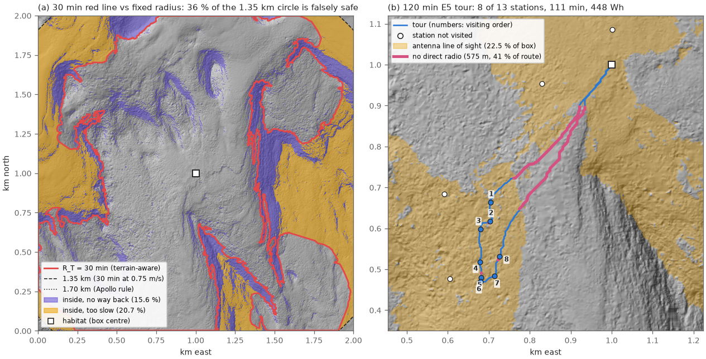
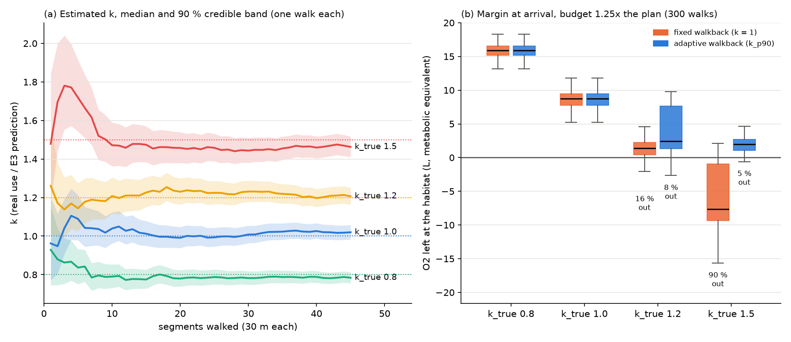

<!-- Owner: JB assembles; owners confirm their numbers · Sources: E4_walkback.md, product_api_hud.md, E5_orienteering.md, E6_benchmark.md, E2/E1/E8/E9/E12 notes, E11_comms.md, X2_adaptive_walkback.md, C1_eva_robustness.md, P6_departure_time.md · Status: drafted from the notes by JB's Claude; owner to confirm -->

## 4. Results

**Simple rules call unsafe goals safe.** At a budget of 50 % of the farthest round trip, the share of goals each method calls safe that its own route cannot complete is:
- A\*-slope: 27.7 %;
- fixed radius: 45.7 %;
- linear O2: 21.4 %;
- exact planner: 0 %.

The baselines are not too conservative; they underestimate E3. A terrain-aware 30 min line also beats the classic fixed radius: 36 % of what the 1.35 km circle calls safe cannot get back in 30 min. Of that, 15.6 % of the cells have no way back at all, blocked or cut off by scarps, and 20.7 % are too slow (Figure @fig:redline).

**Time, not energy, binds in the box.** The costliest round trip from the centre is 562.8 Wh, against about 2,050 Wh of a 7 h suit budget. The full tour of the 13 manual stations collects 56 of 56 points in 723.6 Wh and 180.9 min. Service, not walking, is 61 % of the energy and 72 % of the time. With a 120 min limit the tour visits 8 stations for 37 points (111.4 min, 445.1 Wh). The station choice stops depending on the rubric once the time budget covers the nominal duration. Adding E8's contacts (26 reachable stations, solved and proven optimal by CP-SAT in 0.3 s) raises the score to 60.47, and then energy binds (872.0 of 900 Wh).

**Exact solvers are fast enough.** The exact solvers reach the optimum on every instance, with a median time within 0.12 s of the fastest metaheuristic. ILS misses the optimum in about a quarter of the instances, with gaps up to 37.5 % with time windows. GA is the best metaheuristic (97 % optimal on the random instances). All methods find the optimum on the real E5 instances.

**What the terrain explains.** DEM features explain the choice of valley (AUC 0.73 over the whole box) but not the path inside the boxwork (0.53 in a 50 m corridor). Learned DEM prices are zero. Only orthophoto sand earns a small price (factor 1.0–1.115). With it, the route to Nevado Sajama moves up to 23 m and costs 1.8 % more, and the 120 min tour visits the same stations.

**Radio, light and dose.** A 3 m antenna at the box centre sees 22.6 % of the box (13.0 % on average over 20 random habitats). On the 120 min tour, 575 m (41 %) of the route has no direct radio, and a partner 20 m behind reduces the unlinked length only to 526 m. Leaving at any time from about 06:30 to 14:30 keeps the nominal walk sunlit on sol 4711; terrain shadows shorten that window by 15–45 min. A provisional 2.97 h EVA receives 19.4 µGy at the background rate.

**Adaptive walkback.** In simulation (budget 1.25 × the plan, 300 walks per case), a fixed walkback runs out of O2 in 90.0 % of the walks when the astronaut uses 1.5 × the model, against 4.7 % for the adaptive rule. With k_true = 0.8 neither policy turns back early (Figure @fig:x2). A paired evaluation on the E5 tour (C1) gives, at k_true = 1.2, reserve violations of 60.67 % for the nominal policy and 3.67 % for the adaptive one. With serially correlated noise (ρ = 0.7), the coverage of the filter's 90 % interval drops to 47–54 %.

{#fig:redline}

{#fig:x2}
